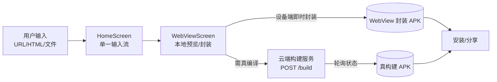

# 系统架构（Architecture）

> 状态：已生效（2026-10-24 由安卓工程师评审）
> 遵循：[`docs/DOC_CHARTER.md`](DOC_CHARTER.md) · 对齐：[`PROJECT_BRIEF.md`](../PROJECT_BRIEF.md) §2 · [`DESIGN_LANGUAGE.md`](../DESIGN_LANGUAGE.md)

---

## 1. 总览

Web2APK 是一款**纯原生安卓应用**（Jetpack Compose + Material 3），核心能力是把网页/前端代码一键变成 APK。设计要点：

- **混合构建路径**：浏览器端能做的（URL/HTML 渲染与封装）在**设备端 WebView 即时完成**；需要真编译/真签名的（Vue 工程、PHP 站点、正式发布包）交给**云端构建服务**。
- **前端优先体验**：首屏极简，所有复杂度藏在「封装」这一步之后。
- **设计语言内建**：主题系统直接消费 `DESIGN_LANGUAGE.md` 的 OKLCH 令牌，UI 与安卓层共用唯一色板。

## 2. 模块划分

| 模块 | 路径 | 职责 |
|------|------|------|
| `ui/theme` | `app/.../ui/theme/` | 设计令牌（OKLCH→Compose）、主题、动效 |
| `ui/components` | `app/.../ui/components/` | 可爱组件：胶囊按钮、柔卡、打包脉冲 |
| `ui/screens` | `app/.../ui/screens/` | HomeScreen（输入）、WebViewScreen（预览/封装） |
| `ui/Web2ApkApp` | `app/.../ui/Web2ApkApp.kt` | 应用根：主题绑定 + 状态路由 |
| `build` (Phase 2) | 云端 | 真编译/签名/出包，契约见 [`build-api-contract.md`](build-api-contract.md) |

## 3. 关键架构决策（ADR 摘要）

1. **设备端 WebView 即时封装（sprint-1）**：URL/HTML 无需后端即可出包，零成本可演示，快速验证核心价值。
2. **云端真构建（Phase 2）**：Vue/PHP/正式签名需要 Android 工具链，放云端避免客户端体积与复杂度爆炸。
3. **Material 3 改造而非自定义体系**：复用 M3 的 `ColorScheme`/`Typography`/`Shape`，仅替换令牌值，兼顾无障碍与一致性。
4. **设计令牌单一来源**：色值只在 `DESIGN_LANGUAGE.md` 定义，Compose 侧是**派生**而非**复制**。

> 完整决策记录见 [`brainstorm/`](brainstorm/)。

## 4. 数据流

## 5. 技术选型

| 关注点 | 选型 | 理由 |
|--------|------|------|
| UI 框架 | Jetpack Compose | 声明式、与 M3 深度整合 |
| 设计系统 | Material 3（改造） | 无障碍、主题、组件成熟 |
| 颜色空间 | OKLCH 定义 → sRGB hex | 感知均匀，亮暗主题一致 |
| 封装（sprint-1） | WebView + 本地打包 | 零后端、即时 |
| 构建（Phase 2） | 云端 Android 构建 | 真编译/签名，客户端轻量 |
| 文档 | Docs-as-Code（本仓） | 同仓版本化，不漂移 |

## 6. 已知限制（sprint-1）

- 设备端 WebView 封装产出的 APK 不含真编译优化，仅适合预览/轻量分发。
- 云端构建服务尚未落地，Phase 2 起接入（契约已定）。
- 本沙箱无 Android SDK，源码以可评审形式交付，待 Android Studio 编译。
