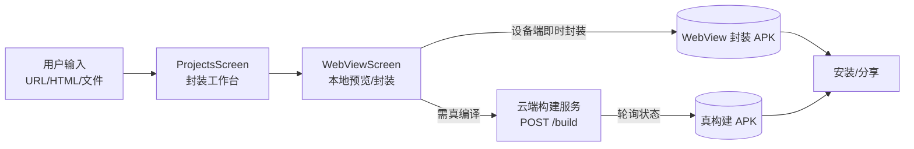
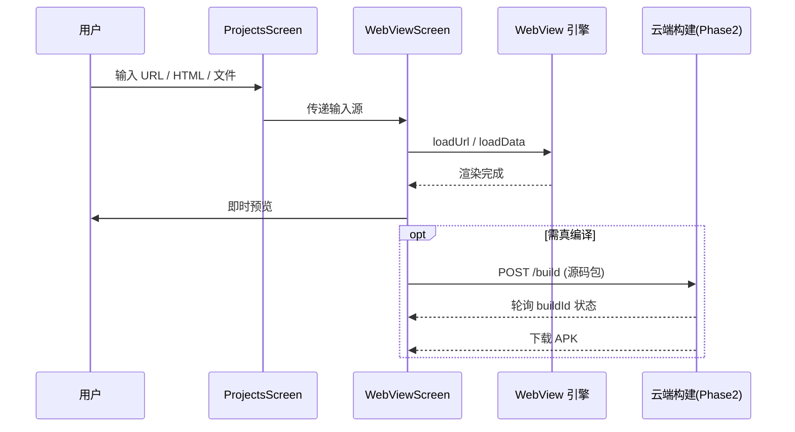

# 系统架构（Architecture）

> 状态：已生效（2026-10-24 由安卓工程师评审）
> 遵循：[`docs/DOC_CHARTER.md`](DOC_CHARTER.md) · 对齐：[`PROJECT_BRIEF.md`](../PROJECT_BRIEF.md) §2 · [`DESIGN_LANGUAGE.md`](../DESIGN_LANGUAGE.md)

---

## 1. 总览

Web2APK 是一款**纯原生安卓应用**（Jetpack Compose + Material 3），核心能力是把网页/前端代码一键变成 APK。设计要点：

- **混合构建路径**：浏览器端能做的（URL/HTML 渲染与封装）在**设备端 WebView 即时完成**；需要真编译/真签名的（Vue 工程、PHP 站点、正式发布包）交给**云端构建服务**。
- **前端优先体验**：首屏极简，所有复杂度藏在「封装」这一步之后。
- **设计语言内建**：主题系统直接消费 `DESIGN_LANGUAGE.md` 的 OKLCH 令牌，UI 与安卓层共用唯一色板。



## 2. 模块划分

| 模块 | 路径 | 职责 |
|------|------|------|
| `ui/theme` | `app/.../ui/theme/` | 设计令牌（OKLCH→Compose）、主题、动效 |
| `ui/components` | `app/.../ui/components/` | 可爱组件：胶囊按钮、柔卡、打包脉冲 |
| `ui/screens` | `app/.../ui/screens/` | ProjectsScreen（封装工作台：输入+列表）、DevelopingScreen（占位）、ProfileScreen（个人中心）；WebViewScreen（预览复用纯组件） |
| `ui/permission` | `app/.../ui/permission/` | 权限基础设施：三层权限状态机 + 应用内二次确认弹窗（存储权限已接入，通知/安装待 Phase-2） |
| `ui/storage` | `app/.../ui/storage/` | 启动存储门 `StoragePermissionGate`：MMAFile 目录的授权引导与静默就绪 |
| `storage` | `app/.../storage/` | MMAFile 外部存储唯一事实来源：目录清单 `MmaDir`、授权判断、幂等创建、日志目录决策 |
| `ui/navigation` | `app/.../ui/navigation/` | 页面骨架：路由清单 `MmaRoute` + 导航宿主 `MmaNavHost` |
| `ui/viewmodel` | `app/.../ui/viewmodel/` | `AddProjectViewModel` / `ProjectEditViewModel` / `ProjectListViewModel`；手工 DI 工厂 |
| `MainActivity` | `app/.../MainActivity.kt` | 唯一载体 Activity：`setContent` + `reportFullyDrawn()`（启动终点） |
| `ui/MmaApp` | `app/.../ui/MmaApp.kt` | 应用根：主题绑定 + 持有 NavController |
| `data/model` | `app/.../data/model/` | 领域模型 + 枚举（无持久化注解，UI 唯一可见） |
| `data/local` | `app/.../data/local/` | SQLite 持久化：实体、DAO、AppDatabase、类型转换器、SQLCipher 工厂 |
| `data/security` | `app/.../data/security/` | 数据库口令经 Android Keystore 加密存储 |
| `data/repository` | `app/.../data/repository/` | 项目与导出运行仓储：上层唯一出口 |
| `build` (Phase 2) | 云端 | 真编译/签名/出包，契约见 [`build-api-contract.md`](build-api-contract.md) |

> 数据层细节（选型实证、加密方案、性能实践、迁移策略）见 [`data-layer.md`](data-layer.md)。

## 3. 关键架构决策（ADR 摘要）

1. **设备端 WebView 即时封装（sprint-1）**：URL/HTML 无需后端即可出包，零成本可演示，快速验证核心价值。
2. **云端真构建（Phase 2）**：Vue/PHP/正式签名需要 Android 工具链，放云端避免客户端体积与复杂度爆炸。
3. **Material 3 改造而非自定义体系**：复用 M3 的 `ColorScheme`/`Typography`/`Shape`，仅替换令牌值，兼顾无障碍与一致性。
4. **设计令牌单一来源**：色值只在 `DESIGN_LANGUAGE.md` 定义，Compose 侧是**派生**而非**复制**。
5. **SQLite 采用 Room + SQLCipher**：SQLCipher 自带 `SupportOpenHelperFactory`（实现 `androidx.sqlite.db` 接口）可**直连** Room 2.x，无需手写桥接；数据库全程加密，口令存于 Keystore。（对比评估过的 WCDB：其官方适配层仅实现旧版 `android.arch.persistence` 接口，与 AndroidX Room 不兼容，已否决。）
6. **令牌门禁 CI 化**：`scripts/gitops/check_token_usage.py` 扫描 `ui/`（排除 `theme/`）的颜色/圆角/间距/字号字面量，Verify 与 Release 工作流均以 `--strict` 拦截；渐进策略为「先报告后 blocking」，确有必要的例外用行内 `// token-gate: allow <理由>` 豁免（规约见 `docs/CODE_STYLE.md` §4）。

> 完整决策记录见 [`brainstorm/`](brainstorm/)。

## 3.1 页面骨架与导航

```
MainActivity ─ setContent ─▶ MmaApp（主题 + NavController + HazeState）
                                └─▶ MmaNavHost
        projects ────┬──▶ developing（占位）
                      └──▶ profile（个人中心）
```

| 路由 | 页面 | 取数来源 | 骨架模板 |
|------|------|---------|---------|
| `projects` | ProjectsScreen | `ProjectListViewModel`（列表 Flow）+ `ProjectRepository` | 主页（顶栏 + 底栏） |
| `developing` | DevelopingScreen | —（占位） | 主页（顶栏 + 底栏） |
| `profile` | ProfileScreen | `BuildConfig.VERSION_NAME` + `MmaStorage.isAuthorized` | 主页（顶栏 + 底栏） |

**三段式槽位嵌入布局**：所有页面经 `ui/components/MmaScreen.kt` 组装——
`topBar`（MmaTopBar，顶级页仅标题、子页带返回箭头；**槽位可插拔**，传自定义 composable 即替换，
title/onBack 随之失效）+ `content`（页面内容，**必须消费 innerPadding**，否则被栏遮挡；
该层同时是 Haze 磨砂源，见 §3.4）+ `bottomBar`（MmaBottomBar，仅主页级页面传入，
项目/开发中/我的共享同一底栏，tab 清单 `DefaultMmaTabs` 可配置）。骨架管结构与系统栏避让，
页面只管内容；一屏一 MmaScreen，不再自建顶栏。

**分层约定：路由负责取数，页面负责渲染。**
所有页面都是**无状态** Composable（参数进、事件出），
因此 Paparazzi 可以直接渲染页面做截图回归，不需要数据库与导航环境。

**单一数据源是加密数据库**：项目与导出运行记录一经登记即落加密库，
页面重建后仍可读到真实状态，不出现假进度或转圈卡死。

**导出终态守卫**：`ExportStatus` 终态为 SUCCESS/FAILED/CANCELLED；
仓储层 `markSucceeded/markFailed/markCancelled` 均带终态检查——
取消后迟到的协程无法把记录改写为成功或失败（用户点取消即真取消）。

## 3.2 权限层（三层策略）

**系统权限弹窗不可定制**（官方定论：应用无法配置或更改该对话框），
因此走「应用内二次确认 → 系统弹窗」两段式：先用自家语气解释为什么需要，
用户点头后再唤起系统弹窗，拒绝与永久拒绝均有对应路径。

| 层级 | 代表权限 | 授予方式 | 本项目策略 |
|------|---------|---------|-----------|
| 普通权限 | `INTERNET` | 安装时自动授予 | 正常声明，无交互 |
| 运行时权限 | `POST_NOTIFICATIONS`（API 33+） | 系统弹窗，可拒绝 | 场景触发时先弹 `MmaPermissionDialog` 二次确认，再 `RequestPermission` 启动器申请 |
| 特殊权限 | `REQUEST_INSTALL_PACKAGES` | 跳系统设置页手动开 | `ACTION_MANAGE_UNKNOWN_APP_SOURCES` 引导；`LifecycleResumeEffect` 在设置页返回后复查 |
| 特殊权限 | `MANAGE_EXTERNAL_STORAGE`（API 30+）/ `WRITE_EXTERNAL_STORAGE`（≤28） | 前者跳设置页；后者系统弹窗 | MMAFile 公共目录写入；`rememberAllFilesAccessPermissionState`（判断委托 `MmaStorage.isAuthorized`），启动门引导，见 §3.3 |

组件清单（`ui/permission/`）：通知与安装 spec 已就绪待 Phase-2 接入点；
**存储权限已接入**（`StoragePermissionGate`，见 §3.3）：

| 文件 | 职责 |
|------|------|
| `PermissionStatus.kt` | 状态机（Idle/Requesting/Granted/Denied/PermanentlyDenied）+ 纯函数 `resolveStatusAfterResult`（JVM 可测） |
| `MmaPermissionState.kt` | `rememberMmaPermissionState`：`rememberLauncherForActivityResult(RequestPermission())` 接线，`shouldShowRequestPermissionRationale` 在回调内读（区分 Denied / PermanentlyDenied）；特殊权限 `rememberInstallPackagesPermissionState` / `rememberAllFilesAccessPermissionState` |
| `MmaPermissionSpec.kt` / `PermissionSpecs.kt` | 文案规格与预置文案（通知、安装、所有文件访问、API-29 说明），**全程不出现权限名**，用人话讲用途 |
| `MmaPermissionDialog.kt` | 二次确认弹窗三形态（FirstTime / Rationale / GoToSettings），视觉规格见 `DESIGN_LANGUAGE.md` §8 |

**Phase 2 接入清单**（与对应功能同 commit 补齐，禁止提前声明）：

- 通知：`POST_NOTIFICATIONS`（33+ 运行时申请）+ 建 `NotificationChannel`
- 安装 APK：`REQUEST_INSTALL_PACKAGES` + `FileProvider` + `res/xml/file_paths.xml`
- 导出 APK 到外部存储：≤28 `WRITE_EXTERNAL_STORAGE`；30+ 复用已授权的 `MANAGE_EXTERNAL_STORAGE`（目标即 `MMAFile/APK`）。写入公共媒体集合（Download 等）才可免权限走 MediaStore/SAF——**写任意根目录不适用**

## 3.3 存储初始化（MMAFile 目录）

首次启动在 `/storage/emulated/0/` 建 `MMAFile` 及五个子目录；结构**幂等创建**，
`Setting` 等内容被用户删除后，下次启动自动重建（数据根本在数据库，目录只是用户向展示）。

```
/storage/emulated/0/MMAFile/
├── APK/       安装包（Phase-2 安装链路）
├── Log/       运行日志（授权后 FileSink 主目录）
├── Items/     项目数据（Phase-2）
├── Setting/   设置的用户向展示（内容镜像钩子 SettingMirror，Phase-2）
└── Backup/    本地备份与备份导入检测（Phase-2）
```

**API 分级**（targetSdk 34 实测结论，`MmaStorage.isAuthorized` 为唯一事实来源）：

| API | 写公共根的途径 | 本项目行为 |
|-----|--------------|-----------|
| ≤ 28 | `WRITE_EXTERNAL_STORAGE` 运行时权限 | 启动门走系统弹窗，granted 后 ensure + 日志迁移 |
| 29 | **死区**：`requestLegacyExternalStorage` 被 targetSdk≥30 忽略、`MANAGE_EXTERNAL_STORAGE` 不可授予 | 一次性说明弹窗（标记文件防复弹），静默降级私有目录 |
| ≥ 30 | 仅 `MANAGE_EXTERNAL_STORAGE`（跳设置页） | 启动门跳设置，返回 `LifecycleResumeEffect` 复查；国产 ROM 无该设置页时 `runCatching` 兜底跳应用详情页 |

**降级路径**：未授权/外部存储不可写 → 日志留 `filesDir/logs`（免权限、卸载即清理），
应用功能不中断；授权成功后 `MmaLogger.redirectFileSink` 把历史日志合并进 `MMAFile/Log`
（先摘 sink → drain → 合并 → 换新 sink；同目录短路，防误删活跃日志）。

**扩展方式**：新增子目录 = `MmaDir` 加一个枚举值，`ensureDirs` 遍历 `entries` 自动创建；
路径必须经 `MmaStorage` 获取，禁止散落 `File(...)`（CODE_STYLE §3.1 已立规约）。

**已知限制**：卸载后 MMAFile 残留于外部存储（系统行为，无清理钩子）；
`getExternalStorageDirectory()` API 29 弃用但仍是 targetSdk 34 下唯一权威外部根
（持 MANAGE 后 File API 可用，有已知轻微性能惩罚）；未来若上架 Google Play
需申报 `MANAGE_EXTERNAL_STORAGE` 用途（当前只发 GitHub release，不涉及）。

## 3.4 设计令牌可定制架构（MmaDesign + Haze）

**目标：令牌高可定制、业务代码零迁移。** 为 Phase-2 自定义主题（配色 / 圆角 / 透明度 /
磨砂 / 骨架插拔）铺路，已落地的部分本期交付。

**令牌可覆盖（零迁移模式）**：

| 组件 | 职责 |
|------|------|
| `ui/theme/MmaDesign.kt` | 令牌聚合体：`SpacingScale`（间距 7 档）/ `AlphaScale`（透明度 7 档，预留）/ `MaterialTier`（Flat/Elevated/Translucent，预留）/ `TranslucentSpec`（磨砂参数）/ `ScaffoldStyle`（顶栏/底栏变体 + 磨砂总开关） |
| `LocalMmaDesign` | CompositionLocal 承载点；`MmaTheme(design = …)` 装配默认实例 |
| `Spacing` 代理对象 | 全部为 @Composable getter 读 `LocalMmaDesign.current`——**调用点写法不变**，换主题只需换 MmaDesign 实例 |

Phase-2 自定义主题入口：
```kotlin
MmaTheme(design = MmaDesign(spacing = SpacingScale(space1 = 2.dp, …))) { … }
```

**磨砂（Haze 0.7.3，版本红线见下）**：

| 组件 | 职责 |
|------|------|
| `ui/LocalHazeState.kt` | App 壳层创建一次并下发的 Haze 源状态 |
| `MmaScreen` content slot | `Modifier.haze(state)`——**源**挂页面内容层 |
| `MmaTopBar` / `MmaBottomBar` | `Modifier.hazeChild(state)`——**消费方**与源是 Scaffold 内兄弟 slot（**消费方不能是源的后代**，否则自引用循环，这是 LocalHazeState 存在的理由） |
| `MmaTranslucentSurface` | 磨砂容器三态降级：false=实色 / true+state=hazeChild 真磨砂（Haze 内部按 API 分级，31+ RenderNode 真模糊）/ true 无 state=半透明+1dp 描边近似 |

「参数优先、令牌兜底」：`translucent: Boolean? = null`——传值即显式决策，null 跟随
`ScaffoldStyle.translucentChrome && variant == Translucent`。截图测试不提供 LocalHazeState
→ null → 近似降级，golden 零风险。

**Haze 版本红线**：0.7.3 是最后一个用 Kotlin 1.9.24 编译的稳定版（CMP 1.6.11）；
1.0.0+ 起 Kotlin 2.x 元数据，本项目 Kotlin 1.9.24 编译器读不了；升级须随 Kotlin 整体演进。
注意旧坐标 `haze-jetpack-compose` 止于 0.7.0 已废弃，现行坐标为 `dev.chrisbanes.haze:haze`。
CMP 传递的 androidx compose 1.6.8 由 BOM 2024.09.00 仲裁抬至 1.7.2（API 兼容）。

## 4. 数据流



## 5. 技术选型

| 关注点 | 选型 | 理由 |
|--------|------|------|
| UI 框架 | Jetpack Compose | 声明式、与 M3 深度整合 |
| 设计系统 | Material 3（改造） | 无障碍、主题、组件成熟 |
| 颜色空间 | OKLCH 定义 → sRGB hex | 感知均匀，亮暗主题一致 |
| 封装（sprint-1） | WebView + 本地打包 | 零后端、即时 |
| 构建（Phase 2） | 云端 Android 构建 | 真编译/签名，客户端轻量 |
| 文档 | Docs-as-Code（本仓） | 同仓版本化，不漂移 |

## 6. 已知限制（sprint-1）

- 设备端 WebView 封装产出的 APK 不含真编译优化，仅适合预览/轻量分发。
- 云端构建服务尚未落地，Phase 2 起接入（契约已定）。
- 本沙箱无 Android SDK，源码以可评审形式交付，待 Android Studio 编译。
