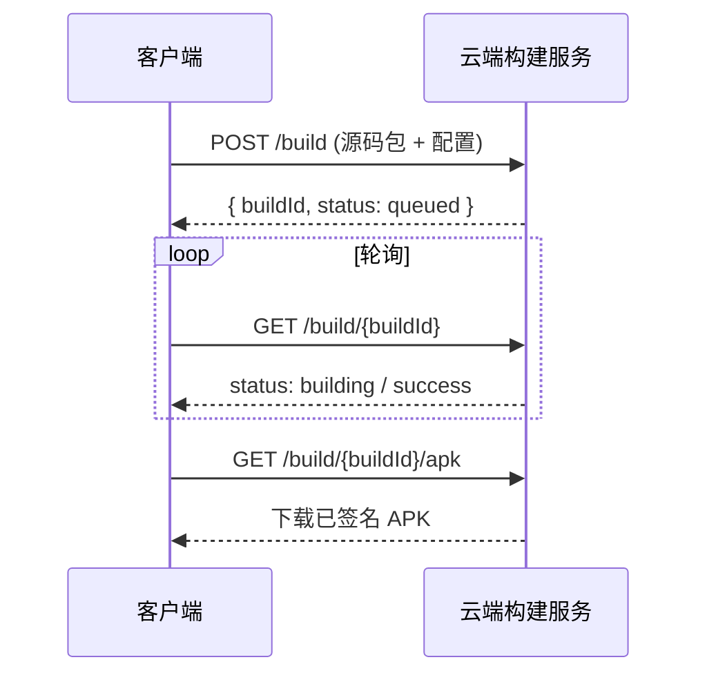

# 构建与发布（Deployment）

> 状态：评审中（2026-10-24，Phase 2 云端构建待落地）
> 遵循：[`docs/DOC_CHARTER.md`](DOC_CHARTER.md) · 对齐：[`PROJECT_BRIEF.md`](../PROJECT_BRIEF.md) §2

本文件说明 Web2APK 的构建、签名与发版流程。sprint-1 仅设备端 WebView 即时封装；真编译/正式签名走 Phase 2 云端构建（契约见 [`build-api-contract.md`](build-api-contract.md)）。

---

## 1. 构建变体（Build Variants）

| 变体 | 用途 | 出包方式 |
|------|------|----------|
| `debug` | 开发/预览 | 本地 `gradle` 或设备端 WebView 即时封装 |
| `release` | 正式发布 | 云端真构建 + 签名（Phase 2） |

## 2. 本地构建（debug）

```bash
./gradlew :app:assembleDebug     # 生成 app-debug.apk
./gradlew :app:installDebug      # 安装到设备
```

## 3. 设备端即时封装（sprint-1）

用户输入 URL/HTML 后，`WebViewScreen` 在本地：

1. `WebView.loadUrl()` / `loadDataWithBaseURL()` 渲染；
2. 生成轻量封装 APK（WebView 壳 + 入口配置），供预览/轻量分享；
3. 不执行真编译，不含生产级优化。

## 4. 云端真构建（Phase 2）

对 Vue 工程、PHP 站点、正式发布包，走云端构建服务：



请求/响应字段、状态机、错误码见 [`build-api-contract.md`](build-api-contract.md)。

## 5. 签名（Signing）

- `debug`：使用 Android 默认 debug keystore。
- `release`：使用云端托管的上传密钥（Upload Key），由 Google Play 重签；密钥不落地客户端。
- 密钥与证书管理见内部密钥库（不入库）。

## 6. 发版流程（Release）

1. 冻结 `main`，从最新提交切 `release/vX.Y.Z`。
2. 更新 [`CHANGELOG.md`](../CHANGELOG.md)：将 `[Unreleased]` 晋级为 `[X.Y.Z] - YYYY-MM-DD`。
3. `git tag vX.Y.Z && git push --tags`。
4. 触发云端构建生成 `release` APK / AAB。
5. 上传至分发渠道（应用商店/内部分发）；保留回滚版本。

## 7. 回滚（Rollback）

- 保留上一稳定 `vX.Y.Z` 构建产物与 tag。
- 异常时切回上一 tag 重新分发；客户端若存在热更新通道，先降级配置再修包。

## 8. 环境

| 环境 | 说明 |
|------|------|
| 本地/dev | `debug` 变体，设备直装 |
| 预发/staging | 云端构建 `release` 候选，内部分发 |
| 生产/prod | 云端构建正式包，对外分发 |

> 生产发版的 CI/CD 与权限细节随 Phase 2 落地后补充。
