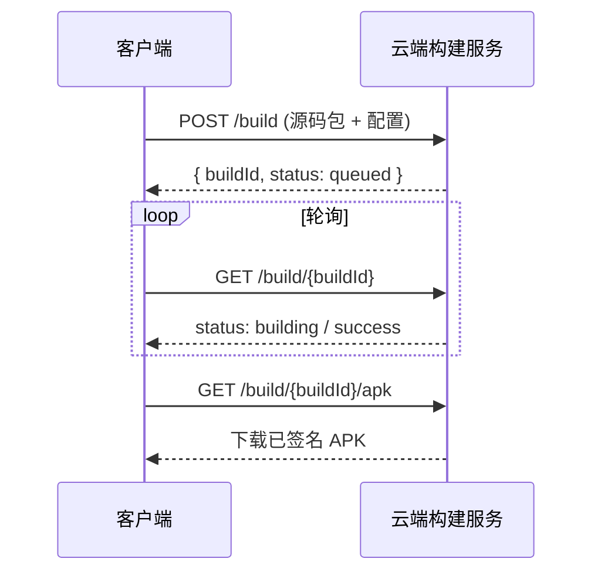

# 构建与发布（Deployment）

> 状态：评审中（2026-10-25，Phase 2 云端构建待落地）
> 遵循：[`docs/DOC_CHARTER.md`](DOC_CHARTER.md) · 对齐：[`PROJECT_BRIEF.md`](../PROJECT_BRIEF.md) §2
> **版本规范见 [`VERSIONING.md`](VERSIONING.md)（四段式 `0.0.0.0+1`，本文件不重复定义）。**

本文件说明 **MMA**（包名 `com.make.apk`）的构建、签名与发版流程。sprint-1 仅设备端 WebView 即时封装；真编译/正式签名走 Phase 2 云端构建（契约见 [`build-api-contract.md`](build-api-contract.md)）。

> ### 核心约束：本地不做编译成品
> **APK/AAB 成品只在 GitHub 上产出**——推送 `v*` tag 后由
> [`.github/workflows/release.yml`](../.github/workflows/release.yml) 构建并发布 Release。
> **本地只做验证**（测试 + 截图回归），不产出、不分发本地构建产物。

---

## 1. 构建变体（Build Variants）

| 变体 | 用途 | 出包方式 |
|------|------|----------|
| `debug` | 开发/预览 | 本地 `gradle` 或设备端 WebView 即时封装 |
| `release` | 正式发布 | 云端真构建 + 签名（Phase 2） |

## 2. 本地只做验证（不产出成品）

```bash
./gradlew testDebugUnitTest      # 数据层 + 逻辑单元测试
./gradlew verifyPaparazziDebug   # 截图回归：与已提交基线逐像素比对
./gradlew recordPaparazziDebug   # 仅当 UI 有意变更时，重新生成基线并随代码提交
```

> 本地**不执行** `assembleDebug` / `assembleRelease` 来产出交付物。
> `app/build/outputs/` 下的一切均被 `.gitignore` 排除，不得作为交付物分发。
> 需要真机联调时可在本地临时构建，但成品以 GitHub Release 为准。

## 3. 设备端即时封装（sprint-1）

用户输入 URL/HTML 后，`WebViewScreen` 在本地：

1. `WebView.loadUrl()` / `loadDataWithBaseURL()` 渲染；
2. 生成轻量封装 APK（WebView 壳 + 入口配置），供预览/轻量分享；
3. 不执行真编译，不含生产级优化。

## 4. 云端真构建（Phase 2）

对 Vue 工程、PHP 站点、正式发布包，走云端构建服务：



请求/响应字段、状态机、错误码见 [`build-api-contract.md`](build-api-contract.md)。

## 5. 签名（Signing）

- `debug`：使用 Android 默认 debug keystore（仅本地验证用）。
- `release`：**当前仓库尚未配置签名**（`isMinifyEnabled = false`，无 `signingConfig`），
  由 GitHub Actions 产出的 APK 为 **unsigned**，适用于自分发/内测。
- 后续上架：配置上传密钥（Upload Key）为 GitHub Secret，在 `release.yml` 中接入签名；
  由 Google Play 重签，密钥不落地仓库。
- 密钥与证书管理见内部密钥库（不入库）。

## 6. 发版流程（Release）

> 版本格式与递增规则见 [`VERSIONING.md`](VERSIONING.md)。
> 当前：`versionName = "0.0.0.0"`、`versionCode = 1` → tag `v0.0.0.0+1`。

1. 在 `app/build.gradle.kts` 中递增版本（`versionCode` **必增**，四段式按规则递增）。
2. 更新 [`CHANGELOG.md`](../CHANGELOG.md)：将 `[Unreleased]` 晋级为 `[0.0.0.0+N] - YYYY-MM-DD`。
3. 本地验证：`./gradlew testDebugUnitTest verifyPaparazziDebug` 全绿。
4. 提交并推送到 `main`。
5. **打 tag 并推送**（tag 名必须与版本严格一致）：

   ```bash
   git tag v0.0.0.0+1
   git push origin v0.0.0.0+1
   ```

6. GitHub Actions 自动执行：校验 tag 与版本一致 → `assembleRelease` → 创建 Release 上传 APK。
7. 从 GitHub Release 下载成品并分发。

## 7. 回滚（Rollback）

- 保留上一稳定版本的 tag 与其 Release 成品。
- **不可回退 `versionCode`**：即便回滚功能，也要通过递增 BUILD/PATCH 发新版本，
  否则用户无法升级（见 [`VERSIONING.md`](VERSIONING.md) §2 硬性约束）。
- 异常时从上一 tag 的 Release 重新取包分发；客户端若存在热更新通道，先降级配置再修包。

## 8. 环境

| 环境 | 说明 |
|------|------|
| 本地/dev | `debug` 变体，设备直装 |
| 预发/staging | 云端构建 `release` 候选，内部分发 |
| 生产/prod | 云端构建正式包，对外分发 |

> 生产发版的 CI/CD 与权限细节随 Phase 2 落地后补充。
