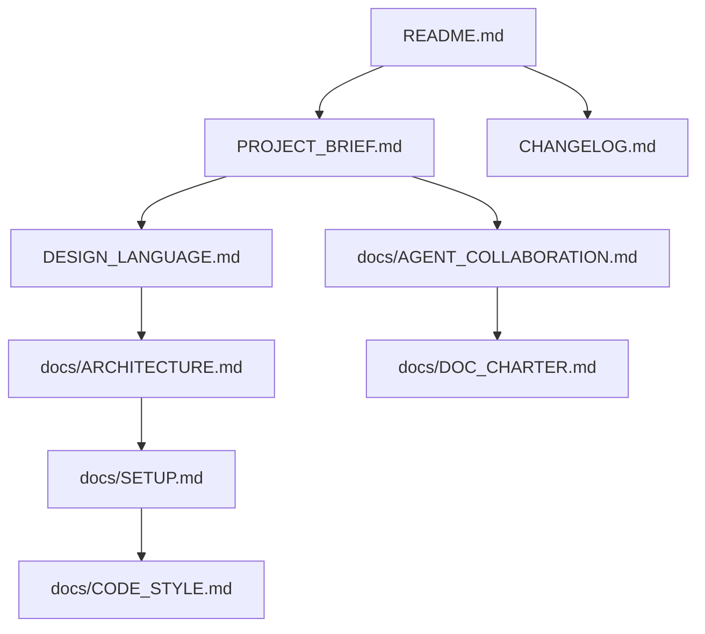

# 文档地图（Documentation Index）

> 状态：已生效（2026-10-24 由 Producer 评审）
> 本仓全部文档的导航。新增/删除文档请同步更新本文件与 `docs/DOC_CHARTER.md` §3。

---

## 顶层文档（仓库根）

| 文档 | 类型 | 说明 |
|------|------|------|
| [`README.md`](../README.md) | Tutorial | 项目门面：是什么、快速开始、功能、结构 |
| [`PROJECT_BRIEF.md`](../PROJECT_BRIEF.md) | Explanation | **团队宪法**：产品/架构/角色/工作流/质量闸门 |
| [`DESIGN_LANGUAGE.md`](../DESIGN_LANGUAGE.md) | Reference | **设计语言**：OKLCH 令牌、风格、反模式 |
| [`CHANGELOG.md`](../CHANGELOG.md) | Reference | 版本日志（Keep a Changelog + SemVer） |
| [`CONTRIBUTING.md`](../CONTRIBUTING.md) | How-to | 贡献指南：人类 + Agent 协作流程 |

## docs/ 深度文档

| 文档 | 类型 | 说明 |
|------|------|------|
| [`DOC_CHARTER.md`](DOC_CHARTER.md) | Reference | **文档宪章**：所有文档的规矩总纲 |
| [`INDEX.md`](INDEX.md) | Reference | 本文档（地图） |
| [`ARCHITECTURE.md`](ARCHITECTURE.md) | Explanation | 系统架构、模块、数据流、技术选型 |
| [`AGENT_COLLABORATION.md`](AGENT_COLLABORATION.md) | How-to | AI Agent 协同协议：角色 RACI、交接契约、模板 |
| [`CODE_STYLE.md`](CODE_STYLE.md) | Reference | Kotlin/Compose 代码风格 + 提交/日志规范 |
| [`SETUP.md`](SETUP.md) | Tutorial | 本地环境搭建 |
| [`DEPLOYMENT.md`](DEPLOYMENT.md) | How-to | 构建、签名、发版流程 |
| [`build-api-contract.md`](build-api-contract.md) | Reference | 云端构建 API 契约（Phase 2 后端规格） |
| [`data-layer.md`](data-layer.md) | Reference | **数据层设计**：Room + SQLCipher 加密 SQLite（选型实证 / 分层 / 加密 / 性能 / 迁移 / 排错） |
| [`VERSIONING.md`](VERSIONING.md) | Reference | **版本规范**：纯四段式 `0.0.0.1-rc1`、顺延规则、RC 机制、tag 格式、本地只验证不出成品 |
| [`logging.md`](logging.md) | Reference | **日志层设计**：九大类别、结构化事件、强制脱敏、崩溃/ANR 自研捕获、保留期与合规 |

## QA / 质量闸门

| 文档 | 类型 | 说明 |
|------|------|------|
| [`qa/sprint-1-checklist.md`](qa/sprint-1-checklist.md) | Checklist | Sprint-1 合并前质量闸门（设计一致性 / 安卓实现 / 可访问性 WCAG 2.2 AA / 构建契约 / 文档链接健康 / 反模式核查） |
| [`qa/screenshot-testing.md`](qa/screenshot-testing.md) | How-to | 截图回归测试指南（Paparazzi 优先、Roborazzi 备选；安装 / 运行 / 基线管理 / CI / 排错） |

## 决策与迭代记录

| 路径 | 说明 |
|------|------|
| [`brainstorm/`](brainstorm/) | 架构分歧与决策记录（free-ideation / discussion / concept / vote / summary） |
| [`sprint-1/`](sprint-1/) | 首个迭代计划与进度 |

## 阅读顺序建议

- **新成员/新 Agent**：README → PROJECT_BRIEF → DESIGN_LANGUAGE → SETUP。
- **做功能**：ARCHITECTURE → CODE_STYLE → CONTRIBUTING。
- **用 Agent 协作**：AGENT_COLLABORATION → DOC_CHARTER。
