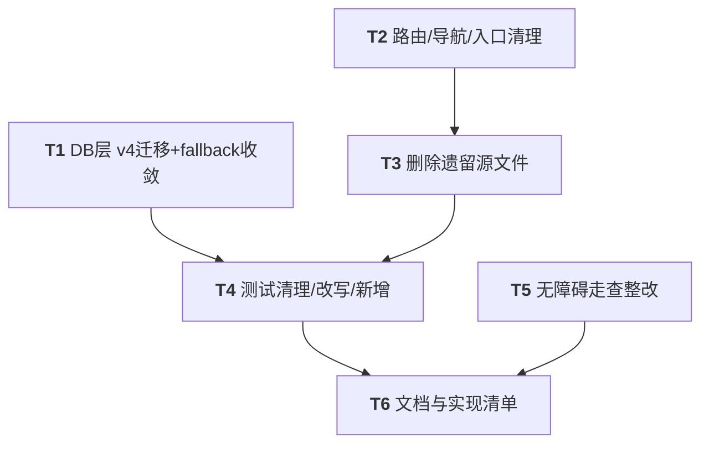

# 阶段 5 收尾质量门禁 + 遗留清理 —— 实现方案与任务分解

> 架构师：高见远（Bob）· 基于主理人已核实现状 + 本轮最小化源码复核（仅核对 `WebViewScreen` 依赖面与删除链引用面，未重复全量探索）。
> 范围约束：**只做清理与质量门禁，不实现新打包/导出流程**。新架构（Project + ExportRun）的打包执行 UI 属后续阶段。

---

## 1. 实现方案概述

### 1.1 目标
1. v4 显式迁移删除 legacy `build_records` 表。
2. 退役 `BuildHistoryRepository` / `BuildRecord` 系列（旧打包流程数据层）。
3. 移除 `fallbackToDestructiveMigration()`（PROJECT_BRIEF §7）。
4. 无障碍走查（WCAG 2.2 AA）：列表可访问性、图标 `contentDescription`、对比度、触控目标 ≥ 48×48dp、TalkBack 遍历顺序、动态状态公告。
5. 更新文档与实现清单。

### 1.2 A. 删表安全性论证（结论）

**删 `build_records` 安全。依据：**

- **可达读表代码已全部移除**：`Building`/`Result`/`Preview` 三个 composable 经 `app.buildHistoryRepository.observeById` 读 `build_records`。全仓搜索 `MmaRoute.Building/Result/Preview.create(` 的生产调用仅存在于 Building↔Result 的**内部互相跳转**，以及测试文件；**无任何外部入口**导航进这些路由（`DevelopingScreen` 纯占位、不导航至此；`ProjectsScreen` 阶段 3 已切到 `Project`）。因此移除这三屏后，运行时不存在任何读 `build_records` 的可达路径。
- **数据零丢失**：迁移链 `1→2→3`（`MIGRATION_2_3.migrateBuildRecords`）已把 `build_records` 每行**复制**为「一个 `projects` + 一条 `export_runs`」。`MIGRATION_3_4` 仅 `DROP TABLE IF EXISTS build_records`，删的是复制后的冗余 legacy 副本，不丢任何业务数据。
- **`MIGRATION_3_4` 必须 `DROP TABLE IF EXISTS`**：新装设备（v4 直接建库）从不创建该表，裸 `DROP` 会报错；`IF EXISTS` 保证幂等。

**各升级来源路径安全：**

| 起点 | 迁移链 | 中间态 | `MIGRATION_3_4` 后最终表 | 结论 |
|---|---|---|---|---|
| v1 | 1_2 → 2_3 → 3_4 | 1_2 建 `log_entries`；2_3 建 `projects`+`export_runs` 并复制 `build_records`（保留原表） | `log_entries` + `projects` + `export_runs`（无 `build_records`） | 安全，数据已前置复制 |
| v2 | 2_3 → 3_4 | 2_3 复制并保留 `build_records` | 同上 | 安全 |
| v3 | 3_4 | `build_records` 存在（v1/v2 创建、v3 保留） | `DROP` 成功 | 安全 |
| 全新安装 | 无迁移（Room 直接按 v4 实体建库） | — | `log_entries` + `projects` + `export_runs` | 安全（`build_records` 从未创建） |

> 注意：Room 在 `onUpgrade` 后调用 `onValidateSchema` 强校验最终 schema 与 v4 实体声明是否一致；本方案最终表集与 v4 `entities` 完全一致，校验通过。

### 1.3 B. 移除 fallback 的风险与缓释（结论 + 推荐）

- **风险**：移除 `fallbackToDestructiveMigration()` 后，若迁移链任一环节（手写 SQL 与 `4.json` 不一致、列缺失等）出错，Room 抛 `IllegalStateException`，回归 rc3 启动闪退。当前 rc3 修复靠的就是该兜底。
- **缓释（必须随本阶段落地）**：
  1. **自定义迁移校验门禁**：沿用阶段 1 已建模式（`Migration_2_3_Test` 的等价验证路径）——Room 自执行迁移 + `onValidateSchema` 运行期强校验 + 与 KSP 导出的 `4.json` DDL 归一化比对（`normalizeSql` 去 `IF NOT EXISTS`/空白后逐字比）。
  2. **QA 全链路验证**：覆盖 `1→2→3→4`、`2→3→4`、`3→4` 三条升级路径均成功打开，且做**数据丢失评估**（断言 `projects`/`export_runs` 行数 == 旧 `build_records` 行数）。
  3. **回退开关（主理人授权降级路径）**：若验证中发现移除 fallback 导致某路径无兜底闪退且无更好方案，**保留 `fallbackToDestructiveMigration()` 并在 `AppDatabaseFactory.kt` 显式标注"阶段 5 临时保留 fallback，待 X 验证通过后再移除"**，不得静默。
- **推荐决策**：先按"移除"实施，用 `Migration_3_4_Test`（新增）+ 改写后的全链路测试兜底；保留回退开关注释。最终是否"永久移除"由主理人据 QA 结果裁定（见 §8 H.2）。

---

## 2. 文件清单（修改 / 删除 / 新增，按阶段）

> 约定：**删**=整文件删除；**改**=编辑；**留**=不动。共 10 个主源文件删、4 个主源文件改、1 个新增测试、5 个测试删、2 个测试改。

### 2.1 数据层（DB / 迁移 / 转换器）

| 文件 | 处置 | 说明 |
|---|---|---|
| `data/local/AppDatabase.kt` | **改** | `version = 4`；`entities` 移除 `BuildRecordEntity`；删除 `abstract fun buildRecordDao()`；更新 KDoc 版本历史（v4 删 legacy 表）。 |
| `data/local/AppDatabaseFactory.kt` | **改** | `MIGRATIONS` 加入 `MIGRATION_3_4`；移除 `.fallbackToDestructiveMigration()`（或按 §1.3 回退保留并标注）；更新 TODO 注释。 |
| `data/local/Migrations.kt` | **改** | 新增 `MIGRATION_3_4`（`DROP TABLE IF EXISTS build_records`）。`MIGRATION_1_2`/`2_3` 与 `migrateBuildRecords`/`LegacyRow` **保留不动**（2_3 仍复制+保留原表）。 |
| `data/local/Converters.kt` | **改** | 删除 `BuildStatus`/`BuildInputType`/`BuildEngine` 共 6 个 `@TypeConverter` 方法及其 3 条 import；保留 `ProjectType`/`VersionScheme`/`ExportStatus` 转换器（被 `ProjectEntity`/`ExportRunEntity` 使用）。 |
| `data/local/entity/BuildRecordEntity.kt` | **删** | legacy 实体。 |
| `data/local/dao/BuildRecordDao.kt` | **删** | legacy DAO。 |
| `data/model/BuildRecord.kt` | **删** | 含 `BuildInputType`/`BuildEngine`/`BuildStatus` 枚举 + `BuildRecord` data class，全部仅被待删文件引用。 |
| `data/mapper/BuildRecordMapper.kt` | **删** | `toDomain`/`toEntity`。 |
| `data/repository/BuildHistoryRepository.kt` | **删** | 旧数据层唯一出口。 |
| `app/schemas/.../AppDatabase/1.json`、`2.json`、`3.json` | **留** | **必须保留**（历史 schema 审计；迁移虽不依赖它们，但删之无益且破坏可追溯性）。 |
| `app/schemas/.../AppDatabase/4.json` | **新增（编译期生成）** | 工程师执行 `./gradlew compileDebugKotlin`（KSP 导出）后产出，纳入版本管理。 |

### 2.2 路由 / 导航 / 应用入口

| 文件 | 处置 | 说明 |
|---|---|---|
| `ui/navigation/MmaRoute.kt` | **改** | 删除 `Building`/`Result`/`Preview` 三个 `data object` 及其 `create()`；删除 `companion` 中的 `ARG_RECORD_ID`。保留 `ARG_PROJECT_ID`/`RESULT_CREATED_PROJECT_ID`/`RESULT_UPDATED_PROJECT_ID`。 |
| `ui/navigation/MmaNavHost.kt` | **改** | 删除 import：`BuildRecord`、`BuildViewModel`、`BuildViewModelFactory`、`PreviewScreen`、`BuildingScreen`、`ResultScreen`；删除 `val repository = app.buildHistoryRepository`（line 65，移除 Building/Result/Preview 后无引用）；删除 Building/Result/Preview 三个 composable 块（151–210、331–346）；删除 `recordIdArgument()`/`recordIdOrNull()`/`observeRecord()` 辅助（350–364）。保留 Projects/Developing/Profile/Add/Project。 |
| `MmaApplication.kt` | **改** | 删除 `val buildHistoryRepository` 字段（38–40）及 import `BuildHistoryRepository`（line 10）。其余单例（projectRepository/exportRunRepository/logRepository）保留。 |

### 2.3 UI 屏幕 / ViewModel（旧打包流程）

| 文件 | 处置 | 说明 |
|---|---|---|
| `ui/screens/BuildingScreen.kt` | **删** | 旧构建中屏。 |
| `ui/screens/ResultScreen.kt` | **删** | 旧结果屏（import `BuildStatus`）。 |
| `ui/screens/PreviewScreen.kt` | **删** | 含 `BuildRecord.toWebRuntimeConfig()` 桥与 `FALLBACK_RUNTIME_CONFIG`；删除后 `WebViewScreen` 不再有主调用方，但作为未来复用纯组件**保留**（见下）。 |
| `ui/screens/WebViewScreen.kt` | **留** | **已核实零 `BuildRecord` 依赖**（仅 `ProjectEntry`/`WebRuntimeConfig`）。保留供后续 Project+ExportRun 预览复用。 |
| `ui/viewmodel/BuildViewModel.kt` | **删** | 含 `BuildViewModel` + `BuildViewModelFactory`，仅被 MmaNavHost 引用。 |
| `ui/viewmodel/HistoryViewModel.kt` | **删** | 死代码（全仓无任何调用方）。 |

### 2.4 测试（删 / 改 / 留 / 新增）

| 文件 | 处置 | 说明 |
|---|---|---|
| `test/.../ui/screens/BuildingScreenTest.kt` | **删** | 测已删屏。 |
| `test/.../ui/screens/ResultScreenTest.kt` | **删** | 测已删屏。 |
| `test/.../ui/screens/PreviewScreenTest.kt` | **删** | 测已删 `PreviewScreen`（`BuildRecord` 构造）。 |
| `test/.../ui/screens/WebViewScreenTest.kt` | **留** | `WebViewScreen` 保留，其快照基线零漂移，保留。 |
| `test/.../data/BuildRecordMapperTest.kt` | **删** | 测已删 `BuildRecordEntity`/mapper + `Converters` 的 `BuildStatus`/`BuildInputType`/`BuildEngine` 方法（随 `BuildRecord.kt` 删除一并移除）。 |
| `test/.../navigation/MmaRouteTest.kt` | **改** | 删除 `legacyRoutes_areUnchanged`（断言 Building/Result/Preview）与 `argumentKeys_areStable` 中的 `ARG_RECORD_ID` 断言；保留 add/project/projects/developing/profile/result 键的稳定断言。 |
| `test/.../navigation/MmaRouteEdgeCaseTest.kt` | **改** | `resultKeys_areDistinctFromArgumentKeys` 的 `argumentKeys` 改为仅 `ARG_PROJECT_ID`；`allRoutes_areUniqueTemplates` 移除 Building/Result/Preview；删除 `legacyBuildingAndResultRoutes_keepTheirShape`。保留 project/add/result 边界用例。 |
| `test/.../data/Migration_2_3_Test.kt` | **改** | 删除 `migrate_2To3_legacyTableIsPreserved`（3_4 已 DROP，不再成立）；`ALL_TABLES` 移除 `"build_records"`；其余 2→3 复制/数据不丢/DDL 断言仍有效（openRoom 现在会应用 1→2→3→4 全链，复制断言依然成立）。建议重命名为 `Migration_Chain_Test` 或保留原名并在 KDoc 注明"实际已覆盖到 v4"。 |
| `test/.../data/Migration_3_4_Test.kt` | **新增** | 专门测 v3→v4：`openRoom` 仅应用 `MIGRATION_3_4`（用 v3 老库从 `3.json` 构造），断言 `build_records` 被 DROP（count==0）、`projects`/`export_runs` 行数不变、Room `onValidateSchema` 通过（schema 与 v4 实体一致）。 |

### 2.5 文档

| 文件 | 处置 | 说明 |
|---|---|---|
| `PROJECT_BRIEF.md`、`docs/design/*.md`、`docs/data-layer.md`、`docs/ARCHITECTURE.md`、`docs/AGENT_COLLABORATION.md` | **改** | 移除对 `BuildHistoryRepository`/`BuildRecord`/`fallbackToDestructiveMigration` 的过时描述；更新 DB 版本为 v4、标注 legacy 表已退役；更新实现清单勾选本阶段项。 |
| `data/security/SqlCipherPassphrase.kt` 注释（line 37） | **改（可选）** | 注释提及 `MmaNavHost` 同步触发 `buildHistoryRepository`，已不成立，建议更新措辞。 |

---

## 3. v4 迁移设计（DDL + AppDatabase 改动 + MIGRATIONS 登记）

### 3.1 `MIGRATION_3_4`（完整代码，加入 `Migrations.kt`）

```kotlin
/**
 * v3 → v4 迁移：删除 legacy `build_records` 表。
 *
 * 安全性：v2→v3 已把每一行复制为 `projects` + `export_runs`，
 * 此处仅 DROP 复制后的冗余副本，**零业务数据丢失**。
 * 用 `IF EXISTS` 保证新装设备（从未建过该表）幂等不报错。
 *
 * 注意：本迁移不改动 `projects`/`export_runs`/`log_entries` 的任何结构，
 * 故与 v4 实体声明及 `4.json` 逐字对齐（Room `onValidateSchema` 通过）。
 */
internal val MIGRATION_3_4 = object : Migration(3, 4) {
    override fun migrate(db: SupportSQLiteDatabase) {
        db.execSQL("DROP TABLE IF EXISTS `build_records`")
    }
}
```

### 3.2 `AppDatabase` 改动

```kotlin
@Database(
    entities = [
        LogEntryEntity::class,
        ProjectEntity::class,
        ExportRunEntity::class,
    ],
    version = 4,
    exportSchema = true,
)
@TypeConverters(Converters::class)
abstract class AppDatabase : RoomDatabase() {
    abstract fun logEntryDao(): LogEntryDao
    abstract fun projectDao(): ProjectDao
    abstract fun exportRunDao(): ExportRunDao
    // 已移除：BuildRecordEntity / buildRecordDao()
    companion object {
        const val DATABASE_NAME = "web2apk.db"
    }
}
```
- 同步删除文件顶部 `import BuildRecordDao` / `import BuildRecordEntity`。
- KDoc 版本历史补：`v4：DROP legacy build_records（数据已于 v3 复制到 projects+export_runs）`。

### 3.3 `AppDatabaseFactory` 改动

```kotlin
object AppDatabaseFactory {
    val MIGRATIONS: Array<Migration> = arrayOf(MIGRATION_1_2, MIGRATION_2_3, MIGRATION_3_4)
    fun create(context: Context): AppDatabase {
        // …openHelperFactory / PerformancePragmas 不变…
        return Room.databaseBuilder(...)
            .openHelperFactory(openHelperFactory)
            .addCallback(PerformancePragmas)
            .addMigrations(*MIGRATIONS)
            // 阶段 5：显式迁移链已覆盖 1→2→3→4 且全链路测试通过（见 Migration_Chain_Test /
            // Migration_3_4_Test），按 PROJECT_BRIEF §7 移除 fallback。
            // 【回退开关】若 QA 发现移除后某升级路径无兜底闪退且无解，恢复下行并标注。
            // .fallbackToDestructiveMigration()
            .build()
    }
}
```

### 3.4 `4.json` 产出与纳管
- 工程师执行 `./gradlew compileDebugKotlin`（KSP + Room schema export 已配置，现存 1/2/3.json 即证）。
- 产物 `app/schemas/com.make.apk.data.local.AppDatabase/4.json` 必须 `git add` 纳入版本管理（与 1/2/3.json 并列，**旧 json 不得删**）。

---

## 4. 任务列表（有序、含依赖、按实现顺序）

> 每个任务含：任务名 / 涉及文件 / 依赖前序任务 / 验收要点。

### T1 · DB 层 v4 迁移与 fallback 收敛
- **涉及文件**：`AppDatabase.kt`、`AppDatabaseFactory.kt`、`Migrations.kt`、`Converters.kt`、`app/schemas/.../4.json`（生成后提交）。
- **依赖**：无（基础设施，最先）。
- **验收**：
  - `version = 4`，`entities` 无 `BuildRecordEntity`，无 `buildRecordDao()`。
  - `MIGRATIONS` 含 `MIGRATION_3_4`；`fallbackToDestructiveMigration()` 已移除（或回退标注）。
  - `Converters` 无 `Build*` 方法/import。
  - `4.json` 已生成并提交；`compileDebugKotlin` 通过。

### T2 · 路由 / 导航 / 应用入口清理
- **涉及文件**：`MmaRoute.kt`、`MmaNavHost.kt`、`MmaApplication.kt`。
- **依赖**：无（可与 T1 并行；但 T3 删文件前须先移除这里的引用，故 T2 须在 T3 前）。
- **验收**：
  - `MmaRoute` 无 `Building`/`Result`/`Preview`/`ARG_RECORD_ID`。
  - `MmaNavHost` 无上述三个 composable、无 `repository` 引用、无相关 import/辅助函数。
  - `MmaApplication` 无 `buildHistoryRepository` 字段/import。

### T3 · 删除遗留源文件（数据层 + UI + VM）
- **涉及文件**：`BuildHistoryRepository.kt`、`BuildRecordEntity.kt`、`BuildRecordDao.kt`、`BuildRecordMapper.kt`、`BuildRecord.kt`、`BuildViewModel.kt`、`HistoryViewModel.kt`、`BuildingScreen.kt`、`ResultScreen.kt`、`PreviewScreen.kt`（共 10 文件删除）；`WebViewScreen.kt` **留**。
- **依赖**：T2（先摘除引用再删文件，避免悬空 import）。
- **验收**：
  - 全仓 `grep -r "BuildRecord\|BuildHistoryRepository\|BuildViewModel\|HistoryViewModel\|BuildingScreen\|ResultScreen\|PreviewScreen"` 主源零命中（仅文档注释允许）。
  - `WebViewScreen.kt` 仍在且未被破坏。
  - `compileDebugKotlin` 通过（无悬空符号）。

### T4 · 测试清理、改写与新增
- **涉及文件**：删 `BuildingScreenTest.kt`/`ResultScreenTest.kt`/`PreviewScreenTest.kt`/`BuildRecordMapperTest.kt`；改 `MmaRouteTest.kt`/`MmaRouteEdgeCaseTest.kt`/`Migration_2_3_Test.kt`；新增 `Migration_3_4_Test.kt`。
- **依赖**：T1、T2、T3（改/删均基于已落地的源码与 DB 版本）。
- **验收**：
  - 339 单测 0 失败（基线保持）。
  - 新增 `Migration_3_4_Test` 通过；改写后 `Migration_2_3_Test` 覆盖 1→2→3→4 全链且数据不丢（断言 `projects`/`export_runs` 行数 == 旧 `build_records` 行数）。
  - `MmaRouteTest`/`MmaRouteEdgeCaseTest` 编译通过且保留的稳定路由断言仍绿。

### T5 · 无障碍走查整改（WCAG 2.2 AA）
- **涉及文件**：`ProjectsScreen.kt`、`AddProjectScreen.kt`、`ProjectEditScreen.kt`、`DevelopingScreen.kt`、`ProfileScreen.kt`；共享组件 `MmaScreen.kt`（返回箭头）、`MmaBottomBar.kt`（tab）、`editor/` 包（`ProjectTypeSelector` 的 HorizontalPager 邻居页、`EditTabRow`、`WebSettingsTab` 开关、`HighSettingsTab` 删除按钮、`ProjectIcon` 可点击态）。
- **依赖**：无（针对现有可达页面，与 T1–T4 解耦，可并行）。
- **验收**：见 §5 清单逐条；QA 用 TalkBack 实机走查 + 对比度工具复核；54 张 Paparazzi 快照零漂移（纯语义/无障碍属性改动需同步更新相关基线）。

### T6 · 文档与实现清单更新
- **涉及文件**：`PROJECT_BRIEF.md`、`docs/design/*.md`、`docs/data-layer.md`、`docs/ARCHITECTURE.md`、`docs/AGENT_COLLABORATION.md`、`SqlCipherPassphrase.kt` 注释（可选）。
- **依赖**：T1–T5（文档须反映最终落地态）。
- **验收**：全仓无对 `BuildRecord`/`BuildHistoryRepository`/`fallbackToDestructiveMigration` 的过期描述；DB 版本标注 v4；实现清单勾选本阶段全部项。

### 任务依赖图



---

## 5. 测试清理清单（删 / 改 / 留 + 理由）

| 测试文件 | 处置 | 理由 |
|---|---|---|
| `BuildingScreenTest.kt` | 删 | 测已删 `BuildingScreen`（依赖 `BuildRecord`）。 |
| `ResultScreenTest.kt` | 删 | 测已删 `ResultScreen`（依赖 `BuildRecord`）。 |
| `PreviewScreenTest.kt` | 删 | 测已删 `PreviewScreen`（构造 `BuildRecord`）。 |
| `WebViewScreenTest.kt` | **留** | `WebViewScreen` 保留，快照基线零漂移。 |
| `BuildRecordMapperTest.kt` | 删 | 测已删 `BuildRecordEntity`/mapper，且测 `Converters` 的 `BuildStatus`/`BuildInputType`/`BuildEngine` 方法（随 `BuildRecord.kt` 删除需一并移除）。 |
| `MmaRouteTest.kt` | 改 | 删 `legacyRoutes_areUnchanged` 与 `argumentKeys_areStable` 中 `ARG_RECORD_ID` 断言；保留 add/project/projects/developing/profile/result 键稳定断言（仍具价值）。 |
| `MmaRouteEdgeCaseTest.kt` | 改 | `argumentKeys` 改为仅 `ARG_PROJECT_ID`；`allRoutes_areUniqueTemplates` 移除 Building/Result/Preview；删 `legacyBuildingAndResultRoutes_keepTheirShape`；保留 project 边界/add/result 键用例。 |
| `Migration_2_3_Test.kt` | 改 | 删 `migrate_2To3_legacyTableIsPreserved`（3_4 已 DROP，不再成立）；`ALL_TABLES` 移除 `"build_records"`；其余 2→3 复制/数据不丢/DDL 断言保留（openRoom 现应用全链 1→2→3→4，复制断言依然成立）。建议补一条 `migrate_fullChain_dataNotLostAfterDrop` 显式断言删表后 `projects`/`export_runs` 行数不变。 |
| `Migration_3_4_Test.kt` | 新增 | v3→v4 专项：从 `3.json` 造 v3 老库，仅应用 `MIGRATION_3_4`，断言 `build_records` count==0、`projects`/`export_runs` 行数不变、Room `onValidateSchema` 通过。 |

---

## 6. 无障碍走查清单（针对现有可达页面，WCAG 2.2 AA）

> 通用基线：间距用 `Spacing`、颜色用 `MaterialTheme.colorScheme`、触控目标 ≥ 48×48dp、TalkBack 遍历顺序与视觉一致、动态状态用 `Snackbar`/`LiveRegion` 公告。

### 6.1 `ProjectsScreen`（项目列表）
- [ ] **项目卡（CuteCard）**：整卡 `onClick` 进入编辑，但无显式 `semantics` 角色/标签。建议 `Modifier.semantics { contentDescription = "打开项目 ${apkName}"; role = Role.Button }`，避免 TalkBack 仅读裸文本、缺失"可打开"语义。**注意**：卡内含「删除」按钮，勿把整卡标成 `Role.Button` 造成嵌套按钮反模式——改用 contentDescription 文本点明动作即可。
- [ ] **「删除」TextButton**：确认命中区 ≥ 48×48dp（Material3 默认 `LocalMinimumInteractiveComponentSize`=48dp，但 `TextButton` 历史默认 40dp，需 QA 实测或显式 `Modifier.defaultMinSize(minHeight = 48.dp)`）。
- [ ] **空态 `MmaIcon(Folder, contentDescription = null)`**：装饰性置 null ✅ 正确，保留。
- [ ] **顶栏「＋」IconButton**：`contentDescription = "新建项目"` ✅ 已正确；确认 IconButton 命中区 ≥48dp。
- [ ] **删除二次确认弹窗**：`BasicAlertDialog` 出现时 TalkBack 应自动聚焦并读标题「删除项目」；删除完成后**无完成公告**——建议删除成功后用 `Snackbar`（`LiveRegionMode.Polite`）公告"已删除项目 X"，或语义 live region 播报。

### 6.2 `AddProjectScreen`（新建）
- [ ] **`ProjectIcon(onClick = onPickIcon)`**：可点击图标，若无 `contentDescription`/role，TalkBack 无法识别"选择图标"动作——需补 `semantics { contentDescription = "选择图标"; role = Role.Button }`。
- [ ] **「保存」TextButton / 「选择图标」TextButton**：文本存在 ✅；确认命中区 ≥48dp。
- [ ] **保存中 / 失败状态**：当前成功=导航返回、失败=Toast。**Toast 对 TalkBack 不可靠**——建议失败改 `Snackbar` 公告；并增加"保存中"可见进度指示（如 `CircularProgressIndicator` + `semantics { stateDescription = "保存中" }`）以覆盖动态状态公告要求。
- [ ] **`ProjectTypeSelector` 的 HorizontalPager 邻居页指示**：准星选择器的左右邻居页/指示点若为图标，需 `contentDescription`（如"上一项/下一项"或"第 N 个类型"）；Pager 滑动区确认可聚焦且顺序合理（见 §6.6 共享组件）。

### 6.3 `ProjectEditScreen`（编辑）
- [ ] **收起/展开 IconButton**：`contentDescription = 展开/收起基本信息` ✅ 已正确动态切换；确认命中区 ≥48dp。
- [ ] **「保存」TextButton**：文本 ✅；`SaveFailed` 经 `Snackbar` 公告（在 MmaNavHost 叠加 host）——需确认 Snackbar 文本被 TalkBack 播报（必要时 `semantics { liveRegion = LiveRegionMode.Polite }`）；缺"保存中"状态公告，同 §6.2 建议。
- [ ] **`HighSettingsTab` 删除项目按钮**：需 `contentDescription`（如"删除项目"）；确认命中区 ≥48dp。
- [ ] **`EditTabRow` tab**：TabRow 默认 `Role.Tab` ✅；确认选中态有 `stateDescription`/公告。
- [ ] **`WebSettingsTab` 开关（JavaScript/DOM 存储/第三方 Cookie 等）**：`Switch`/`Checkbox` 需有清晰 `contentDescription` 与开/关 `stateDescription`；对比度：开关轨道与拇指色需满足 3:1（WCAG 1.4.11）。

### 6.4 `DevelopingScreen`（占位）
- [ ] 纯静态：`MmaIcon(Developing, contentDescription = null)` 装饰性 ✅ 正确；无交互元素，无问题。无需改动。

### 6.5 `ProfileScreen`（我的）
- [ ] **条目卡（CuteCard onClick）**：同 §6.1——补 `semantics` contentDescription（如"软件设置，点击查看"），避免仅读标题/副标题缺失动作语义。
- [ ] **条目 `MmaIcon(..., contentDescription = null, size = 24.dp)`**：装饰性 ✅；但 24dp 偏小，确认整卡命中区 ≥48dp（卡高由 padding+文本撑开，通常 >48，QA 实测）。
- [ ] **顶部信息卡 `MmaIcon(Folder, contentDescription = null, size = 48.dp)`**：装饰性 ✅。
- [ ] **无动态状态公告**：本页无写操作，暂无需求。

### 6.6 共享组件（跨页，必须一并核查）
- [ ] **`MmaScreen` 返回箭头 IconButton**：确认 `contentDescription`（如"返回"），不可为空导致 TalkBack 静默。
- [ ] **`MmaBottomBar` 各 tab**：确认 `contentDescription`（如"项目/开发中/我的"）与选中态 `stateDescription`；Tab 间 TalkBack 遍历顺序须与视觉从左到右一致。
- [ ] **`ProjectTypeSelector` HorizontalPager**：邻居页/指示点 `contentDescription` + 合理遍历顺序（避免 TalkBack 在 Pager 内乱序）。
- [ ] **对比度总览**：运行对比度检查工具，确认 `onSurface`/`onSurfaceVariant` 对 `surface`、主色 `primary` 对背景满足 WCAG 2.2 AA（正文 4.5:1、大字 3:1、UI 组件 3:1）。

---

## 7. 共享知识（跨文件约定）

- **间距**：统一用 `com.make.apk.ui.theme.Spacing`（如 `Spacing.space4`），禁止硬编码 dp。
- **颜色**：统一用 `MaterialTheme.colorScheme.*`（primary / onSurface / onSurfaceVariant / error / surface），禁止硬编码色值；保证暗/亮双主题对比度达标。
- **依赖注入**：手工 DI（懒加载 `by lazy` 集中在 `MmaApplication`），**不引入 Hilt**。新增单例只改 `MmaApplication`。
- **页面范式**：所有屏幕为**无状态 Composable**（数据进、事件出），便于 Paparazzi 直接渲染；业务态在 VM，交互态可留页面 `remember`。
- **快照命名**：Paparazzi 快照文件名带下划线（如 `projects_screen_light.png`），与现有 54 张基线一致。
- **令牌门禁**：`scripts/gitops/check_token_usage.py` 限制特定令牌使用；本阶段改动若触及相关 API 须通过门禁（CI 自动跑）。
- **DB 迁移铁律**：新增版本须同步三处——`AppDatabase.version +1`、`entities` 对齐、`AppDatabaseFactory.MIGRATIONS` 登记、KSP 导出 `N.json` 提交；迁移 SQL 必须逐字对齐 `N.json`（用 `normalizeSql` 比对）。

---

## 8. 待明确事项（需主理人裁决）

### H.1 `WebViewScreen` 去留
- 我已核实：`WebViewScreen.kt` **零 `BuildRecord` 依赖**（仅 `ProjectEntry`/`WebRuntimeConfig`），且当前唯一主调用方是 `PreviewScreen`（将被删）。它属未来 Project+ExportRun 预览可复用的纯渲染组件，且 `WebViewScreenTest` 快照基线零漂移。
- **我的建议：留**（保留 `WebViewScreen.kt` 与其测试，作为后续架构预览复用资产）。
- 请主理人确认是否采纳"留"；若决定一并删，则 `WebViewScreenTest.kt` 亦删、`WebViewScreen.kt` 移入后续阶段待重建。

### H.2 `fallbackToDestructiveMigration()` 是否最终移除
- 我的建议：先移除并用 `Migration_3_4_Test` + 改写后的全链路测试兜底；但若 QA 在 §1.3 验证中发现移除后某升级路径无兜底闪退且无解，**回退保留并显式标注**。
- 请主理人裁定最终策略（"本阶段永久移除" vs "保留回退开关直至下阶段"）。

### H.3 我发现的、前序未覆盖的衍生风险 / 待确认点
1. **`Converters` 的 `BuildStatus`/`BuildInputType`/`BuildEngine` 方法必须随 `BuildRecord.kt` 删除一并移除**（否则编译失败）——已纳入 T1，但请确认无遗漏引用（grep 已确认主源仅被待删文件引用）。
2. **`schema 1.json/2.json/3.json` 必须保留**（审计 + 可追溯），仅新增 `4.json`；已注明，请确认无清理脚本误删旧 json。
3. **`editor/` 包组件无障碍未逐一读完**：`ProjectTypeSelector`（HorizontalPager 邻居页）、`EditTabRow`、`WebSettingsTab` 开关、`HighSettingsTab` 删除按钮、`ProjectIcon` 可点击态——建议 QA 按 §6.6 一并走查（超出"删除"范围但属本阶段质量门禁）。
4. **`MmaScreen` 返回箭头 / `MmaBottomBar` tab 的 `contentDescription`**：共享组件，需确认已具备（本阶段可达页均依赖），若缺失一并补。
5. **删除确认 / 保存的"完成态"公告缺口**：当前 `ProjectsScreen` 删除成功、`AddProjectScreen` 保存无 TalkBack 友好公告（Toast 不可靠）。建议统一用 `Snackbar` + `LiveRegion`，请主理人确认是否在本阶段补（属无障碍门禁范畴，我建议补）。
6. **`SqlCipherPassphrase.kt:37` 注释**提及 `MmaNavHost` 同步触发 `buildHistoryRepository`，已失效，建议顺手更新（T6 已列可选）。

---

> 设计结论摘要：删除链顺序 = **先摘导航引用（T2）→ 删路由声明/UI/VM/仓库/实体（T3）→ 改 DB+迁移+转换器（T1）→ 加 v4 迁移+移除 fallback（T1）→ 清理/改写/新增测试（T4）→ 无障碍整改（T5）→ 文档（T6）**。删 `build_records` 经论证零数据丢失；`fallback` 移除附测试兜底与回退开关。`WebViewScreen` 建议留作复用。
