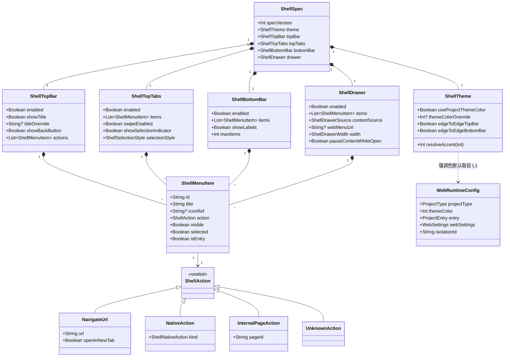
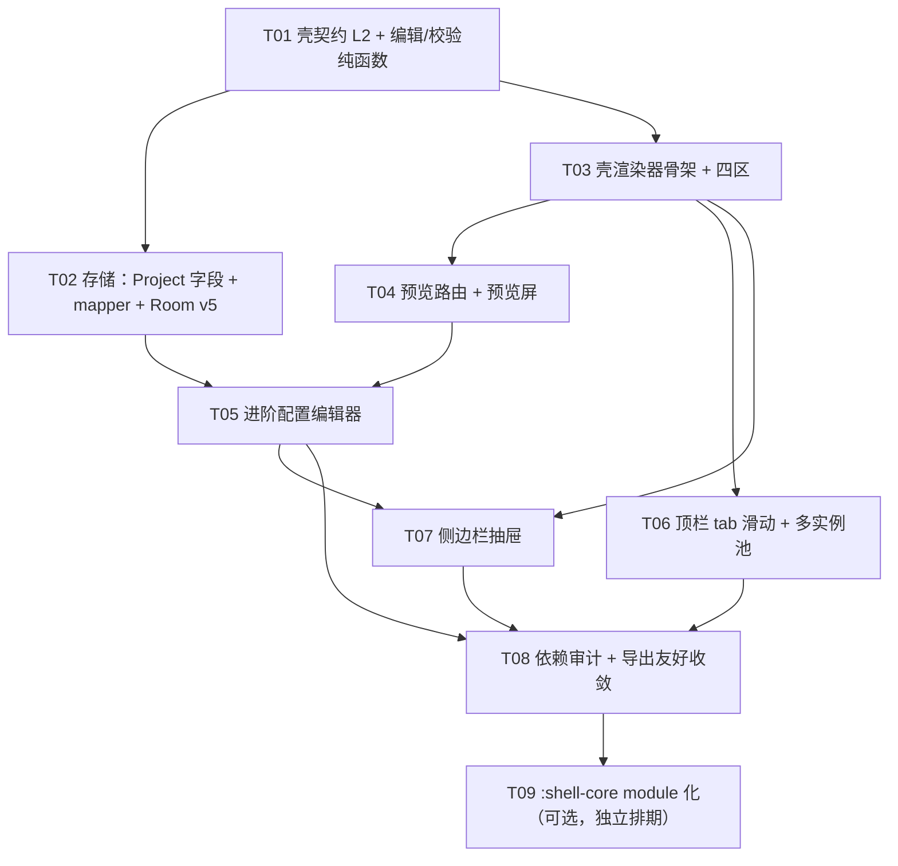

# 阶段 6.0 · 可配置注入壳（ShellSpec 契约 + ShellRenderer + 预览侧）—— 架构预研设计

> 架构师：高见远（Gao）· 主理人裁决方向：载体 = 混合（C 方案）· 本阶段**不写注入/导出实现**。
> 现状基线（已复核源码，非推测）：阶段 0–5 全绿 —— **344 单测 0 失败 / 47 张 Paparazzi 快照零漂移 / assembleDebug 通过**。
> 本文档只做设计；实现需按 §11 任务列表分阶段落地。

---

## 0. 需求收敛结论（一句话）

> **把「壳」抽成一份纯数据契约 `ShellSpec`（L2）+ 一份纯渲染实现 `ShellRenderer`（L3），主程序预览侧用同一份 `ShellSpec` + 同一份 `ShellRenderer` 渲染出「壳内 WebView」的原生 UI；壳的顶栏 / 顶栏 tab / 底栏 tab / 侧边栏四区各自可开关、条目可增删改；本阶段只落契约 + 预览侧 + 配置编辑器，注入/导出留待后续。**

### 0.1 三层结构（主理人裁决的落地化）

| 层 | 名称 | 位置 | 职责 | 本阶段是否实现 |
|---|---|---|---|---|
| L1 | `WebRuntimeConfig` | `data/model/WebRuntimeConfig.kt`（已存在） | 运行时数据：入口 / webSettings / 主题色 / 图标 / 版本 | 不改（仅加 `shellSpec` 的**投影入口**） |
| L2 | **`ShellSpec`** | **新增** `data/model/ShellSpec.kt` | 壳的**长什么样**：四区开关 + 条目 + 主题覆写 + 尺寸/行为策略 | ✅ 实现 |
| L3 | **`ShellRenderer`** | **新增** `ui/shell/`（未来可搬 `:shell-core`） | 把 `ShellSpec` 渲染成实际原生 UI | ✅ 实现（预览侧） |

**一致性公式**：`预览 == 导出 ⟺ 同一份 ShellSpec 数据 + 同一份 ShellRenderer 代码`。
不做任何"人工对齐"（不靠两份 UI 分别实现、不靠截图比对兜底）。

---

## 1. `ShellSpec` 契约设计（核心交付）

### 1.1 设计原则

1. **纯 Kotlin + 零 `android.*` 依赖**：L2 放在 `data/model/`，可 JVM 单测、可被导出侧直接读。
2. **`@Serializable` 且向前兼容**：用 `RuntimeJson` 现有全局 `Json`（`ignoreUnknownKeys = true`）编解码，**不得各处另建 `Json { }`**（沿用 `data/json/RuntimeJson.kt` 的"全局唯一序列化器"约定）。
3. **`specVersion` 必备**：它会被写进 DB、也会写进将来 APK 的 assets，必须能判断"这份配置是不是我认识的版本"。
4. **动作模型开放但当下只有 URL**：`ShellAction` 是密封接口，当前仅 `NavigateUrl` 一个可用实现，另留 `Native` / `InternalPage` / `Unknown` 三个扩展位与兜底位。
5. **壳不描述 Web 行为**：Web 相关（UA / Cookie / JS）留在 L1 `WebRuntimeConfig.webSettings`，壳只管 chrome。**职责边界不重叠。**
6. **图标用「逻辑键」而非资源 id**：`iconRef` 存逻辑键（如 `refresh` / `add`），由 `ShellIconResolver` 在各宿主侧解析为 drawable / 内联资产 —— 这是"预览==导出"的关键之一（详见 §5.4）。

### 1.2 完整 Kotlin 草案

```kotlin
package com.make.apk.data.model

import kotlinx.serialization.SerialName
import kotlinx.serialization.Serializable
import kotlinx.serialization.KSerializer
import kotlinx.serialization.descriptors.SerialDescriptor
import kotlinx.serialization.encoding.Decoder
import kotlinx.serialization.encoding.Encoder
import kotlinx.serialization.json.JsonDecoder
import kotlinx.serialization.json.JsonElement
import kotlinx.serialization.json.JsonObject
import kotlinx.serialization.json.jsonObject
import kotlinx.serialization.json.jsonPrimitive

// ══════════════════════════════════════════════════════════════════════
//  壳契约（L2）—— 描述"壳长什么样"，不含任何 Web 运行时行为
// ══════════════════════════════════════════════════════════════════════

/**
 * 可配置注入壳契约（阶段 6.0 · L2）。
 *
 * 与 L1 [WebRuntimeConfig] 的分工：
 * - L1 = **内容怎么跑**（入口 / webSettings / 主题色 / 图标 / 版本）；
 * - L2 = **壳长什么样**（顶栏 / 顶栏 tab / 底栏 tab / 侧边栏 四区开关与条目）。
 *
 * 落地约束（务必保持）：
 * - **纯 Kotlin，零 `android.*` 依赖** → 可 JVM 单测、可被导出壳工程直接消费；
 * - **只允许 kotlinx.serialization** → 主程序预览与未来导出壳用同一个序列化器读同一份 JSON；
 * - **specVersion 必带** → 该对象会被写进 DB 与将来 APK 的 assets，必须能向后兼容解析；
 * - **新增字段一律带默认值** → 老数据反序列化不炸（配合 RuntimeJson 的 ignoreUnknownKeys）。
 */
@Serializable
data class ShellSpec(
    /** 契约版本号（见 [ShellSpec.CURRENT_SPEC_VERSION]）。 */
    val specVersion: Int = CURRENT_SPEC_VERSION,
    /** 主题覆写（null = 跟随 L1 的 `themeColor`）。 */
    val theme: ShellTheme = ShellTheme(),
    /** 顶栏区（含标题、右侧动作按钮）。 */
    val topBar: ShellTopBar = ShellTopBar(),
    /** 顶栏 tab 区（可作 pager 指示器）。 */
    val topTabs: ShellTopTabs = ShellTopTabs(),
    /** 底栏 tab 区。 */
    val bottomBar: ShellBottomBar = ShellBottomBar(),
    /** 侧边栏（抽屉）区。 */
    val drawer: ShellDrawer = ShellDrawer(),
) {
    companion object {
        /** 当前契约版本。新增字段时 +1，并在此登记升级说明。 */
        const val CURRENT_SPEC_VERSION: Int = 1

        /** 契约版本升级说明（写进文档与导出壳的兼容判断）。 */
        const val VERSION_NOTES: String =
            "v1: 四区（topBar/topTabs/bottomBar/drawer）+ ShellAction 仅 NavigateUrl 可用"

        /** 默认壳：四区全关，等价于"裸 WebView"（与阶段 5 现状一致，零回归风险）。 */
        val DEFAULT: ShellSpec = ShellSpec()
    }
}
```

#### 1.2.1 主题（与 L1 的关系）

```kotlin
/**
 * 壳主题覆写。
 *
 * **默认跟随 L1**：[useProjectThemeColor] = true 时，壳的强调色取 `WebRuntimeConfig.themeColor`
 * （应用主题色），保证"项目主题色"与"壳强调色"天然一致，不产生第二处真值。
 * 用户显式覆写时（[themeColorOverride] 非 null）才用壳自己的颜色。
 */
@Serializable
data class ShellTheme(
    /** 是否跟随项目主题色（L1 `themeColor`）。true 时 [themeColorOverride] 被忽略。 */
    val useProjectThemeColor: Boolean = true,
    /** 壳强调色覆写（ARGB）；null = 跟随项目主题色。 */
    val themeColorOverride: Int? = null,
    /** 顶栏是否沉浸（背景铺满状态栏区域）。 */
    val edgeToEdgeTopBar: Boolean = true,
    /** 底栏是否沉浸。 */
    val edgeToEdgeBottomBar: Boolean = true,
) {
    /** 解析最终强调色：null 表示"调用方用 L1 的 themeColor"。 */
    fun resolveAccent(projectThemeColor: Int): Int =
        if (useProjectThemeColor) projectThemeColor else (themeColorOverride ?: projectThemeColor)
}
```

> **为什么不把 `themeColor` 直接搬进 `ShellSpec`**：会出现"项目主题色"与"壳主题色"两个真值，用户改主题色时不确定改哪个。**推荐做法 = L1 为主 + ShellSpec 只做 override**（已写进 `ShellTheme` 草案）。

#### 1.2.2 壳条目与动作模型

```kotlin
/**
 * 壳条目（顶栏动作按钮 / 顶栏 tab / 底栏 tab / 抽屉菜单项 通用）。
 *
 * 字段设计要点：
 * - [id] **稳定标识**：跨编辑会话不变，用于选中态锚点、持久化 key、埋点、导出壳的 DOM/View 复用 key。
 *   约定由 UI 生成 `UUID` 短码（如 `itm_9f2a`），**不可用下标**（重排即漂移）。
 * - [iconRef] 是**逻辑图标键**（如 `refresh` / `add` / `home`），不是 Android 资源 id / 资源名。
 *   预览侧由 app 的 `ShellIconResolver` 解析为 drawable，导出侧由壳工程解析为内联资产 → 两侧同键同形。
 * - [selected] 是**默认选中标记**（仅 tab 类区域有意义）；运行期选中态由渲染器持有，不回写 spec。
 * - [visible] 为 false 时条目保留在配置里但不渲染（"先关掉，后恢复"，不丢用户配置）。
 */
@Serializable
data class ShellMenuItem(
    /** 稳定标识（UI 生成，形如 `itm_a1b2`）。 */
    val id: String,
    /** 显示标题（非空，长度上限见校验器）。 */
    val title: String,
    /** 逻辑图标键；null = 无图标（纯文字条目）。 */
    val iconRef: String? = null,
    /** 动作（当前仅 URL 可用，模型已开放）。 */
    val action: ShellAction = ShellAction.NavigateUrl(""),
    /** 可见性开关（false = 保留配置但不渲染）。 */
    val visible: Boolean = true,
    /** 默认选中（tab 类区域生效；渲染期以运行态为准）。 */
    val selected: Boolean = false,
    /** 是否为入口根（tab 类区域生效）：标记后该 tab 即「回入口」的目标页与栈根；默认首项即入口。 */
    val isEntry: Boolean = false,
)

/**
 * 壳动作（**开放接口，当前仅 URL 可用**）。
 *
 * 演进路线（后续阶段逐步实现，当前一律走 [Unknown] 兜底）：
 * - [NavigateUrl] —— 打开网页（本期唯一可执行实现）；
 * - [Native] —— 原生动作（刷新 / 分享 / 打开浏览器…），本期仅登记枚举值不执行；
 * - [InternalPage] —— 壳内置原生页（关于 / 设置 / 空白页），本期仅登记不执行；
 * - [Unknown] —— **未知类型兜底**：老壳读到新动作类型时不得崩溃，降级为"不可用条目"。
 *
 * ⚠ 密封接口的**多态反序列化**在遇到未知 `type` 判别符时会抛异常，
 * 故本模型必须走自定义容错序列化器 [ShellActionSurrogate]（见 §1.2.3），
 * 不能直接用 `json.decodeFromString<ShellAction>()`。
 */
@Serializable
sealed interface ShellAction {

    /** 打开网页（当前唯一可执行动作）。 */
    @Serializable
    @SerialName("url")
    data class NavigateUrl(
        /** 目标网址（http/https）。 */
        val url: String,
        /** 是否在新标签页打开（多实例场景用；单实例时退化为当前页跳转）。 */
        val openInNewTab: Boolean = false,
    ) : ShellAction

    /** 原生动作（预留）。 */
    @Serializable
    @SerialName("native")
    data class Native(
        /** 原生动作种类。 */
        val kind: ShellNativeAction,
    ) : ShellAction

    /** 壳内置原生页（预留）。 */
    @Serializable
    @SerialName("internal_page")
    data class InternalPage(
        /** 内置页标识（如 `about` / `settings` / `blank`）。 */
        val pageId: String,
    ) : ShellAction

    /** 未知动作（反序列化兜底；渲染时按"不可用"处理，不崩溃）。 */
    @Serializable
    @SerialName("unknown")
    data object Unknown : ShellAction
}

/** 原生动作种类（预留位；本期不执行）。 */
@Serializable
enum class ShellNativeAction {
    /** 刷新当前页。 */
    REFRESH,

    /** 分享当前页。 */
    SHARE,

    /** 用系统浏览器打开。 */
    OPEN_IN_BROWSER,

    /** 未知（兜底）。 */
    UNKNOWN,
}
```

#### 1.2.3 动作模型的容错序列化器（必须）

```kotlin
/**
 * [ShellAction] 的**容错**序列化器。
 *
 * 存在理由：kotlinx 的多态解码遇到未知 `type` 判别符会抛
 * `SerializationException`；壳配置是要写进 APK assets 的长期数据，
 * 老壳读到新动作类型必须"降级不崩"（与 RuntimeJson 的宽容策略同源）。
 *
 * 策略：读 `type` 判别符 → 命中已知类型则用对应序列化器解；未命中 → [ShellAction.Unknown]。
 * 已知类型但字段缺失/类型不符 → 同样降级为 Unknown（不抛给上层）。
 */
object ShellActionSurrogate : KSerializer<ShellAction> {

    override val descriptor: SerialDescriptor =
        ShellAction.serializer().descriptor

    override fun serialize(encoder: Encoder, value: ShellAction) {
        // 编码交给默认多态序列化器（带 type 判别符）
        when (value) {
            is ShellAction.NavigateUrl ->
                encoder.encodeSerializableValue(ShellAction.NavigateUrl.serializer(), value)
            is ShellAction.Native ->
                encoder.encodeSerializableValue(ShellAction.Native.serializer(), value)
            is ShellAction.InternalPage ->
                encoder.encodeSerializableValue(ShellAction.InternalPage.serializer(), value)
            ShellAction.Unknown ->
                encoder.encodeSerializableValue(ShellAction.serializer(), ShellAction.Unknown)
        }
    }

    override fun deserialize(decoder: Decoder): ShellAction {
        val jsonDecoder = decoder as? JsonDecoder ?: return ShellAction.Unknown
        val obj: JsonObject = jsonDecoder.decodeJsonElement().jsonObject
        val type = obj["type"]?.jsonPrimitive?.content
        return runCatching {
            when (type) {
                "url" -> jsonDecoder.json.decodeFromJsonElement(ShellAction.NavigateUrl.serializer(), obj)
                "native" -> jsonDecoder.json.decodeFromJsonElement(ShellAction.Native.serializer(), obj)
                "internal_page" ->
                    jsonDecoder.json.decodeFromJsonElement(ShellAction.InternalPage.serializer(), obj)
                else -> ShellAction.Unknown
            }
        }.getOrDefault(ShellAction.Unknown)
    }
}
```

> 实现提示：`ShellAction` 上需 `@Serializable(with = ShellActionSurrogate::class)`；
> 若 Kotlin 版本对 `@Serializable(with=)` 与密封多态共存有限制，退路是
> **把 `ShellAction` 降级为「非密封 data class + `type: ShellActionType` + 可选 payload 字段」**
> （天然容错，代价是失去类型安全的 payload 校验）——**该退路列入待裁决 §12.3**。

#### 1.2.4 四个区域

```kotlin
/**
 * 顶栏区（含标题 + 右侧动作按钮）。
 *
 * [actions] 与标题、顶栏 tab **分开建模**：动作按钮是"触发一次动作"，
 * tab 是"导航到一页"，两者生命周期与语义都不同，混在一个 list 里会让选中态语义混乱。
 */
@Serializable
data class ShellTopBar(
    /** 区域开关。false = 完全不渲染顶栏。 */
    val enabled: Boolean = false,
    /** 是否显示标题。 */
    val showTitle: Boolean = true,
    /** 标题文案；null = 用项目名（L1 `apkName`）。 */
    val titleOverride: String? = null,
    /** 是否显示返回按钮（仅顶栏 tab 区有导航栈时有意义）。 */
    val showBackButton: Boolean = true,
    /** 右侧动作按钮（如「添加」「刷新」）。 */
    val actions: List<ShellMenuItem> = emptyList(),
)

/**
 * 顶栏 tab 区。
 *
 * 双重身份（主理人需求）：**既是导航栏，也是 pager 指示器**。
 * - [swipeEnabled] = true → 顶栏 tab 兼作分页指示器，内容区可左右滑动切页；
 * - [swipeEnabled] = false → 顶栏 tab 只做导航（点击切页，不响应滑动）。
 *
 * **选中态恒开**（需求硬要求）：[showSelectionIndicator] 仅控制"指示器样式"，
 * 不允许关闭"当前页高亮"这件事本身；高亮恒在，见 §3.2。
 */
@Serializable
data class ShellTopTabs(
    /** 区域开关。false = 不渲染顶栏 tab。 */
    val enabled: Boolean = false,
    /** 条目（每个 tab 一页）。 */
    val items: List<ShellMenuItem> = emptyList(),
    /** 是否允许左右滑动切页（tab 兼作 pager 指示器）。 */
    val swipeEnabled: Boolean = true,
    /** 是否显示选中指示器（指示器样式，不影响"当前页高亮"本身）。 */
    val showSelectionIndicator: Boolean = true,
    /** 选中态呈现方式。 */
    val selectionStyle: ShellSelectionStyle = ShellSelectionStyle.INDICATOR,
)

/** 顶栏 tab 的选中态呈现方式。 */
@Serializable
enum class ShellSelectionStyle {
    /** 指示器条（M3 TabRow 风格）。 */
    INDICATOR,

    /** 药丸背景（胶囊高亮）。 */
    PILL,

    /** 仅文字颜色变化。 */
    TEXT,
}

/**
 * 底栏 tab 区。
 *
 * 与顶栏 tab 的差异：**底栏 tab 恒为导航**（无滑动切页语义）；
 * 条目数上限 [maxItems]（M3 NavigationBar 在窄屏下超过 5 项会挤压，故设默认上限 5）。
 */
@Serializable
data class ShellBottomBar(
    /** 区域开关。false = 不渲染底栏。 */
    val enabled: Boolean = false,
    /** 条目。 */
    val items: List<ShellMenuItem> = emptyList(),
    /** 是否显示文字标签。 */
    val showLabels: Boolean = true,
    /** 条目数量上限（超出时渲染层截断并在日志中告警）。 */
    val maxItems: Int = 5,
)

/**
 * 侧边栏（抽屉）区。
 *
 * 主理人裁决：抽屉**本体是原生 Drawer**，内部菜单列表可以是 Web/HTML 渲染。
 * 本阶段**只留接口与占位**，不实现 Web 覆盖层。
 */
@Serializable
data class ShellDrawer(
    /** 区域开关。false = 不渲染抽屉入口。 */
    val enabled: Boolean = false,
    /** 菜单条目（原生渲染路径使用）。 */
    val items: List<ShellMenuItem> = emptyList(),
    /** 抽屉内容来源。 */
    val contentSource: ShellDrawerSource = ShellDrawerSource.NATIVE,
    /** Web 覆盖层地址（`contentSource = WEB` 时生效；本阶段仅占位不渲染）。 */
    val webMenuUrl: String? = null,
    /** 抽屉宽度策略。 */
    val width: ShellDrawerWidth = ShellDrawerWidth(),
    /** 打开抽屉时是否暂停内容区 WebView（省资源；Web 覆盖层菜单打开时应暂停）。 */
    val pauseContentWhileOpen: Boolean = true,
)

/** 抽屉内容来源。 */
@Serializable
enum class ShellDrawerSource {
    /** 原生 Compose 列表（本期主路径）。 */
    NATIVE,

    /** Web 覆盖层渲染菜单（本期仅占位，接口已留）。 */
    WEB,
}

/** 抽屉宽度策略（dp 上限用尺寸令牌，此处只表达"取哪一档"）。 */
@Serializable
data class ShellDrawerWidth(
    /** 宽度档位。 */
    val mode: ShellDrawerWidthMode = ShellDrawerWidthMode.MEDIUM,
    /** 自定义宽度（dp）；mode = CUSTOM 时生效。 */
    val customDp: Int = 0,
)

/** 抽屉宽度档位。 */
@Serializable
enum class ShellDrawerWidthMode {
    /** 窄（约 240dp 量级）。 */
    SMALL,

    /** 中（约 300dp 量级）。 */
    MEDIUM,

    /** 宽（约 360dp 量级）。 */
    LARGE,

    /** 自定义（[ShellDrawerWidth.customDp]）。 */
    CUSTOM,
}
```

### 1.3 `ShellSpec` 的结构图（mermaid classDiagram）



---

## 2. 存储落点（设计预留 vs 本阶段实际改动）

### 2.1 三个候选

| 方案 | 优点 | 缺点 |
|---|---|---|
| **A. `projects` 表新增列 `shell_spec_json`** | 1:1 关系，无生命周期管理；查询路径单一；Room 迁移成本 = 一条 `ALTER TABLE ADD COLUMN`；导出时"一个项目一份壳配置"天然对应 | 列变宽（JSON 文本），大配置时行变大（可接受，壳配置通常 < 4KB） |
| B. 新建 `shell_specs` 表（`projectId` 外键） | 壳配置可独立版本化/独立分页；未来若支持"多套壳模板"更好扩展 | 多一张表 + DAO + 实体 + 迁移 + 级联删除 + 一致性维护成本；**当前需求 1:1，扩展性未被使用** |
| C. 塞进 `WebRuntimeConfig`（L1） | 不改 DB | **违背分层**：L1 是"内容运行时"，L2 是"壳形态"；且 L1 会被写进导出 assets，混进去会让壳配置与内容配置互相污染 |

### 2.2 推荐：**A（`projects` 新增列）**

理由：
1. **1:1 无需独立生命周期** —— 壳配置随项目生灭，拆表只带来"孤儿行 / 级联 / 事务边界"三类无收益复杂度。
2. **Room 迁移成本最低** —— `ALTER TABLE projects ADD COLUMN shell_spec_json TEXT`（**可空**，见下），不动其它表、不动索引。
3. **与既有风格一致** —— `projects` 表已有 `entry_json` / `webSettings_json` 两个 JSON 列先例，壳配置是同类的"结构化配置文本"。
4. **B 的扩展性现在用不上** —— "一个项目多套壳"是假想需求；真出现时可再加表做"壳预设库"（预设 ≠ 项目配置），不必现在就把项目配置拆表。

**列定义（关键细节）**：
- 类型 `TEXT`、**可空（nullable）**、**无 SQL DEFAULT**。
  - 理由：`NOT NULL DEFAULT ''` 需要在实体上写 `@ColumnInfo(defaultValue = "''")` 且迁移 SQL 的默认值字面量必须与 Room 导出的 schema JSON **逐字匹配**，否则 `onValidateSchema` 直接抛异常（阶段 5 已踩过"迁移 SQL 与 schema JSON 必须一字不差"的坑，参见 `Migrations.kt` 注释）。
  - 可空列 + `ALTER TABLE ... ADD COLUMN shell_spec_json TEXT` 是 SQLite 最安全的一条路径（无默认值比对、无 NOT NULL 约束冲突），迁移风险最低。
- 语义：`null` = 未配置 → mapper 兜底为 `ShellSpec.DEFAULT`（等价"四区全关 = 裸 WebView"= 阶段 5 现状，零回归）。

### 2.3 「设计预留」 vs 「本阶段实际改动」

| 项 | 本阶段（6.0） | 说明 |
|---|---|---|
| `ShellSpec` 契约 + 容错解码 + 单测 | ✅ 实际改动 | 6.1 |
| `ShellSpecEditor`（纯函数编辑操作）+ `ShellSpecValidator` | ✅ 实际改动 | 6.1 / 6.3 |
| `Project.shellSpec` 领域字段 + `ProjectMapper` 映射 + `RuntimeJson` 编解码 | ✅ 实际改动 | 6.1 |
| `ProjectEntity.shellSpecJson` 列 + **Room v5 迁移** | ⚠️ **裁决项**（建议在 6.1 就做） | 见 §12.1 |
| 导出侧 assets 分发 | ⛔ **设计预留，不实现** | §5.3 |
| 侧边栏 Web 覆盖层渲染 | ⛔ **设计预留，只留接口与占位** | §3.5 |
| 多 WebView 池完整内存优化 | ⛔ **只做基础版** | §3.3 |

> **本设计文档默认按"6.1 即做 Room v5（新增一列）"推进**。若主理人选择延后（见 §12.1 备选），
> 则 6.1 的 `Project.shellSpec` 改为**进程内默认值 + 编辑器不落库**，其余设计不变，6.3 之后再补迁移。

### 2.4 迁移草案（若 6.1 执行）

```kotlin
/**
 * v4 → v5：`projects` 新增 `shell_spec_json` 列（壳配置 L2）。
 *
 * 选择**可空 TEXT 列**而非 NOT NULL + DEFAULT：
 * - SQLite 的 `ADD COLUMN ... NOT NULL DEFAULT ''` 需要默认值字面量与 Room 导出 schema 的
 *   `defaultValue` 逐字一致，否则 `onValidateSchema` 抛 IllegalStateException（阶段 5 教训）；
 * - 可空列无默认值比对，且 `null` 语义清晰 = "未配置 → 兜底 ShellSpec.DEFAULT"。
 *
 * 幂等：用 `ADD COLUMN IF NOT EXISTS`? —— SQLite **不支持** `ADD COLUMN IF NOT EXISTS`，
 * 故按项目既有惯例用 `execSQL`（Room 只在版本号推进时执行一次，无需幂等）。
 */
internal val MIGRATION_4_5 = object : Migration(4, 5) {
    override fun migrate(db: SupportSQLiteDatabase) {
        db.execSQL("ALTER TABLE `projects` ADD COLUMN `shell_spec_json` TEXT")
    }
}
```

配套改动：`AppDatabase.version = 5`、`AppDatabaseFactory.MIGRATIONS += MIGRATION_4_5`、
`app/schemas/.../5.json` 由 KSP 重新导出、**新增 `Migration_4_5_Test`**（照抄 `Migration_3_4_Test` 的模式）、
`DatabaseVersionConsistencyTest` 的期望版本号 4 → 5。

> 提示：`Migration_3_4_Test` 已有"迁移后 schema 与实体声明一致"的校验范式，
> 新迁移测试**只增不改**（既有测试文件不改动既有断言，只更新版本号常量——需主理人确认这是否算"改既有快照"，
> 快照指 Paparazzi 图片，测试文件改动是允许的）。

---

## 3. `ShellRenderer` 渲染设计

### 3.1 分层与组合关系

```
ShellHost(spec, config, webViewFactory, onShellAction) { contentScope ->
  ┌──────────────────────────────────────────────┐
  │ ShellTopBarSection   (spec.topBar.enabled)   │  ← 原生 TopAppBar 等价物
  │   标题 / 返回 / actions(ShellMenuItem 图标按钮) │
  ├──────────────────────────────────────────────┤
  │ ShellTopTabsSection  (spec.topTabs.enabled)  │  ← 既是导航栏也是 pager 指示器
  │   Tab 选中态恒开 + [可滑动] 指示器            │
  ├──────────────────────────────────────────────┤
  │ ShellContentSlot                            │  ← WebView 内容区
  │   单实例 / 多实例(每 tab 一个常驻 WebView)      │
  ├──────────────────────────────────────────────┤
  │ ShellBottomBarSection (spec.bottomBar.enabled)│  ← M3 NavigationBar 等价物
  └──────────────────────────────────────────────┘
  ▲ ModalDrawer overlay（spec.drawer.enabled）    ← 原生抽屉 + (未来) Web 覆盖层菜单
}
```

**关键点**：壳的**骨架**（谁在上谁在下、要不要显示）**完全由 `ShellSpec` 决定**，
而**不是**由宿主页面决定。宿主（预览屏 / 未来导出壳）只提供 `config` + `spec` + 内容。

### 3.2 顶栏 tab ↔ pager 双向同步（具体做法）

**状态归属（必须这样分，否则必然出现"滑动中抖动"）**：

| 状态 | 持有者 | 说明 |
|---|---|---|
| `selectedIndex`（运行期当前页） | **上层**（`ShellHost` 内部 `remember { mutableIntStateOf }`，或由调用方注入） | 唯一真值源 |
| `pagerState` | `ShellHost` 内部 `rememberPagerState` | 纯 UI 位置状态 |

**同步算法（两条单向流，禁止双向直写）**：

1. **点击 tab → 带动画跳页**
   ```kotlin
   val scope = rememberCoroutineScope()
   // 点击
   scope.launch { pagerState.animateScrollToPage(index) }   // 有动画
   selectedIndex = index                                       // 立即更新高亮（不等动画结束）
   ```
   `animateScrollToPage` 保证"带动画跳页"（需求：点击 tab 要有动画）；
   选中态**立即**更新（不等动画），否则用户会看到"点了没反应半秒"。

2. **用户手动滑页 → 反写选中态**
   ```kotlin
   // 反写只在"页稳定"时提交，避免滑动过程中指示器来回跳
   LaunchedEffect(pagerState) {
       snapshotFlow { pagerState.settledPage }        // 稳定页（松手且动画结束）
           .collect { settled -> if (settled != selectedIndex) selectedIndex = settled }
   }
   // 高亮跟随手指的"跟手感"用 currentPage 单独驱动视觉：
   val visualIndex = pagerState.currentPage            // 拖动中即变 → 指示器跟手
   ```
   **推荐双通道**：
   - **视觉高亮** = `pagerState.currentPage`（跟手，用户拖到一半指示器就跟着走）；
   - **逻辑当前页** = `settledPage`（用于决定"哪个 tab 内容在加载/在前台"、埋点、返回键行为）。
   两者在滑动中短暂不一致是**正确**的（业界 Material Tabs / ViewPager2 同样如此）。

3. **反向同步（外部改 selectedIndex → pager 跳页）**
   ```kotlin
   LaunchedEffect(selectedIndex) {
       if (selectedIndex != pagerState.currentPage) {
           pagerState.animateScrollToPage(selectedIndex)
       }
   }
   ```
   注意与 (1) 的竞态：用 `if (selectedIndex != pagerState.currentPage)` 守卫，
   避免"点击 → animateScrollToPage → currentPage 变化 → 触发 LaunchedEffect 再 animate"的双重动画。

4. **禁用滑动时**：`HorizontalPager(userScrollEnabled = false)`，其余逻辑不变（点击仍跳页）。

**选中态恒开（需求硬要求）**：无论 `selectionStyle` 取何值，**"当前页高亮"这件事不允许关闭**——
`showSelectionIndicator = false` 只隐藏指示器条，颜色高亮保留。

### 3.3 多 WebView 实例管理

**是否需要多实例的判定（明确"何时不该用多实例"）**：

| 场景 | 实例策略 |
|---|---|
| 顶栏 tab 未启用 / 只有 1 个条目 | **单实例**（一个 WebView，切 tab 时 `loadUrl` 切换） |
| 顶栏 tab ≥ 2 且 `swipeEnabled = false` | **单实例**（点击即换 URL；常驻多实例无收益，只吃内存） |
| 顶栏 tab ≥ 2 且 `swipeEnabled = true` | **多实例**：每个 tab 一个常驻 WebView（借鉴 Google I/O 2026 官方 WebView 多 tab 示例） |
| 底栏 tab 区 | **单实例**（底栏是导航语义，非 pager；常驻多实例会让"底栏 tab = 顶层导航"的直觉破坏） |

> **理由**：多实例的核心价值是"保留 JS 上下文 / 滚动位置 / 表单"，这只在**滑动式分页**下是刚需。
> 底栏 tab 与不滑动切换的顶栏 tab，用户预期是"重新加载"（如同浏览器新标签），单实例更省内存也更符合直觉。

**实例持有方式（关键：`remember` / `rememberSaveable` 的正确用法）**：

- ❌ **不能用 `rememberSaveable`**：WebView 是 `View`，不可序列化，进程恢复时无法重建（会抛 `IllegalArgumentException: Parcelable ...`）。必须用 `remember` + 手动生命周期释放。
- ✅ **正确做法**：
  ```kotlin
  // 池宿主：普通 class（非 Composable 状态），持有 View 引用并负责销毁
  class ShellWebViewPool(private val factory: (Context) -> View) {
      private val views = mutableMapOf<String, View>()   // key = tab item id
      fun obtain(context: Context, key: String): View = views.getOrPut(key) { factory(context) }
      fun destroyAll() { views.values.forEach { (it as? WebView)?.destroy() }; views.clear() }
  }

  // Composable 侧
  val pool = remember { ShellWebViewPool(webViewFactory) }
  DisposableEffect(Unit) {
      onDispose { pool.destroyAll() }        // ← 必须：离开预览页即销毁全部 WebView
  }
  ```
- **为什么不用 `remember` 存单个 WebView**：`AndroidView` 的 `factory` 只在首次组合时调用；
  但**多实例**场景需要在 pager 里为 N 个页各建一个 View → 用 `key(tabId)` 包裹每个 `AndroidView`，
  让 Compose 按 key 独立管理生命周期：
  ```kotlin
  HorizontalPager(state = pagerState) { page ->
      val tab = tabs[page]
      key(tab.id) {                       // ← 关键：按稳定 id 建 key，条目重排不重建实例
          AndroidView(factory = { pool.obtain(it, tab.id) }, modifier = ...)
      }
  }
  ```
- **内存回收策略（基础版，本阶段不做精细优化）**：
  1. `DisposableEffect` 离开预览页 → `destroyAll()`；
  2. `onTrimMemory(TRIM_MEMORY_UI_HIDDEN)` → 暂停所有实例（`onPause()`）而非销毁；
  3. **超出上限时**：本阶段限制顶栏 tab 条目数上限（建议 ≤ 8）并在超限时**告警日志**（不静默截断），
     精细 LRU 回收列入后续阶段（§11 边界）。

### 3.4 侧边栏（抽屉）

**结构**：
```
ModalDrawer(
  drawerContent = {
      ShellDrawerContent(spec.drawer)   // 本阶段：原生列表占位（items）
                                    // 未来：ShellWebOverlay(webMenuUrl) 覆盖层
  },
  drawerState = rememberDrawerState(...),
  gesturesEnabled = spec.drawer.enabled,
) { /* 主体内容 */ }
```

**要点**：
- **抽屉本体 = 原生 `ModalDrawer`**（主理人裁决）：开合动画、边缘手势、返回键关闭全部走系统实现，与 Material 3 行为一致 → 预览与导出一致。
- **内容区 = Web 覆盖层**（本阶段只留接口）：`ShellDrawerSource.WEB` 时，未来在 `drawerContent` 内放一个 `AndroidView`（WebView）加载 `webMenuUrl`；`drawerContent` 高度按 `ShellDrawerWidth` / 可自定义。
  - **本阶段实现**：`ShellDrawerContent` 在 `contentSource == WEB` 时渲染一个**占位卡**（文案"Web 菜单（待实现）"），`Native` 时渲染原生条目列表。
- **抽屉开合与 WebView 生命周期**：
  - `drawerState.isOpen` 变化时，若 `spec.drawer.pauseContentWhileOpen` → **暂停内容区 WebView**（`webView.onPause()` + `pauseTimers()`），恢复时 `onResume()`；
  - 若 `contentSource == WEB` → 打开抽屉时**才创建/恢复**覆盖层 WebView，关闭时**销毁**（覆盖层菜单通常轻量、生命周期短）；
  - 依据：抽屉打开时用户看不到内容区，暂停可省 CPU/内存；关闭后恢复保证 JS 上下文不丢（因为实例没销毁，只 `onPause`）。
- **返回键**：抽屉打开时返回键先关抽屉（`ModalDrawer` 默认行为），再返回上一页 —— Compose `ModalDrawer` 自带该优先级，无需手写。

### 3.5 主题、状态栏与安全区（insets）

| 事项 | 方案 |
|---|---|
| 强调色 | `ShellTheme.resolveAccent(config.themeColor)` → 注入 `ShellHost` 的 `LocalShellAccent`（CompositionLocal），壳内所有强调色走它，**不直接读 `MaterialTheme.colorScheme.primary`**（否则无法体现"壳覆写主题色"） |
| 状态栏 | `spec.theme.edgeToEdgeTopBar` = true → 顶栏背景铺到状态栏后（`statusBarsPadding()` 内部消化）；false → 顶栏在状态栏下方起 |
| 导航栏 | `spec.theme.edgeToEdgeBottomBar` = true → 底栏 `navigationBarsPadding()`；false → 底栏贴底不管导航栏 |
| 内容区（WebView） | **不加任何 padding**（沉浸），Web 页自己适配；但 WebView 需要 `viewport-fit=cover` 才真正沉浸（L1 `webSettings` 已有 `useWideViewPort`，具体 `viewport-fit` 属后续 WebSettings 扩展项，本阶段不动） |
| 安全区 | 壳层用 `WindowInsets.safeDrawing` 统一算一次，**只在顶栏/底栏消费**；内容区不消费（否则 Web 页面被 inset 挤压出现双层留白） |
| 深浅色 | 壳跟随宿主 `MaterialTheme`（预览页与导出壳都跟随系统深浅色）→ 一致 |

**关键约束**：`ShellRenderer` **不得直接依赖 app 的 `MmaDesign` / `MaterialTheme` 具体色值**，
只接受 `ShellRenderEnv`（强调色 + 尺寸档位 + 是否深色）注入 —— 这是 §5.2 "module 化"的前提。

---

## 3.6 tab↔入口联动（EntryRoot + 回入口）

> 落地状态：**已实现（rc9，`ShellSpec.isEntry` + `ShellHost.onResetToEntry` + `:template` 运行时）**。
> 本节描述契约与运行时的协同规则，便于后续导出壳沿用同一套语义。

### 3.6.1 三个概念

| 概念 | 定义 | 来源 |
|---|---|---|
| **EntryRoot（入口根）** | 某 tab 的"首页"——其 `ShellAction.NavigateUrl.url`（为空则回落项目自身 `entry`）。每个顶栏 tab 各自持有。 | `tabEntryUrl(baseEntryUrl, tab)` |
| **入口 tab（Entry Tab）** | 被 `isEntry = true` 标记的 tab；无显式标记时回落**首个可见 tab**（向后兼容老数据）。 | `ShellTopTabs.entryTabItem()` |
| **回入口（Reset To Entry）** | 把当前视图复位到入口 tab 的入口根。两种触发：① 顶栏 home 图标按钮；② 重选当前已选中 tab。 | `ShellHost.onResetToEntry` |

### 3.6.2 契约变更（向后兼容）

- `ShellMenuItem` 新增 `val isEntry: Boolean = false`：带默认值，**老数据反序列化不炸**（CURRENT_SPEC_VERSION 仍为 1）。
- `ShellTopTabs.entryTabItem(): ShellMenuItem?`（纯 Kotlin 扩展，零 `android.*`）：首个 `isEntry=true` 可见项，否则首个可见项，否则 null。
- 顶级栏 `ShellTopBarSection` 新增 `onResetToEntry` 回调 → 渲染 home 图标按钮（`ic_home`，**SVG，非 emoji**）；仅当 `spec.topTabs.enabled && 有可见 tab` 时由 `ShellHost` 注入，否则不渲染（保证"未配顶栏 tab 的项目不会出现该按钮"）。

### 3.6.3 运行时（集中式路由 + 每 tab 独立栈）

`:template` 的 `TemplateApp` 持有运行态（**不回写 spec**，守住§8.2 不变量）：

- **TabStack**：`Map<tabId, List<URL>>`，每顶栏 tab 一条独立 URL 后退栈，栈顶 = 当前显示；首屏初始化为各自入口根。切换 tab 保留各自栈（互不干扰）。
- **RouterContract**（`handleAction`）：
  - `ShellAction.NavigateUrl(url)` → 命中某 tab 目标 URL 则切到该 tab（`routeToTab`）；否则压入当前 tab 栈。
  - `ShellAction.InternalPage` → 复位到入口根（`resetToEntry`）。
  - `ShellAction.Native.REFRESH` → 重载当前 tab 栈顶；其余 `Native` 种类本期仅记录不执行（与 §8.1 一致，不崩）。
  - `ShellAction.Unknown` → 忽略。
- **resetToEntry**：跳转入口 tab 并将其栈复位到入口根；其他 tab 栈保留。

### 3.6.4 预览==导出对称

- `ShellPreviewScreen` 同样透传 `onResetToEntry`（选中入口 tab），与 `:template` 共用同一 `ShellHost` 渲染入口按钮；
- 预览侧因 WebView 自带页内历史，回入口以"选中入口 tab"实现（等价于入口根）；导出壳若采用同款 TabStack 则行为完全一致。

---

## 4. 预览侧集成方案

### 4.1 `WebViewScreen` 的改造

**现状**：`WebViewScreen(config, modifier, webViewFactory)` = 裸全屏 WebView。

**目标**：它降级为"**壳内的内容区**"，仍是**无状态、可测**的纯渲染组件。

**改造方案（保持向后兼容，既有 47 张快照零漂移）**：

```kotlin
/**
 * WebView 渲染组件（阶段 6.0 起：**壳内的内容区**）。
 *
 * 角色变更：它不再负责"整屏"，而是 [com.make.apk.ui.shell.ShellHost] 内容槽里的
 * 一块 Web 内容。壳的顶栏 / 顶栏 tab / 底栏 / 抽屉由 [ShellHost] 按 [ShellSpec] 渲染。
 *
 * 兼容性：签名与行为**保持不变**（既有 [com.make.apk.ui.screens.WebViewScreenTest]
 * 的 `shellLight` 快照必须零漂移）——本阶段只把 KDoc 语义更新为"内容区"，
 * 并**新增** `contentKey` 参数用于多实例场景下按 tab 区分配置指纹。
 */
@Composable
fun WebViewScreen(
    config: WebRuntimeConfig,
    modifier: Modifier = Modifier,
    webViewFactory: (Context) -> View = { WebView(it) },
    /** 多实例场景下的内容指纹（tab id 等）；参与"是否需要 reload"的判等。 */
    contentKey: String? = null,
)
```

- `contentKey` 参与去重 tag（`TAG_RUNTIME_KEY` 升级为 `config + contentKey` 组合），
  保证**不同 tab 的实例互不触发 reload**（现状只有单个整型 tag，多实例会互相踩）。
- **既有快照零漂移保证**：`contentKey` 默认 null ⇒ 行为与现状完全等价；
  `WebViewScreenTest.shellLight` 不传该参数 ⇒ 画面不变。

### 4.2 预览入口（推荐）

**推荐：新增路由 `project/{projectId}/run`，并在两处提供入口。**

| 入口 | 位置 | 交互 |
|---|---|---|
| 列表项"运行" | `ProjectsScreen` 每张项目卡右侧一个 `IconButton`（图标 `play`/`preview`） | 点击 → `project/{id}/run` |
| 编辑页顶栏"预览" | `ProjectEditScreen` 的 `MmaScreen.actions` | 点击 → `project/{id}/run`（**携带当前未保存的草稿 spec**） |

**为什么不复用 `project/{id}`（编辑页）做预览**：
1. 编辑页是**表单页**（顶栏 + 身份卡 + 三 Tab + 滚动），不是"应用运行态"；
2. 预览需要**全屏沉浸**（无主程序底栏、无返回箭头以外的 MMA 控件）；
3. 预览要**独立于"保存"**（用户可能只想看效果）；
4. 未来导出壳是全屏 App，预览页的"壳"必须与它同构 —— 编辑页包着壳会让壳的真实边界失真。

**路由草案**：
```kotlin
/** 项目预览（运行态：壳 + WebView，无主程序底栏）。 */
data object ProjectRun : MmaRoute("project/{$ARG_PROJECT_ID}/run") {
    fun create(projectId: Long): String = "project/$projectId/run"
}
```
> ⚠ 路由注册注意：`composable("project/{projectId}")` 与 `composable("project/{projectId}/run")`
> 在 Navigation Compose 里**不冲突**（路径段数不同，匹配唯一），但注册顺序建议 `run` 在前，避免歧义。

### 4.3 「编辑页进阶配置 ↔ 预览」联动

**需求**：改壳配置要**立刻看到效果**。

**推荐方案：双层预览（编辑页内嵌 mini 实时预览 + 全屏预览页）**

| 形态 | 位置 | 内容 | 代价 |
|---|---|---|---|
| **A. 内嵌 mini 预览（推荐）** | 进阶配置 Tab **顶部** | 一个缩放（如 0.35 倍）or 简化的 `ShellHost` 实时渲染，WebView 用**桩 View**（`FrameLayout`） | 渲染开销小、无网络请求、不干扰表单 |
| **B. 全屏预览页** | `project/{id}/run` | 真实 WebView 全屏壳 | 需离开编辑页，看不到"改一下就变"的即时反馈 |
| C. 实时全屏预览（编辑页内嵌真实 WebView） | 编辑页进阶配置 Tab | 真实内容 | **每次改配置都可能触发 WebView reload**，卡顿 + 打断输入，**不推荐** |

**决策**：采用 **A + B 组合**：
1. 进阶配置 Tab 顶部常驻 **mini 预览卡**（`ShellHost` 的**纯壳渲染模式**：`webViewFactory` 注入 `FrameLayout` 桩）→ 改任何一项立刻反映（**这就是"实时预览"**）；
2. Tab 底部一个 **「全屏预览」按钮** → 跳 `project/{id}/run`，带**当前草稿 spec**（未保存也生效）→ 看真实 WebView 效果。

**"草稿 spec 怎么传给预览页"**：
- 推荐：**预览页自己订阅项目**（从仓库取已保存的 `Project.shellSpec`）+ **可选覆盖参数**（导航参数只传 projectId，spec 覆盖走 `savedStateHandle` 传不可序列化对象不行）。
- 两个可选实现：
  - **i. 只看已保存**：预览页读库里的 spec。简单，但"改完没保存就预览"看不到变化 → 需先保存。
  - **ii. 传草稿**：把草稿 spec **以 JSON 字符串**放进导航参数或 `savedStateHandle`（`savedStateHandle` 支持 `String`）→ 预览页优先用草稿 JSON，否则读库。
- **推荐 ii**（`savedStateHandle["draft_shell_spec_json"] = json`），实现简单（JSON 字符串天然可传），且满足"改完立刻看"。
  - 待裁决：§12.2。

---

## 5. 一致性保证机制

### 5.1 公式与三条铁律

```
预览 == 导出   ⟺   同一份 ShellSpec 数据  +  同一份 ShellRenderer 代码
```

**三条铁律**：
1. **渲染代码只有一份**：`ShellRenderer`（`ui/shell/`）是**唯一**的壳渲染实现；
   预览侧与导出侧**都调用它**，任何"预览专用 UI"都是 bug（代码评审红线）。
2. **渲染层不得依赖宿主业务**：壳只吃 `ShellSpec` + `WebRuntimeConfig` + `ShellRenderEnv`，
   不读仓库、不读 VM、不读导航 → 导出侧才能在**没有 MMA 运行时**的环境里渲染同样的壳。
3. **数据只有一份**：`ShellSpec` 是**唯一**壳配置真值；预览读它、编辑器改它、导出打包它，
   不存在"预览用一份、导出用另一份"。

### 5.2 代码组织：对导出友好的形态

**推荐：最终形态 = 独立 Gradle module `:shell-core`（Android Library）**；**本阶段先以包 `ui/shell/` 落地，6.5 前完成 module 化搬运。**

**为什么最终要独立 module**：
- 导出侧是**另一个 APK 工程**（模板壳），它要 import 壳渲染代码 ⇒ 需要一个**可发布的构件**（`aar` 或源码 include）；
- 包级隔离在导出时仍需**人工复制粘贴**源码 —— 这正是要消除的"人工对齐"；
- 独立 module 天然形成**依赖边界**：module 里写 `com.make.apk.ui.theme` 就会在导出侧编译失败 → 逼着做正确分层。

**`:shell-core` 应包含**：
```
shell-core/
  src/main/kotlin/com/make/apk/shell/core/
    model/ShellSpec.kt          ← L2 契约（纯 Kotlin，零 android.*）
    model/ShellMenuItem.kt
    model/ShellAction.kt
    render/ShellHost.kt         ← L3 渲染器
    render/ShellTopBarSection.kt
    render/ShellTopTabsSection.kt
    render/ShellBottomBarSection.kt
    render/ShellDrawerSection.kt
    render/ShellWebPane.kt      ← 原 WebViewScreen 的壳内版本
    render/ShellRenderEnv.kt    ← 强调色 / 尺寸 / 深浅色 注入
    icon/ShellIconResolver.kt   ← 逻辑图标键 → 资源 的解析接口
```

**`:shell-core` 不应包含**：
- `data/local` / `data/repository`（Room / 业务）—— 壳不查库；
- `ui/theme/MmaDesign`（MMA 品牌主题）—— 壳只吃 `ShellRenderEnv`；
- `MmaLogger`（MMA 日志）—— 用 `android.util.Log` 或注入式日志接口。

**本阶段（单 module `:app`）的落地代价与做法**：
| 代价 | 做法 |
|---|---|
| 目录还没拆 | 先建 `app/src/main/java/com/make/apk/ui/shell/`（**新包，不污染既有包**），文件头注明"未来搬 `:shell-core`，禁止 import `com.make.apk.ui.*` 其它包" |
| 主题依赖 | `ShellRenderEnv` 由 `ui/shell/ShellRenderEnvFactory.kt`（留在 app 侧）从 `MaterialTheme` + `config.themeColor` 派生；**壳内部只读 env，不读 MaterialTheme** |
| 图标依赖 | `ShellIconResolver` 接口在 shell 包内；app 侧提供 `MmaShellIconResolver`（逻辑键 → `MmaIcons` drawable） |
| 搬运成本 | 6.5 之前一次性搬到 `:shell-core`；**搬运是纯位移**，有单测 + 47 快照护栏，风险可控 |

**推荐路径**：
```
6.0  ui/shell/（包级）──→ 6.5 前 ──→ :shell-core（module 级）──→ 导出侧 :template-shell 依赖 :shell-core
```

### 5.3 将来导出时 `ShellSpec` 如何随 APK 分发（**本阶段不实现**）

**推荐：独立文件 `assets/shell-spec.json`，而不是扩展 `assets/runtime-config.json`。**

| 方案 | 评价 |
|---|---|
| **独立 `assets/shell-spec.json`** ✅ | ① 职责分离：`runtime-config.json`（内容运行时）与 `shell-spec.json`（壳形态）各自演进、各自 `specVersion`；② 导出侧可**只替换壳配置**做壳模板 A/B 实验；③ 增量读取（壳大了不用重写 runtime-config）；④ 迁移友好：老壳没这个文件 → 回落默认壳，不崩 |
| 扩展 `assets/runtime-config.json`（加 `shellSpec` 字段） | ① 违反分层（L1 混入 L2）；② 每次壳改动都要重写整个 runtime-config；③ 老壳读到新字段虽不崩（`ignoreUnknownKeys`）但拿不到壳配置 → 仍需回落逻辑 |

**导出侧的读取顺序（预留）**：
```
assets/shell-spec.json（存在则读，失败回落 ShellSpec.DEFAULT）
  → assets/runtime-config.json（内容运行时）
  → 渲染 ShellHost
```
**回落必须存在**：壳配置丢失/损坏 ⇒ 渲染"裸 WebView"（等价 `ShellSpec.DEFAULT`），**不得崩溃、不得白屏**。

**同时需要打包的还有**：`iconRef` 的**图标资产**（逻辑键 → 实际图）必须**内联进导出 APK 的 assets**，
否则导出侧解析不到图标（→ 渲染占位）。这是"已知不可一致风险"的主要来源之一（见 §5.4）。

### 5.4 已知的不可一致风险清单

| # | 风险 | 影响 | 可接受性判断 |
|---|---|---|---|
| R1 | **图标资源**：预览侧用 app 的 `res/drawable/ic_*.xml`；导出侧需把图标内联进 assets（PNG/SVG） | 导出后图标可能与预览**形状/描边/尺寸略有差异**（尤其自绘 SVG 转 PNG） | **可接受（需治理）**：约定"逻辑键 → 同一份 SVG 源"，导出侧构建期把 SVG 转 VectorDrawable/PNG 塞进 assets；差异以"同一 SVG 源"为验收标准（像素级一致不保证） |
| R2 | **字体**：预览用系统默认中文字体；导出壳若自带字体或系统字体不同 → 字距/断行差异 | 视觉不完全一致 | **可接受**：导出壳**不自带字体**（与预览一致走系统字体）；若未来允许自带字体，则预览侧必须同步注入同一字体文件，否则列为"已知不一致"并写进导出说明 |
| R3 | **Android 版本差异**：不同 ROM 的 Material3 组件渲染（Tab 指示器高度、NavigationBar 图标间距）有细微差异 | 像素级差异 | **不可消除、业界普遍**：验收标准定为"**同设备同系统版本**下预览 == 导出"（本机预览即目标机同版本）；跨版本差异属系统行为，不追责 |
| R4 | **WebView 版本差异**：预览用设备当前 WebView（Chromium）；导出 APK 在另一台设备跑 → WebView 版本可能不同 | 网页渲染差异（与壳无关，但影响"看起来一样"） | **不可消除**：属 WebView 行为，不在壳一致性范围内；导出壳也用系统 WebView（不内置 Chromium），保证"同设备同版本"一致 |
| R5 | **状态栏/导航栏沉浸差异**：预览页在 MMA 主程序内（主程序有自己的 Scaffold/系统栏处理）；导出壳是独立 App | 边缘留白可能差几个 dp | **可接受（必须治理）**：壳的 inset 处理全部收敛到 `ShellHost` 内部（§3.5），预览与导出走**同一段 inset 代码**；预览时 MMA 主程序的 Scaffold 不得给壳区域额外加 padding |
| R6 | **多 WebView 实例的内存回收时机不同**：预览退出即销毁；导出壳可能被系统杀死后台 | 导出后切 tab 可能重建实例（丢失滚动位置） | **可接受**：导出壳按"最少销毁"策略（后台只 `onPause` 不销毁），预览按"退出即销毁"（省主程序内存）。**差异仅在"实例何时被销毁"，不影响视觉** |
| R7 | **抽屉 Web 覆盖层**：本阶段只有占位，未来实现时预览侧与导出侧都要加载同一个 `webMenuUrl` | 若一侧未实现 → 抽屉空白 | **本阶段不暴露**（占位卡文案明确"待实现"），不产生"看起来不一致"的误判 |
| R8 | **令牌/主题**：壳若引用 app 的 `MaterialTheme` 具体色 → 导出侧无色可用 | 导出壳无法渲染 | **结构性风险**：由 §5.2 的 `ShellRenderEnv` 边界**在编译期挡住**（module 化后 `:shell-core` 编译不过就是防线） |

---

## 6. 编辑页「进阶配置」Tab 的 UI 与交互设计

### 6.1 整体布局

```
进阶配置 Tab（TemplateTab 重写）
┌─────────────────────────────────────────┐
│ [mini 预览卡]  ← ShellHost 纯壳渲染，实时  │  ← 顶部常驻
│  ┌───────────────────────────┐          │
│  │ ▓ 顶栏  ⊕                 │          │
│  │ ▓ 顶栏tab  ▎▎▎            │          │
│  │ ▓ (web 桩)                │          │
│  │ ▓ 底栏 ● ● ●              │          │
│  └───────────────────────────┘          │
│  「全屏预览」按钮                        │
├─────────────────────────────────────────┤
│ ▼ 顶栏            [开关 Switch]          │  ← SectionCard + 展开
│   标题显示 [Switch]  返回按钮 [Switch]    │
│   右侧动作：                            │
│     ▸ [+ 添加动作]                       │
│     ▸ 刷新   (icon)      [编辑][删除]    │
│ ▼ 顶栏 Tab        [开关 Switch]          │
│   滑动切页 [Switch]  选中样式 [Segmented] │
│   ▸ [+ 添加 Tab]                        │
│   ▸ 首页 (icon)          [编辑][删除]    │
│ ▼ 底栏              [开关 Switch]        │
│   显示文字 [Switch]                      │
│   ▸ [+ 添加 Tab]                        │
│ ▸ 侧边栏            [开关 Switch]        │
│   内容来源 [Segmented: 原生|Web]         │
│   宽度 [ExposedDropdownMenu]             │
│   ▸ [+ 添加菜单项]                       │
└─────────────────────────────────────────┘
```

### 6.2 M3 组件映射表

| 交互需求 | M3 组件 | 用法要点 |
|---|---|---|
| 区域总开关 | `Switch` | 放在 `SectionCard` 标题行右侧；关闭时区域内容置灰但**保留条目**（不清空） |
| 二选一 / 三选一（选中样式、内容来源） | `SegmentedButton`（单选 `SingleChoiceSegmentedButtonRow`） | 选项 ≤ 3 时用 Segmented，> 3 用 `ExposedDropdownMenu` |
| 顶栏 tab 选中样式（3 档） | `SegmentedButton` | 指示器 / 药丸 / 文字 |
| 抽屉宽度档位（4 档） | `ExposedDropdownMenu` | 走 `OutlinedTextField(readOnly=true)` + `menuAnchor()` |
| 条目标题输入 | `OutlinedTextField` / 复用 `ProjectTextField` | 复用既有 `ProjectTextField` 保持风格一致 |
| 条目 URL 输入 | `OutlinedTextField` + `ProjectTextField` | 校验文案来自 `ShellSpecValidator` |
| 条目图标选择 | `ExposedDropdownMenu`（逻辑图标键网格）或 `FilterChip` 组 | 键来自 `ShellIconCatalog`（app 侧提供，**逻辑键**枚举）；顶栏动作按钮**图标必填** |
| 增删条目 | `FilledTonalButton`/`TextButton`（+ 添加）/ `IconButton`（删除） | 删除需 `AlertDialog` 二次确认 |
| 编辑已有条目 | 点击条目行 → 展开内联编辑区 或 弹 `AlertDialog` | **推荐内联展开**（`AnimatedVisibility`），避免多层弹窗 |
| 排序 | **本阶段不做拖拽**；用「上移/下移」`IconButton`（`ArrowUpward`/`ArrowDownward`） | 见 §6.4 说明 |
| 危险操作（清空区域 / 删除项目） | `AlertDialog` | 与 `ProjectsScreen`/`HighSettingsTab` 现有确认弹窗风格一致 |
| 折叠/展开分区 | `SectionCard` + `AnimatedVisibility` | 与既有 `SectionCard` 一致 |
| 底部主操作（全屏预览） | `Button`（filled） | 固定在 Tab 内容末尾 |

**排序的取舍（明确建议）**：
- **不做拖拽排序**。理由：① 拖拽在 Compose 里要引入手势 + 长按拖拽实现，成本高、快照测试难写；② 条目顺序语义弱（tab 顺序有一定意义，但可用上移/下移满足）；③ 6.0 的核心价值是"能不能配"，不是"排序体验"。
- 提供 **上移 / 下移** 两个 `IconButton`（仅在非首/非末项出现），满足 90% 排序需求，实现成本极低。

### 6.3 条目编辑表单字段

| 字段 | 控件 | 校验（文案唯一来源） |
|---|---|---|
| 标题 | `ProjectTextField` | 非空；长度 ≤ 24（超长截断/警告） |
| 图标 | 图标键网格（`FilterChip`） | **顶栏动作按钮：必填**（错误）；tab / 底栏 / 抽屉：可选 |
| 动作类型 | `SegmentedButton`（当前只有「打开网页」可选，其余置灰 + 「即将支持」） | 当前恒为 URL |
| URL | `ProjectTextField` | **复用 `ProjectValidator.validateEntryUrl` 的规则与文案**（`MSG_URL_REQUIRED` / `MSG_URL_SCHEME_BLOCKED`）——**不另起文案** |
| 可见 | `Switch` | — |
| 默认选中 | `RadioButton`（同区域单选） | 顶栏 tab / 底栏 tab 区域内互斥 |

### 6.4 校验规则（全部落在纯函数 `ShellSpecValidator`）

| 规则 | 级别 | 文案来源 |
|---|---|---|
| 区域已启用但条目为空（顶栏 tab / 底栏 tab） | **ERROR**（阻断保存） | `ShellSpecValidator` 新增（"顶栏 Tab 至少需要 1 个条目"） |
| 条目标题为空 | ERROR | `ShellSpecValidator` |
| 条目 URL 非法 | ERROR | **复用 `ProjectValidator.validateEntryUrl`**（不另起文案） |
| 顶栏动作按钮图标缺失 | ERROR | `ShellSpecValidator`（"顶栏动作按钮需要选择图标"） |
| 同一区域内 `id` 重复 | ERROR | `ShellSpecValidator`（数据一致性护栏） |
| 底栏条目数 > `maxItems` | WARNING | `ShellSpecValidator` |
| 标题超长 | WARNING | `ShellSpecValidator` |

**实现方式**：新增 `ui/editor/ShellSpecValidator.kt`（纯 Kotlin、零 `android.*`），
内部**调用** `ProjectValidator.validateEntryUrl(raw)` 取结论 → **文案天然单一来源**。

### 6.5 状态管理落点（推荐）

**推荐：不新增独立 ViewModel；在 `ProjectEditViewModel` 内增加 `shellSpec` 状态字段 + 把"编辑操作"抽成纯函数对象 `ShellSpecEditor`。**

**理由**：
1. **保存语义必须唯一**：`ProjectEditViewModel` 已有 `dirty` / `saving` / `canSave` / `events(Saved/SaveFailed)` / 落库（`directory.update`）。
   若壳配置另起一个 VM，就会出现**两个 dirty 标记、两份保存按钮、两条落库路径** → 竞态与"保存了名字没保存壳"的经典 bug。
2. **壳配置是 `Project` 的一个字段**：与 `webSettings` 同级（`ProjectEditUiState.webSettings` 已存在），
   `webSettings` 就是"进 `ProjectEditUiState` + VM 里逐项 onXxxChanged + `save()` 时 copy 进 `Project`"的成熟范式 → **照抄它**。
3. **但"编辑逻辑"要抽出去**：增删改条目/重排/开关联动是**纯数据变换**，写成 VM 方法会让 VM 膨胀到 800+ 行。
   → 抽 `ShellSpecEditor`（纯 Kotlin 对象/函数），VM 只做 `shellSpec = ShellSpecEditor.xxx(state.shellSpec, ...)` 转发。

**具体形态**：
```kotlin
// data/model 或 ui/editor（纯 Kotlin，零 android.*）
object ShellSpecEditor {
    fun addItem(spec: ShellSpec, area: ShellArea, item: ShellMenuItem): ShellSpec
    fun updateItem(spec: ShellSpec, area: ShellArea, itemId: String, transform: (ShellMenuItem) -> ShellMenuItem): ShellSpec
    fun removeItem(spec: ShellSpec, area: ShellArea, itemId: String): ShellSpec
    fun moveItem(spec: ShellSpec, area: ShellArea, itemId: String, delta: Int): ShellSpec
    fun setAreaEnabled(spec: ShellSpec, area: ShellArea, enabled: Boolean): ShellSpec
    fun setTopTabsSwipe(spec: ShellSpec, enabled: Boolean): ShellSpec
    fun setSelectedItem(spec: ShellSpec, area: ShellArea, itemId: String): ShellSpec
}

/** 四个区域的类型化定位（避免到处传字符串 key）。 */
enum class ShellArea { TOP_BAR_ACTIONS, TOP_TABS, BOTTOM_BAR, DRAWER }
```

**VM 侧新增**（照抄 `webSettings` 范式）：
```kotlin
// ProjectEditUiState
val shellSpec: ShellSpec = ShellSpec.DEFAULT
val shellErrors: Map<ShellField, FieldMessage> = emptyMap()   // 壳配置字段级提示

// ProjectEditViewModel
fun onShellSpecChanged(spec: ShellSpec) { ... }               // 整体替换（编辑器算好的）
fun onShellAreaEnabledChanged(area: ShellArea, enabled: Boolean)
fun onShellItemAdded(area: ShellArea, item: ShellMenuItem)
fun onShellItemUpdated(area: ShellArea, itemId: String, item: ShellMenuItem)
fun onShellItemRemoved(area: ShellArea, itemId: String)
fun onShellItemMoved(area: ShellArea, itemId: String, delta: Int)
```
> 保存路径：`save()` 里 `base.copy(..., shellSpec = state.shellSpec)`。
> 校验：`revalidate()` 追加壳校验（`ShellSpecValidator.validate(spec)` → `shellErrors`）。

**字段级提示的 key**：新增 `ShellField` 枚举（`TOP_BAR` / `TOP_TABS` / `BOTTOM_BAR` / `DRAWER` / `ITEM_<id>`）。
**不复用 `EditField`**（那是"项目身份字段"语义），但**复用 `FieldMessage`** 类型与呈现组件。

---

## 7. 分阶段落地建议（6.1 – 6.5）

| 子阶段 | 目标 | 验收标准 | 依赖 |
|---|---|---|---|
| **6.1 契约 + 存储** | `ShellSpec` 及其模型、`ShellSpecEditor`、`ShellSpecValidator`、`RuntimeJson` 编解码、`Project.shellSpec` 字段、mapper 映射、Room v5 迁移（若裁决为"本阶段做"） | ① `ShellSpec` 序列化/反序列化**往返等价**单测通过；② 未知 `type` 的动作降级为 `Unknown` **不抛异常**单测通过；③ 未知字段（模拟未来版本 JSON）被忽略；④ Room 迁移 `4→5` 成功且 `shell_spec_json` 可读写，旧项目迁移后 `shellSpec == ShellSpec.DEFAULT`；⑤ 既有 344 单测仍全绿、47 快照零漂移 | — |
| **6.2 渲染器 + 预览集成** | `ui/shell/`：`ShellHost` + 四区渲染 + `ShellWebPane`（原 `WebViewScreen` 迁入或复用）；`project/{id}/run` 路由 + `ShellPreviewScreen`；`ProjectsScreen` 加"运行"入口 | ① 四区开关逐一开关，壳结构随之增删（截图测试覆盖 5 种组合）；② 预览页壳 = `ShellHost(spec, config)`，**无任何预览专用 UI 分支**；③ 既有 `WebViewScreenTest.shellLight` 快照**零漂移**；④ 新增快照只增不改；⑤ 令牌门禁 `--strict` 0 违规 | 6.1 |
| **6.3 进阶配置编辑器** | `TemplateTab` 重写（四区增删改 + mini 实时预览 + 全屏预览按钮）；`ProjectEditViewModel` 增壳状态；`ShellSpecValidator` 接入 `canSave` | ① 改任一项，mini 预览**立刻**反映；② 非法 URL / 空区域 / 缺图标 → 阻断保存且文案来自单一来源；③ 保存后重启 App 壳配置保持；④ 至少 8 张新快照（各区开/关、错误态）；⑤ 既有快照零漂移 | 6.2 |
| **6.4 顶栏 tab 滑动切页 + 多实例** | `HorizontalPager` 双向同步；每 tab 一个常驻 WebView 的实例池；选中态恒开 | ① 点击 tab **带动画**跳页且高亮立即变；② 手动滑动 → 高亮跟手、逻辑当前页在松手后落定；③ 切 tab 后原页 JS 上下文/滚动位置**保留**；④ 退出预览页全部 WebView `destroy()`（无泄漏，`Activity` 销毁后无残留实例）；⑤ 单 tab 时**走单实例**（不建多实例） | 6.2 |
| **6.5 侧边栏（抽屉）+ 收口** | 原生 `ModalDrawer` + 抽屉入口（顶栏图标）；`ShellDrawerSource.WEB` 占位接口；`ShellRenderer` 收敛为"导出友好"形态（`ShellRenderEnv` / `ShellIconResolver` / 零 `com.make.apk.ui.*` 依赖） | ① 抽屉可开合、返回键优先关抽屉；② 抽屉开时内容区 WebView 按 `pauseContentWhileOpen` 暂停；③ `WEB` 源渲染占位卡（明确"待实现"）；④ **依赖审计**：`ui/shell/` 下无 `import com.make.apk.ui.theme.*` / `data.*`（除 model）；⑤ 47 既有快照零漂移 | 6.3、6.4 |

**子阶段之间可并行性**：6.4 与 6.3 可并行（都依赖 6.2）；6.5 依赖 6.3+6.4。
**模块化搬运（`:shell-core`）**：建议在 **6.5 之后**单开一个小任务做（纯位移 + 单测护栏），见 §11 T09。

---

## 8. 边界与"本阶段不做的事"

### 8.1 明确不做

| 不做项 | 说明 |
|---|---|
| 注入 / 导出 / 打包 / 签名 | 主理人明确"先不做"，后续单独讨论；本阶段只出契约与预览侧 |
| SAF 归档 / HTML 打包资产 / VUE / PHP 运行时 | 与壳无关，且属导出管线 |
| 侧边栏 **Web 覆盖层实际渲染** | 本阶段**只留接口与占位**（`ShellDrawerSource.WEB` + 占位卡） |
| 多 WebView 池的精细内存优化 | 本阶段基础版（退出销毁 + 上限告警）；LRU / 后台策略列入后续 |
| 拖拽排序 | 用上移/下移替代（§6.2） |
| 壳配置的"预设库 / 多套壳模板" | 当前 1:1，伪需求 |
| 导出侧 assets 分发实现 | 只做设计（§5.3） |
| `ShellAction.Native` / `InternalPage` 的**执行** | 模型与枚举已登记，执行器后续阶段实现（当前按 `Unknown` 不可用处理） |
| 顶栏 tab 与底栏 tab 的**联动**（如选中态互映） | 本阶段四区独立；联动规则待用户明确 |

### 8.2 一条必须守住的"不变量"

> **ShellSpec 的任何字段都不得被"运行时状态"污染**（选中态、抽屉开合、滚动位置一律不入 spec）。
> 否则预览与导出会因为"运行时残留"而漂移（例如导出的 APK 带着上次预览选中的 tab id）。
> —— `ShellMenuItem.selected` 只是**默认选中**（初始值），运行期选中态由渲染器持有。

---

## 9. 任务列表（有序、含依赖、含验收要点）

> 任务粒度按**功能分组**（非单文件），符合"任务 ≤ 5 组 + 子阶段"的分层：下面按子阶段列出 T01–T09，
> 其中 T01–T05 为 6.1–6.5 主体，T06–T09 为收口与加固。

### T01 · 壳契约 L2 + 纯函数编辑/校验（阶段 6.1）
- **涉及文件**
  - 新增：`app/src/main/java/com/make/apk/data/model/ShellSpec.kt`（含 `ShellTheme` / `ShellTopBar` / `ShellTopTabs` / `ShellBottomBar` / `ShellDrawer` / `ShellMenuItem` / `ShellAction` / `ShellNativeAction` / `ShellSelectionStyle` / `ShellDrawerSource` / `ShellDrawerWidth` / `ShellDrawerWidthMode`）
  - 新增：`app/src/main/java/com/make/apk/data/model/ShellActionSurrogate.kt`（容错序列化器；若并入上一文件可省）
  - 新增：`app/src/main/java/com/make/apk/ui/editor/ShellSpecEditor.kt`（纯函数编辑操作 + `ShellArea`）
  - 新增：`app/src/main/java/com/make/apk/ui/editor/ShellSpecValidator.kt`（纯函数校验，复用 `ProjectValidator.validateEntryUrl`）
  - 改：`app/src/main/java/com/make/apk/data/json/RuntimeJson.kt`（新增 `encodeShellSpec` / `decodeShellSpec`）
  - 新增测试：`app/src/test/java/com/make/apk/data/ShellSpecSerializationTest.kt`、`app/src/test/java/com/make/apk/ui/editor/ShellSpecEditorTest.kt`、`app/src/test/java/com/make/apk/ui/editor/ShellSpecValidatorTest.kt`
- **依赖**：无
- **验收要点**
  1. 序列化往返等价（`decode(encode(x)) == x`）；
  2. 未知动作 `type` → `Unknown`，**不抛异常**；
  3. 未知顶层字段（模拟未来版本 JSON）被忽略且不崩；
  4. `specVersion` 存在且 `CURRENT_SPEC_VERSION == 1`；
  5. `ShellSpecEditor` 全部操作是纯函数（无副作用、可 JVM 测）；
  6. `ShellSpecValidator` 的 URL 错误文案 **== `ProjectValidator` 同场景文案**（同一来源断言）；
  7. 既有 344 单测仍全绿。
- **风险**：低。唯一技术风险 = kotlinx 多态 + 自定义序列化器的 API 细节（退路见 §1.2.3 注解）。

### T02 · 存储落点：Project 字段 + mapper + Room v5（阶段 6.1，**取决于裁决 §12.1**）
- **涉及文件**
  - 改：`app/src/main/java/com/make/apk/data/model/Project.kt`（加 `shellSpec: ShellSpec = ShellSpec.DEFAULT`，`toRuntimeConfig()` **不改**（L1 不含壳））
  - 改：`app/src/main/java/com/make/apk/data/local/entity/ProjectEntity.kt`（加 `shellSpecJson: String?`）
  - 改：`app/src/main/java/com/make/apk/data/mapper/ProjectMapper.kt`（双向映射 + 脏 JSON 兜底为 `ShellSpec.DEFAULT`）
  - 改：`app/src/main/java/com/make/apk/data/local/AppDatabase.kt`（`version = 5`）
  - 改：`app/src/main/java/com/make/apk/data/local/AppDatabaseFactory.kt`（`MIGRATIONS += MIGRATION_4_5`）
  - 改：`app/src/main/java/com/make/apk/data/local/Migrations.kt`（新增 `MIGRATION_4_5`）
  - 改：`app/src/main/java/com/make/apk/data/repository/ProjectRepository.kt`（`newProject(...)` 增 `shellSpec` 参数，默认 `ShellSpec.DEFAULT`）
  - 新增：`app/schemas/com.make.apk.data.local.AppDatabase/5.json`（由 KSP 导出，**不手写**）
  - 改/新增测试：`app/src/test/java/com/make/apk/data/DatabaseVersionConsistencyTest.kt`（版本号 4→5）、新增 `Migration_4_5_Test.kt`；`ProjectMapperTest.kt` 增壳配置往返用例
- **依赖**：T01
- **验收要点**
  1. `1→2→3→4→5` / `2→3→4→5` / `3→4→5` / `4→5` / 全新安装 五条路径全部能打开库；
  2. 迁移后旧项目 `shellSpec == ShellSpec.DEFAULT`（行为与阶段 5 一致：裸 WebView）；
  3. `onValidateSchema` 通过（Room 强校验不抛）；
  4. 脏 JSON（人为写坏）→ mapper 兜底 `DEFAULT`，**不崩**；
  5. 既有单测全绿、47 快照零漂移（快照不涉及 DB，但 `ProjectEditScreenTest` 的 state 构造需默认值不破）。
- **风险**：**中**（Room 迁移是本项目历史高风险点）。缓解：列设为**可空 TEXT 无默认值**（§2.2）；
  迁移后必须跑 `Migration_4_5_Test` + 全链路升级测试；**若裁决为"本阶段不做"**，则本任务整体推迟到 6.3 之后，
  且 6.1–6.2 的 `Project.shellSpec` 恒为 `DEFAULT`（编辑结果不落库，需在 UI 上明示"暂不保存"）。

### T03 · 壳渲染器骨架 + 四区渲染（阶段 6.2）
- **涉及文件**
  - 新增：`app/src/main/java/com/make/apk/ui/shell/ShellHost.kt`
  - 新增：`app/src/main/java/com/make/apk/ui/shell/ShellRenderEnv.kt`（强调色 / 尺寸 / 深浅色注入 + `LocalShellAccent`）
  - 新增：`app/src/main/java/com/make/apk/ui/shell/ShellTopBarSection.kt`
  - 新增：`app/src/main/java/com/make/apk/ui/shell/ShellTopTabsSection.kt`
  - 新增：`app/src/main/java/com/make/apk/ui/shell/ShellBottomBarSection.kt`
  - 新增：`app/src/main/java/com/make/apk/ui/shell/ShellDrawerSection.kt`
  - 新增：`app/src/main/java/com/make/apk/ui/shell/ShellIconResolver.kt`（接口 + `ShellIconKey` 逻辑键枚举）
  - 新增：`app/src/main/java/com/make/apk/ui/shell/MmaShellIconResolver.kt`（app 侧实现：逻辑键 → `MmaIcons` drawable）
  - 改：`app/src/main/java/com/make/apk/ui/screens/WebViewScreen.kt`（降级为壳内内容区；加 `contentKey`；KDoc 更新）
  - 新增测试：`app/src/test/java/com/make/apk/ui/shell/ShellHostTest.kt`（Paparazzi：四区开关组合）
- **依赖**：T01
- **验收要点**
  1. `ShellHost` 是**唯一**壳渲染入口；四区开关逐一增删对应 UI；
  2. 壳内部**零** `import com.make.apk.ui.theme.*`（只用 `ShellRenderEnv`）；
  3. 既有 `WebViewScreenTest.shellLight` 快照**零漂移**；
  4. 新增快照命名带下划线、**只增不改**；
  5. 令牌门禁 `python3 scripts/gitops/check_token_usage.py --strict` → 0 违规（硬编码 dp 必须 `// token-gate: allow:<理由>`）；
  6. `assembleDebug` 通过。
- **风险**：中（Paparazzi 新增快照需逐张 review 是否"该有的样子"；抽屉/底栏 insets 细节易漂移）。

### T04 · 预览路由 + 预览屏（阶段 6.2）
- **涉及文件**
  - 改：`app/src/main/java/com/make/apk/ui/navigation/MmaRoute.kt`（新增 `ProjectRun`）
  - 改：`app/src/main/java/com/make/apk/ui/navigation/MmaNavHost.kt`（注册路由；`ProjectRun` 的 VM 取数）
  - 新增：`app/src/main/java/com/make/apk/ui/screens/ShellPreviewScreen.kt`（**无状态**：state 进 / 事件出）
  - 新增：`app/src/main/java/com/make/apk/ui/viewmodel/ShellPreviewViewModel.kt` + `ShellPreviewUiState.kt` + 手工 DI 工厂
  - 改：`app/src/main/java/com/make/apk/ui/screens/ProjectsScreen.kt`（卡片加"运行" `IconButton`）
  - 新增：`app/src/main/res/drawable/ic_play.xml`（或复用现有图标）
  - 新增测试：`app/src/test/java/com/make/apk/ui/screens/ShellPreviewScreenTest.kt`（Paparazzi）
- **依赖**：T03
- **验收要点**
  1. 列表点"运行" → 进入全屏壳预览（无主程序底栏）；返回键回到列表；
  2. 预览屏无内部业务状态（Paparazzi 可直接喂 state 出图）；
  3. 预览壳与未来导出壳**同一 `ShellHost`**（代码层面只有一处 `ShellHost` 调用点服务于"运行态"）；
  4. 令牌门禁 0 违规；既有快照零漂移。
- **风险**：低-中。

### T05 · 进阶配置编辑器（阶段 6.3）
- **涉及文件**
  - 改：`app/src/main/java/com/make/apk/ui/editor/TemplateTab.kt`（**重写**：四区增删改 + mini 预览 + 全屏预览按钮）
  - 新增：`app/src/main/java/com/make/apk/ui/editor/ShellSectionCard.kt`（区域卡：开关 + 展开）
  - 新增：`app/src/main/java/com/make/apk/ui/editor/ShellItemRow.kt`（条目行：展开编辑 + 上移/下移 + 删除）
  - 新增：`app/src/main/java/com/make/apk/ui/editor/ShellItemEditor.kt`（条目表单：标题/图标/动作/URL/可见）
  - 新增：`app/src/main/java/com/make/apk/ui/editor/ShellMiniPreview.kt`（mini 壳实时预览，WebView 桩）
  - 新增：`app/src/main/java/com/make/apk/ui/editor/ShellField.kt`（`ShellField` 枚举，字段级提示 key）
  - 改：`app/src/main/java/com/make/apk/ui/viewmodel/ProjectEditUiState.kt`（加 `shellSpec` / `shellErrors`）
  - 改：`app/src/main/java/com/make/apk/ui/viewmodel/ProjectEditViewModel.kt`（加壳事件方法 + `revalidate()` 追加壳校验 + `save()` copy）
  - 改：`app/src/main/java/com/make/apk/ui/screens/ProjectEditScreen.kt`（`TemplateTab` 传参）
  - 改：`app/src/main/java/com/make/apk/ui/navigation/MmaNavHost.kt`（`TemplateTab` 参数接线）
  - 新增测试：`app/src/test/java/com/make/apk/ui/editor/TemplateTabTest.kt`（Paparazzi）、`app/src/test/java/com/make/apk/ui/viewmodel/ProjectEditShellSpecTest.kt`
- **依赖**：T02（落库）、T04（跳预览）
- **验收要点**
  1. 改任一项 → mini 预览**立刻**反映（同帧重绘，不需保存）；
  2. 非法 URL / 空区域 / 缺图标 → **阻断保存**（`canSave == false`）且文案与 `ProjectValidator` 同源；
  3. 保存 → 退出 App 重进 → 壳配置保持（T02 已落库时）；
  4. 删除条目有二次确认；上移/下移在首/末项禁用；
  5. 既有 47 快照零漂移（注意：`ProjectEditScreenTest_light_tab_advanced.png` **会变**！——`TemplateTab` 从占位卡改为真实 UI ⇒ **该快照必然漂移**，需主理人裁决：接受"更新这一张既有快照"还是"新开 Tab 内容以保持快照不变"）。
- **风险**：**中高**。关键风险 = 既有快照 `ProjectEditScreenTest_light_tab_advanced.png` 必然漂移（占位卡 → 真 UI）。
  建议：**允许更新这一张既有快照**（快照变更原因是功能实现，非回归），并在 PR 说明中单列；其余 46 张保持零漂移。

### T06 · 顶栏 tab 滑动切页 + 多实例池（阶段 6.4）
- **涉及文件**
  - 改：`app/src/main/java/com/make/apk/ui/shell/ShellTopTabsSection.kt`（`HorizontalPager` + 双向同步）
  - 新增：`app/src/main/java/com/make/apk/ui/shell/ShellPagerBridge.kt`（`currentPage` / `settledPage` 双通道同步逻辑，**纯逻辑可测**）
  - 新增：`app/src/main/java/com/make/apk/ui/shell/ShellWebViewPool.kt`（实例池 + `destroyAll`）
  - 改：`app/src/main/java/com/make/apk/ui/shell/ShellHost.kt`（内容槽：单实例 / 多实例策略判定）
  - 新增测试：`app/src/test/java/com/make/apk/ui/shell/ShellPagerBridgeTest.kt`、`app/src/test/java/com/make/apk/ui/shell/ShellWebViewPoolTest.kt`
- **依赖**：T03
- **验收要点**
  1. 点击 tab → `animateScrollToPage`（有动画）+ 高亮**立即**切换；
  2. 手动拖动 → 指示器**跟手**（`currentPage`），松手后 `settledPage` 落定；
  3. 无"双重动画"（`LaunchedEffect` 守卫生效）；
  4. 切走再切回：JS 变量与滚动位置**保留**（多实例生效）；
  5. 单 tab 时**只建 1 个 WebView**（可断言实例数）；
  6. 离开预览页 → 全部 `destroy()`（无残留）；
  7. `swipeEnabled = false` → 拖动无响应但点击仍跳页。
- **风险**：**中**（多实例的生命周期与内存是主要风险点；Paparazzi 无法验 WebView 实例数 → 需普通 JVM 单测 + 手工设备验证）。

### T07 · 侧边栏抽屉（阶段 6.5）
- **涉及文件**
  - 改：`app/src/main/java/com/make/apk/ui/shell/ShellDrawerSection.kt`（`ModalDrawer` + `ShellDrawerContent`）
  - 新增：`app/src/main/java/com/make/apk/ui/shell/ShellDrawerWebOverlay.kt`（**占位接口**：本阶段渲染占位卡，不加载 Web）
  - 改：`app/src/main/java/com/make/apk/ui/shell/ShellHost.kt`（接 `ModalDrawer`、抽屉开合暂停内容 WebView）
  - 新增测试：`app/src/test/java/com/make/apk/ui/shell/ShellDrawerSectionTest.kt`（Paparazzi：开/关两态）
- **依赖**：T03、T05
- **验收要点**
  1. 抽屉开/关动画走原生 `ModalDrawer`；返回键优先关抽屉；
  2. 抽屉打开时内容区 WebView 按 `pauseContentWhileOpen` 被 `onPause()`，关闭后 `onResume()`；
  3. `contentSource = WEB` → 渲染**明确的占位卡**（文案"Web 菜单（待实现）"），不空白、不假装可用；
  4. 抽屉宽度档位生效。
- **风险**：中（Drawer 与 Scaffold/inset 的嵌套易出留白 bug）。

### T08 · 依赖审计 + 导出友好收敛（阶段 6.5 收口）
- **涉及文件**
  - 改：`app/src/main/java/com/make/apk/ui/shell/**`（清除对 `com.make.apk.ui.theme.*` / `data.local` / `data.repository` 的直接依赖）
  - 新增：`app/src/main/java/com/make/apk/ui/shell/ShellRenderEnvFactory.kt`（app 侧唯一"从 MaterialTheme + themeColor 派生 env"的地方）
  - 新增：`scripts/gitops/check_shell_core_dependencies.py`（**可选**：静态检查 `ui/shell/` 不得 import 禁包，仿 `check_token_usage.py` 形态）
  - 新增测试：`app/src/test/java/com/make/apk/ui/shell/ShellDependencyBoundaryTest.kt`（或以脚本代替）
- **依赖**：T03、T05、T06、T07
- **验收要点**
  1. `ui/shell/` 下无 `import com.make.apk.ui.theme.*`、无 `import com.make.apk.data.local.*`、无 `import com.make.apk.data.repository.*`（可用脚本门禁）；
  2. `ShellHost` 的所有视觉输入均来自 `ShellRenderEnv`；
  3. 门禁脚本可加入 CI（与 `check_token_usage.py` 并列）。
- **风险**：低（纯重构 + 门禁）。

### T09 · `:shell-core` Gradle module 化（**6.5 之后**，可选独立阶段）
- **涉及文件**
  - 新增：`shell-core/build.gradle.kts`、`shell-core/src/main/kotlin/com/make/apk/shell/core/**`（由 `ui/shell/` + `data/model/ShellSpec.kt` 搬入）
  - 改：`settings.gradle.kts`（`include(":shell-core")`）
  - 改：`app/build.gradle.kts`（`implementation(project(":shell-core"))`）
  - 改：`app/src/main/java/com/make/apk/data/model/ShellSpec.kt` → 搬至 `shell-core`（**注意**：领域模型搬出 `data/model` 会动 `data/mapper` 引用；需评估"领域模型留在 app、契约进 module"是否更优 → 见 §12.4）
- **依赖**：T08
- **验收要点**
  1. `:shell-core` 独立编译通过，**零** `com.make.apk.*` 依赖（除必要的纯 model）；
  2. `:app` 依赖 `:shell-core` 后全部单测与快照**零漂移**；
  3. `assembleDebug` 通过。
- **风险**：中（Gradle 多模块 + 依赖倒置的重构成本；建议单独排期，别塞进 6.0）

---

## 10. 任务依赖图



---

## 11. 共享知识（工程师必须遵守）

- **分层**：`data/model` 领域模型（零 Room 注解、零 `android.*`）→ `data/local` 实体（唯一带 Room 注解处）→ `data/mapper` 映射 → `data/repository` 出口。新增 `ShellSpec` 的映射**必须**在 `ProjectMapper` 加。
- **JSON**：全局唯一序列化器 `RuntimeJson`（`ignoreUnknownKeys = true` / `encodeDefaults = true`）；**禁止**另建 `Json { }`。
- **Room**：`version` 升级必须提供**显式 Migration** + 新 schema JSON（KSP 导出，不手写）+ 迁移测试；**禁止** `fallbackToDestructiveMigration()`（阶段 5 已移除）。
- **纯函数校验**：所有用户可见中文提示只在 `ProjectValidator` / `ShellSpecValidator` 中出现；UI 与 VM **不拼文案**。
- **Compose**：状态提升；`Screen` 不 new ViewModel、不持业务状态；`collectAsStateWithLifecycle`；事件 `Channel(BUFFERED)` + `receiveAsFlow`，状态 `StateFlow`。
- **令牌**：间距 `Spacing.*`、颜色 `MaterialTheme.colorScheme`；例外须 `// token-gate: allow:<理由>`；`python3 scripts/gitops/check_token_usage.py --strict` 必须 0 违规。
- **DI**：手工 DI（`ViewModelProvider.Factory`），**不引入 Hilt**。
- **快照**：命名带下划线（如 `ShellHostTest_light_topbar_only.png`）；**既有 47 张零漂移是硬指标**；新增只增不改（唯一例外见 T05 风险项，待裁决）。
- **WebView**：多实例场景必须 `key(tabId)` + `DisposableEffect` 释放；`rememberSaveable` **不可**用于 WebView。
- **导出一致性红线**：`ui/shell/` 内**禁止**出现任何"预览专用分支"；禁止直接 import `MaterialTheme` 具体色（走 `ShellRenderEnv`）。
- **日志**：复用 `MmaLogger`（app 侧）；壳层若需日志走注入接口（为 `:shell-core` 预留）。

---

## 12. 待主理人裁决事项

| # | 事项 | 选项 | 架构师倾向 |
|---|---|---|---|
| **12.1** | `ShellSpec` 存储：6.1 是否就做 **Room v5**（新增可空列 `shell_spec_json`）？ | (a) 6.1 即做 v5；(b) 6.1 只做内存默认 + 编辑器，v5 推迟到 6.3 后 | **(a) 6.1 即做**：一条可空 `ADD COLUMN` 迁移风险低；推迟会让 6.3 编辑器面临"改了没地方存"的尴尬 |
| **12.2** | 预览入口位置 | (a) 新路由 `project/{id}/run` + 列表"运行"按钮 + 编辑页"预览"按钮；(b) 只在编辑页内；(c) 只在列表 | **(a)**：预览是独立全屏运行态，不该复用表单页 |
| **12.3** | `ShellAction` 的序列化实现 | (a) 密封接口 + 自定义容错序列化器 `ShellActionSurrogate`；(b) 退化为非密封 `data class(type + payload)` | **(a)**，若 Kotlin 序列化 API 细节受阻则退 (b)（在 T01 内决策，不需再回裁决） |
| **12.4** | `ShellSpec` 的**代码归属**（影响 T09） | (a) 契约留在 `data/model`（app 内），只把渲染器搬 `:shell-core`（module 依赖 app 的 model 会循环依赖 → 需 `:shell-core` 自带 model，app 反向依赖）；(b) 契约 + 渲染器**一起**搬 `:shell-core`，`data/model` 只留 `typealias`/转发 | **(b)**：契约必须在可发布构件里，否则导出侧无法消费；`data/model` 保留薄转发以免动 `data/mapper` 太多 |
| **12.5** | 顶栏 tab **与**底栏 tab 是否需要联动（选中态互映 / 底栏 tab 切换时顶栏 tab 也跳） | (a) 本阶段四区完全独立；(b) 顶栏 tab 选中项与底栏"主页"tab 绑定 | **(a)**：需求未提联动，独立最简；若用户后续要"底栏点首页 = 顶栏第一页"，再加一条显式规则（`ShellSpec` 加 `homeTabId`） |
| **12.6** | 多 WebView 实例的**内存策略** | (a) 退出预览销毁 + 后台 `onPause`（本阶段基础版）；(b) 立即做 LRU + 上限 N | **(a)**：本阶段保基础，LRU 列入后续；需要"顶栏 tab 条目数上限"先定（建议 ≤ 8） |
| **12.7** | 抽屉 **Web 覆盖层**本阶段是否实现 | (a) 只留接口 + 占位卡（主理人已定"只留接口与占位"）；(b) 本阶段就实现 | **(a)**（按主理人原话） |
| **12.8** | `TemplateTab` 重写必然导致既有快照 `ProjectEditScreenTest_light_tab_advanced.png` 漂移 | (a) 允许更新这一张；(b) 保持快照不变（则进阶配置 UI 只能新增独立预览屏承载） | **(a)**：功能实现导致的合理变更；PR 中单列说明，其余 46 张保持零漂移 |
| **12.9** | 「全屏预览」是否传**未保存草稿** | (a) 传（`savedStateHandle` 放 JSON 字符串）；(b) 只看已保存 | **(a)**：满足"改完立刻看"，实现简单 |
| **12.10** | 顶栏 tab 条目数上限（影响多实例内存） | 建议 8（超限告警不截断）/ 5 | 建议 **8**，但需你确认；底栏建议保持 5（M3 NavigationBar 惯例） |
| **12.11** | 壳**是否需要**独立图标资产目录（逻辑键 → 图标）在本阶段就落地 | (a) 只定义逻辑键 + `ShellIconResolver` 接口，app 侧映射到现有 `MmaIcons`；(b) 同时建一套"壳图标"资产 | **(a)**：现有 `MmaIcons` 够用；导出侧内联资产是导出阶段的事 |
| **12.12** | `ShellSpec` 是否需要**导入/导出**（用户把壳配置从一台设备搬到另一台） | (a) 本阶段不做；(b) 一并做（JSON 文件导入导出） | **(a)**：与壳契约正交，属工具性功能，另议 |

---

## 13. 附：文件清单（新增 / 修改，精确路径）

### 13.1 新增

```
app/src/main/java/com/make/apk/data/model/ShellSpec.kt              # L2 契约（含四区 + 条目 + 动作 + 主题）
app/src/main/java/com/make/apk/data/model/ShellActionSurrogate.kt    # 动作容错序列化器（可并入 ShellSpec.kt）
app/src/main/java/com/make/apk/ui/editor/ShellSpecEditor.kt          # 纯函数编辑操作 + ShellArea
app/src/main/java/com/make/apk/ui/editor/ShellSpecValidator.kt       # 纯函数校验（复用 ProjectValidator 文案）
app/src/main/java/com/make/apk/ui/editor/ShellField.kt              # 壳字段级提示 key
app/src/main/java/com/make/apk/ui/editor/ShellSectionCard.kt        # 区域卡（开关 + 展开）
app/src/main/java/com/make/apk/ui/editor/ShellItemRow.kt            # 条目行（展开编辑 + 移动 + 删除）
app/src/main/java/com/make/apk/ui/editor/ShellItemEditor.kt          # 条目表单
app/src/main/java/com/make/apk/ui/editor/ShellMiniPreview.kt         # mini 壳实时预览（WebView 桩）
app/src/main/java/com/make/apk/ui/shell/ShellHost.kt                 # L3 渲染器入口（四区组合）
app/src/main/java/com/make/apk/ui/shell/ShellRenderEnv.kt            # 强调色/尺寸/深浅色注入 + LocalShellAccent
app/src/main/java/com/make/apk/ui/shell/ShellRenderEnvFactory.kt     # app 侧 env 派生（唯一 MaterialTheme 接触点）
app/src/main/java/com/make/apk/ui/shell/ShellTopBarSection.kt
app/src/main/java/com/make/apk/ui/shell/ShellTopTabsSection.kt
app/src/main/java/com/make/apk/ui/shell/ShellBottomBarSection.kt
app/src/main/java/com/make/apk/ui/shell/ShellDrawerSection.kt
app/src/main/java/com/make/apk/ui/shell/ShellDrawerWebOverlay.kt     # 本阶段占位接口
app/src/main/java/com/make/apk/ui/shell/ShellWebViewPool.kt          # 多实例池 + destroyAll
app/src/main/java/com/make/apk/ui/shell/ShellPagerBridge.kt          # pager ↔ tab 双向同步（纯逻辑）
app/src/main/java/com/make/apk/ui/shell/ShellIconResolver.kt         # 逻辑图标键接口
app/src/main/java/com/make/apk/ui/shell/MmaShellIconResolver.kt      # app 侧实现
app/src/main/java/com/make/apk/ui/screens/ShellPreviewScreen.kt     # 全屏预览屏（无状态）
app/src/main/java/com/make/apk/ui/viewmodel/ShellPreviewViewModel.kt
app/src/main/java/com/make/apk/ui/viewmodel/ShellPreviewUiState.kt
app/src/main/res/drawable/ic_play.xml                              # 列表"运行"入口图标（或复用）
scripts/gitops/check_shell_core_dependencies.py                     # 可选：shell 包依赖边界门禁

app/src/test/java/com/make/apk/data/ShellSpecSerializationTest.kt
app/src/test/java/com/make/apk/ui/editor/ShellSpecEditorTest.kt
app/src/test/java/com/make/apk/ui/editor/ShellSpecValidatorTest.kt
app/src/test/java/com/make/apk/ui/editor/TemplateTabTest.kt
app/src/test/java/com/make/apk/ui/shell/ShellHostTest.kt
app/src/test/java/com/make/apk/ui/shell/ShellDrawerSectionTest.kt
app/src/test/java/com/make/apk/ui/shell/ShellPagerBridgeTest.kt
app/src/test/java/com/make/apk/ui/shell/ShellWebViewPoolTest.kt
app/src/test/java/com/make/apk/ui/screens/ShellPreviewScreenTest.kt
app/src/test/java/com/make/apk/ui/viewmodel/ProjectEditShellSpecTest.kt
app/src/test/java/com/make/apk/data/Migration_4_5_Test.kt            # 若裁决 12.1 = (a)
```

### 13.2 修改

```
app/src/main/java/com/make/apk/data/model/Project.kt                # +shellSpec 字段；toRuntimeConfig() 不变
app/src/main/java/com/make/apk/data/local/entity/ProjectEntity.kt   # +shellSpecJson（可空）
app/src/main/java/com/make/apk/data/mapper/ProjectMapper.kt         # 双向映射 + 脏 JSON 兜底
app/src/main/java/com/make/apk/data/local/AppDatabase.kt            # version 4→5（若裁决 12.1 = (a)）
app/src/main/java/com/make/apk/data/local/AppDatabaseFactory.kt    # MIGRATIONS += MIGRATION_4_5
app/src/main/java/com/make/apk/data/local/Migrations.kt             # +MIGRATION_4_5
app/src/main/java/com/make/apk/data/json/RuntimeJson.kt             # +encodeShellSpec/decodeShellSpec
app/src/main/java/com/make/apk/data/repository/ProjectRepository.kt# newProject(+shellSpec)
app/src/main/java/com/make/apk/ui/screens/WebViewScreen.kt          # 降级为壳内内容区（+contentKey）
app/src/main/java/com/make/apk/ui/screens/ProjectsScreen.kt         # 卡片加"运行"入口
app/src/main/java/com/make/apk/ui/screens/ProjectEditScreen.kt      # TemplateTab 参数接线
app/src/main/java/com/make/apk/ui/editor/TemplateTab.kt            # 重写（四区编辑器 + mini 预览）
app/src/main/java/com/make/apk/ui/viewmodel/ProjectEditUiState.kt  # +shellSpec / shellErrors
app/src/main/java/com/make/apk/ui/viewmodel/ProjectEditViewModel.kt # 壳事件方法 + 校验 + save
app/src/main/java/com/make/apk/ui/navigation/MmaRoute.kt            # +ProjectRun
app/src/main/java/com/make/apk/ui/navigation/MmaNavHost.kt          # 注册 ProjectRun + TemplateTab 接线
app/src/test/java/com/make/apk/data/DatabaseVersionConsistencyTest.kt  # 版本号 4→5
app/src/test/java/com/make/apk/data/ProjectMapperTest.kt            # +壳配置往返
app/schemas/com.make.apk.data.local.AppDatabase/5.json             # KSP 导出（不手写）
```

---

## 14. 设计自检（对照主理人硬约束）

| 约束 | 是否满足 | 说明 |
|---|---|---|
| 不写注入/导出实现 | ✅ | 导出分发仅出方案（§5.3），无代码 |
| 同一份 `ShellSpec` + 同一份 `ShellRenderer` | ✅ | §5.1 三条铁律 + §5.2 依赖边界 + T08 门禁 |
| 四个区域各自可开关、条目可增删改 | ✅ | `ShellTopBar/TopTabs/BottomBar/Drawer.enabled` + `items` + `ShellSpecEditor` |
| 顶栏 tab 可选是否左右滑动切页 | ✅ | `ShellTopTabs.swipeEnabled` → `HorizontalPager(userScrollEnabled)` |
| 顶栏 tab 必须做选中态 | ✅ | §3.2 双通道同步；`selectionStyle` 只控样式不禁用高亮 |
| 动作模型预留开放接口 | ✅ | `ShellAction` 密封 + `Native`/`InternalPage`/`Unknown` + 容错序列化器 |
| 顶栏右侧动作独立区 | ✅ | `ShellTopBar.actions` 独立建模 |
| 编辑入口 = 项目编辑页第 2 个 Tab | ✅ | `TemplateTab` 重写（占位卡 → 编辑器） |
| 侧边栏 Web 覆盖层本阶段只留接口 | ✅ | `ShellDrawerSource.WEB` + 占位卡（§8.1） |
| 令牌门禁 0 违规 | ✅ | T03/T04/T05 验收项；硬编码须 `token-gate: allow` |
| 页面无状态范式 / Paparazzi 可直喂状态 | ✅ | `ShellPreviewScreen` 无状态；`TemplateTab` 纯入参 |
| 纯函数校验、文案单一来源 | ✅ | `ShellSpecValidator` 复用 `ProjectValidator.validateEntryUrl` |
| 快照只增不改 | ⚠️ | 唯一例外：`ProjectEditScreenTest_light_tab_advanced.png` 必然漂移 → §12.8 待裁决 |
| 数据层分层（实体/领域/映射） | ✅ | §11 共享知识 + T02 文件清单 |
| `Channel(BUFFERED)` / `StateFlow` / `collectAsStateWithLifecycle` | ✅ | T04 新 VM 遵循既有范式 |
| 手工 DI，不引入 Hilt | ✅ | §11 |
| 344 单测 / 47 快照 / assembleDebug | ✅ | 每个任务的验收要点均包含"既有全绿、零漂移" |
