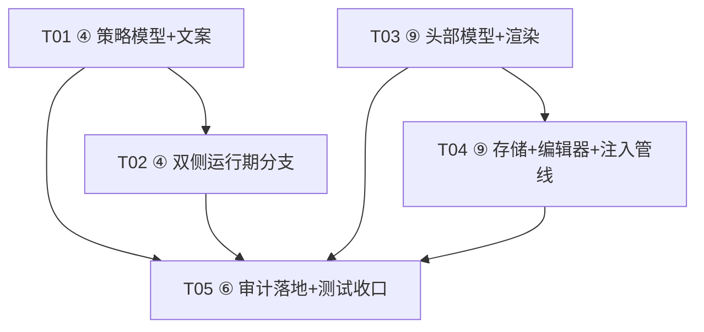
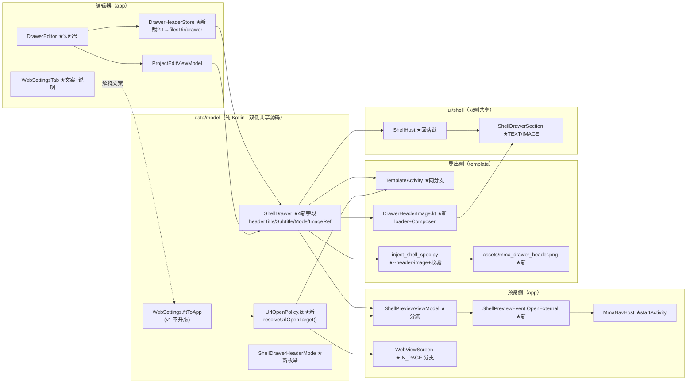

# W2 三项需求设计（④ 打开方式 / ⑥ manifest 审计 / ⑨ 抽屉头部自定义）

> 架构师：Bob（高见远） · 输入：W1 交付现状 + 主理人需求单 · 性质：**设计文档，不改动任何业务代码**
> 硬约束（自 W1 继承）：预览 == 导出（同一份 ShellSpec + 同一份 ShellHost）；序列化仅 kotlinx.serialization；新增字段带默认值不升 specVersion；设计令牌门禁 check_token_usage.py；轻量 APK 卖点（零新增依赖为默认取向）。

---

## Part A · 系统设计

### A1. 需求 ④：应用内打开方式——补运行期分支 + 用户解释

#### 现状确认

- `WebSettings.fitToApp: Boolean`（data/model/WebSettings.kt:86）已入模型、已入编辑器 UI（WebSettingsTab.kt OPEN_MODE_* :188-190、OPEN_MODE_OPTIONS :206-209），**运行期零消费**——`InAppWebViewClient` 恒内嵌、`TemplateActivity.handleAction` 与 `ShellPreviewViewModel.applyAction` 对 `NavigateUrl` 恒加载进内容区。
- WebView 侧已有"外跳"先例：`handleExternal` 对 `intent://` 交系统解析外跳（WebViewScreen.kt :341-365）。

#### 1) 依赖决策（推荐：Intent.ACTION_VIEW，零依赖）

| 方案 | 体积 | 能力 | 结论 |
|---|---|---|---|
| androidx.browser:browser（真 Custom Tabs） | dex 增量约 0.15–0.25 MB（压缩后，随版本浮动），方法数 +1~2k | 主题化工具栏（可着 themeColor）、页面预热、返回键回应用 | ❌ 与「轻量 APK」卖点冲突 |
| **Intent.ACTION_VIEW 系统浏览器** | **0 字节** | 完整系统浏览器能力；无主题工具栏、离开应用上下文 | ✅ **推荐** |

理由：
1. "外链"的语义本来就是"跳出应用去完整浏览器"，ACTION_VIEW 恰好是该语义的最小实现；Custom Tabs 的收益（主题工具栏/预热）服务于"不离开应用"的体验，与开关语义部分相悖。
2. 导出壳 minSdk 24 全部具备 ACTION_VIEW 能力，零 proguard/依赖维护成本。
3. 项目已有同语义先例（`intent://` 外跳、`ShellNativeAction.OPEN_IN_BROWSER` 登记），行为连续。

**连锁小修（不改存储语义、不升版）**：编辑器文案 `OPEN_MODE_CUSTOM_TABS = "Custom Tabs 外链"` 更正为 `"外部浏览器打开"`（fitToApp 布尔语义 true=内嵌 / false=外链 不变）。

#### 2) 外链触发语义（推荐规则，待主理人拍板 §C-2）

把壳里的 URL 按角色分两类，规则可一句话向用户解释：**"壳的骨架留在应用内，内容跳转交给外部浏览器"**。

| URL 来源 | fitToApp=true（默认，现状不变） | fitToApp=false |
|---|---|---|
| 项目入口（entry 首屏） | 内嵌 | **内嵌**（跳出即应用空白，壳不成立） |
| 顶栏 tab / 底栏条目（导航骨架） | 内嵌 | **内嵌**（切 tab 就跳出会让 pager、选中态、回入口全部失效） |
| 顶栏动作按钮 `NavigateUrl` | 内嵌 | **外链** |
| 抽屉菜单项 `NavigateUrl` | 内嵌 | **外链** |
| WebView 页内主帧 http/https 链接点击 | 内嵌 | **外链** |
| `OpenLocalPage` 本地页面 | 内嵌 | **恒内嵌**（本地页面无 URL，类型隔离铁律，无"外开"可言） |
| `intent://` / tel / mailto 等外部协议 | 外跳/提示（现状） | 维持现状 |

落成**纯 Kotlin 判定函数（唯一事实源）**，预览与导出双侧调用同一函数，对称性由代码结构保证而非约定：

```kotlin
// 新文件 data/model/UrlOpenPolicy.kt（纯 Kotlin，零 android.*，可 JVM 单测）
enum class UrlOpenOrigin { ENTRY, TOP_TAB, BOTTOM_TAB, ACTION, DRAWER_ITEM, IN_PAGE_LINK }
enum class UrlOpenTarget { EMBEDDED, EXTERNAL }

fun resolveUrlOpenTarget(settings: WebSettings, origin: UrlOpenOrigin): UrlOpenTarget
// 规则即上表；EX EMBEDDED 为默认，EXTERNAL 仅 origin ∈ {ACTION, DRAWER_ITEM, IN_PAGE_LINK} 且 !fitToApp
```

#### 3) 用户解释文案（中文，WebSettingsTab 呈现）

在分段控件下方补一张说明区（两行 `Text`，用 onSurfaceVariant；`MmaSegmentedChoice` 不带 description，不为其扩 API）：

- **WebView 内嵌**：不离开应用即可浏览；能加载项目内的本地页面；配合顶栏/底栏/抽屉，浏览过程不被跳转打断。适合"以自己的网页/站点为主体"的项目。
- **外部浏览器打开**：交给系统浏览器，多标签、书签、密码填充、复杂登录态完整可用，也不占用应用内存。适合登录、支付流程复杂或重型外部页面。

#### 4) 预览 / 导出双侧对称落点

| 层 | 预览侧（app） | 导出侧（template） | 对称保证 |
|---|---|---|---|
| 判定 | `resolveUrlOpenTarget`（共享） | 同一函数（sourceSets 共享 data/model） | 同一物理文件 |
| 页内链接 | `WebViewScreen.InAppWebViewClient` 读 config（view tag，与 TAG_SSL_KEY 同模式） | 同一文件（sourceSets 共享 ui/screens/WebViewScreen.kt，模板 exclude 列表未剔它） | 同一物理文件 |
| 壳动作分流 | `ShellPreviewViewModel.applyAction`：origin=ACTION/DRAWER_ITEM 且 EXTERNAL → 发一次性事件 `ShellPreviewEvent.OpenExternal(url)`，由导航层 `startActivity` | `TemplateActivity.handleAction` 同分支 `context.startActivity`（抽屉/底栏条目回调补接 handleAction） | 双侧各自接线，判定同源 |
| 执行边缘 | 新文件 `ui/screens/ExternalUrlLauncher.kt`：`fun openExternal(context, url): Boolean`（ACTION_VIEW + try/catch，无浏览器时可回落 `onError` 提示，绝不崩） | 同一文件（**注意**：template 的 sourceSets 引入整个 ui/screens 目录、仅 exclude 指定 screen，新文件会被自动纳入；须保持零 ViewModel/主题依赖） | 同一物理文件 |

### A2. 需求 ⑥：manifest.json 配置审计（摸清 + 补缺口，不强改）

#### 1) 逐字段核对结论（ProjectWorkspaceStore.kt:42-60 vs Project/ProjectEntity）

| Manifest 字段 | 对应 Project 域字段 | 结论 |
|---|---|---|
| projectId / projectType / apkName / packageName / versionScheme / versionName / versionCode | 同名 | ✅ 全镜像 |
| iconRef | iconRef | ✅ 镜像（**注意**：存的是 filesDir 绝对路径快照，跨设备不可移植；assets/icon.png 副本可弥补） |
| themeColor | themeColor | ✅ |
| entry | entry | ✅ 镜像——但见关键发现 ① |
| webSettings | webSettings | ✅ **全量**序列化 |
| shellSpec | shellSpec | ✅ **全量**序列化 |
| isolationId / createdAt / updatedAt / syncedAt | 同名 / 镜像自身时间 | ✅ |

**域字段无一漏镜像。**

**关键发现 ①（与既有认知不符，需勘误）**：`Manifest.entry: ProjectEntry` 对 HTML 项目序列化时，`BundledHtml.html` 与 `files[].content` **全文内联进 manifest.json**——与"manifest 没有内联项目代码（HTML 镜像到 src/）"的说法**不符**。实际形态：代码内容双份（manifest.entry + src/<入口文件>），这是 `writeWorkspace` KDoc"可独立还原"设计的代价，不是缺陷，但文档口径必须更正。

#### 2) 引用规范复核（"项目代码仅规范正式引用"）

- URL 项目：`entry.url` 写进 manifest = **合理配置**（引用而非代码）；
- Archive 项目：`assetRef` 路径引用 + src/asset.txt 说明 = 合理；
- HTML 项目：违反"仅引用"——内容全文内联（见发现 ①）。处置建议：**保持现状**（冗余换"独立还原"自愈完整性，磁盘成本对纯文本 HTML 可接受），登记为后续 Phase 候选（manifest 引用形态化需同步改还原语义，收益低风险高）。

#### 3) 接入口评估（不实施，给扩展点设计）

- 既有模式已被验证：manifest 加新配置节 = "新增带默认值字段 + writeWorkspace 赋值一行"，老 manifest 反序列化回落默认（`Json { ignoreUnknownKeys = true }`）。
- **扩展点建议**：新配置类型按 `settings.<节名>` 分组演进（如未来 `settings.user` / `settings.themePack`），identity/entry 保持顶层不动；`MmaDir.SETTING` 的用户向镜像统一挂 `SettingMirror.sync(context)`：从数据库导出 JSON → `MmaDir.SETTING`，挂 `MmaApplication` 启动 ensure 链之后（与 reconcileWorkspaces 同批），目录被删即启动重建——与现有语义完全一致。

#### 4) 审计结论清单

| 分类 | 内容 | 处置 |
|---|---|---|
| 已接入 | 身份/版本/主题色/图标/入口/webSettings 全量/shellSpec 全量/隔离 id/时间戳 | 无需动 |
| 事实勘误 | manifest **实际内联 HTML 全文**（含附加文件），"无内联"口径错误；iconRef 为绝对路径快照 | **本轮小修**：ProjectWorkspaceStore KDoc 勘误 + docs/ARCHITECTURE 目录树补注 |
| 未接入 | 用户设置、主题包、备份清单（Backup 目录同样空占位） | 后续 Phase（设置系统） |
| 设计建议 | manifest 新节按 `settings.<节名>` 分组；SettingMirror.sync 接口形态（上文）；iconRef 归一为文件名相对引用（涉及消费方，Phase 候选） | 本轮仅写进设计文档与 KDoc 扩展点注释 |

### A3. 需求 ⑨：抽屉头部自定义（标题/副标题可空）+ 顶部图片 Tab

#### 1) 模型改动（ShellSpec v1 兼容追加，**不升版**，VERSION_NOTES 登记）

```kotlin
// data/model/ShellSpec.kt 新增：
@Serializable
enum class ShellDrawerHeaderMode { TEXT, IMAGE }

// ShellDrawer 追加字段（全部带默认值 → 老数据反序列化回落、老壳读新 JSON 忽略）：
val headerTitle: String? = null,      // blank/null → 回落 topBar 标题链（现状行为）
val headerSubtitle: String? = null,   // blank/null → 回落现默认副标题（"原生抽屉 · 与导出壳同源"）
val headerMode: ShellDrawerHeaderMode = ShellDrawerHeaderMode.TEXT,   // 头部展示模式二选一
val headerImageRef: String? = null,   // 头图逻辑引用（见存储方案）
```

标题回落链（ShellHost 内收敛，双侧同源）：`drawer.headerTitle → topBar.titleOverride → 项目名(apkName) → "应用菜单"`——在最前插入 drawer.headerTitle，其余维持现状，零回归。

#### 2) 头图存储与引用方案（推荐方案 B，待拍板 §C-4）

参考上一轮 mma_pages 注入 assets 的先例与 iconRef 的"绝对路径 + 副本"先例：

- **app 侧存储**：新增 `storage/DrawerHeaderStore.kt`（仿 IconStore）：Photo Picker → **居中裁 2:1** → 标准化 1024×512 PNG → `filesDir/drawer/header-<uuid>.png`，**绝对路径**写入 `drawer.headerImageRef`（与 iconRef 同模式；拷贝即隔离，源图删除不影响）。
- **导出侧注入**：`inject_shell_spec.py` 新增 `--header-image <path>`：将同一张图写入 `template/src/main/assets/mma_drawer_header.png`（**固定名**：每次导出只服务一个项目，无命名冲突；assets 保留二进制、无 res/raw 文件名限制——与 mma_pages 同理由）。构建期硬校验：spec `headerMode=IMAGE` 且未提供 --header-image → 拒绝注入（与 local_page 缺 --project 同策略，把"导出后头图丢失"拦在构建期）。
- **壳侧解析**：共享解码器（新文件 `ui/shell/DrawerHeaderImage.kt`）：`DrawerHeaderImageLoader` 接收来源字符串——预览侧传文件路径（BitmapFactory.decodeFile，参考 ProjectIconDecoder），导出侧传 assets 固定名探测（`assets.open` 探存在后 decode）。**双侧判定对称**：`headerMode=IMAGE` 且图解析成功 → 图片头；否则**安全回落 TEXT 模式**（图被删/缺失绝不渲染空块）。
- **比例**：推荐 **2:1**（抽屉宽 240–400dp → 头图高 120–200dp，与 M3 drawer header 观感相称；16:9 在窄抽屉偏矮）。裁剪实现仿 IconComposer 新增纯函数 `DrawerHeaderComposer`（居中裁 2:1 + 缩放 1024×512，可 Robolectric 单测）。上传 UI 提示："建议横版图片，将自动居中裁剪为 2:1"。

#### 3) 头部「文字 / 图片」Tab 交互（编辑器现状已确认）

抽屉编辑器 = `ShellRegionEditors.DrawerEditor`（内容来源 / Web 菜单地址 / 菜单条目 / 宽度档位），**无任何 header 编辑区**。新增"抽屉头部"节：

- 标题输入（"留空用项目名"）、副标题输入（"留空用默认"）；
- 模式分段：`文字` / `图片`（`MmaSegmentedChoice`，同区既有控件）；
- 图片模式展开：上传入口（Photo Picker，复用 IconStore 的授权交互模式）、2:1 预览缩略图（`ContentScale.Crop`，参考 ProjectIcon）、比例提示、移除图片按钮；
- 接线：`ShellEditorTab → ProjectEditViewModel/ProjectEditUiState` 增 drawer header 字段透传与存储回调（改 spec 即写库，既有 update 链路自动镜像 manifest）。

#### 4) 渲染双侧对称（ShellDrawerSection / ShellHost 均为共享物理源码，一处改动两侧生效）

- `ShellHost`：headerTitle 回落链更新；向 `ShellDrawerSection` 透传 `headerSubtitle / headerMode / headerImageRef` 与 `headerImageLoader`。
- `ShellDrawerHeader` 改造：
  - TEXT 分支：标题（新回落链）+ 副标题（可空回落 `DRAWER_SUBTITLE`）；
  - IMAGE 分支：2:1 头图（`produceState` 异步解码 + 缺失回落 TEXT，`ContentScale.Crop`）；头图上**不再叠字**（避免对比度问题，token 门禁友好）。

#### 5) 序列化与注入脚本兼容

- 老数据（无新字段）→ 默认 TEXT + 现回落文案，行为与今天完全一致；
- 老壳读新 JSON → `ignoreUnknownKeys` 忽略；
- `inject_shell_spec.py` `validate_spec` 增：`drawer.headerMode ∈ {TEXT, IMAGE}` 白名单、`headerTitle/headerSubtitle/headerImageRef` 字符串或 null 校验；`test_inject_shell_spec.py` 同步补用例。

---

## Part B · 任务分解

### B1. Required Packages

**零新增第三方依赖**（本设计的一等原则）：④ 推荐 ACTION_VIEW（明确拒绝 androidx.browser）；⑨ 头图解码用 android.graphics（两侧均有）、注入复用现有 Python 脚本。`build.gradle.kts` / `libs.versions.toml` 无改动。

### B2. Task List（有序，≤5，按依赖排序）

> 本轮无基础设施任务（不引入依赖、不动配置）：T01/T03 为两个并行基座。

| Task ID | 任务名 | Source Files（:区域） | 依赖 | 优先级 |
|---|---|---|---|---|
| **T01** | ④ 打开策略模型 + 编辑器解释文案 | `data/model/UrlOpenPolicy.kt`（新：Origin/Target 枚举 + resolveUrlOpenTarget）；`data/model/WebSettings.kt`（fitToApp KDoc 更正：false=系统浏览器外链）；`ui/editor/WebSettingsTab.kt`（OPEN_MODE_CUSTOM_TABS 文案更正 + 分段下说明区两行文案） | 无 | P0 |
| **T02** | ④ 双侧运行期分支接线 | `ui/screens/ExternalUrlLauncher.kt`（新：ACTION_VIEW 执行边缘，零主题依赖，template sourceSets 自动纳入）；`ui/screens/WebViewScreen.kt`（InAppWebViewClient：fitToApp 经 tag 注入，IN_PAGE_LINK 分支）；`ui/viewmodel/ShellPreviewViewModel.kt` + `ShellPreviewUiState.kt`（applyAction 分流 + `ShellPreviewEvent.OpenExternal`）；`ui/navigation/MmaNavHost.kt`（事件消费 startActivity）；`template/src/main/java/com/make/apk/TemplateActivity.kt`（handleAction 同分支 + 抽屉/底栏条目回调补接） | T01 | P0 |
| **T03** | ⑨ 抽屉头部模型 + 双侧渲染 | `data/model/ShellSpec.kt`（ShellDrawerHeaderMode + ShellDrawer 4 新字段 + VERSION_NOTES 登记）；`ui/shell/ShellDrawerSection.kt`（ShellDrawerHeader TEXT/IMAGE 双分支 + 回落）；`ui/shell/ShellHost.kt`（标题回落链 + 新参数透传）；`ui/shell/DrawerHeaderImage.kt`（新：loader + DrawerHeaderComposer 2:1 裁剪） | 无 | P0 |
| **T04** | ⑨ 头图存储 + 编辑器 + 注入管线 | `storage/DrawerHeaderStore.kt`（新：Picker→裁 2:1→1024×512 PNG→filesDir/drawer）；`ui/editor/ShellRegionEditors.kt`（DrawerEditor 头部节：字段/分段/上传/预览/提示）；`ui/editor/ShellEditorTab.kt` + `ui/viewmodel/ProjectEditViewModel.kt` + `ProjectEditUiState.kt`（透传与回调）；`scripts/gitops/inject_shell_spec.py`（--header-image + validate_spec 新字段校验 + 构建期缺图拒绝） | T03 | P0 |
| **T05** | ⑥ 审计落地小修 + 全量测试收口 | `storage/ProjectWorkspaceStore.kt`（KDoc 勘误：HTML 全文内联事实 + iconRef 绝对路径口径）；`storage/SettingMirror.kt`（sync(context) 扩展点注释）；测试清单全项（见 B3）；`docs/ARCHITECTURE.md` §3.3 目录树补注 | T01–T04 | P1 |

依赖结构：T01、T03 并行基座 → T02/T04 各自收敛 → T05 收口。

### B3. 新增 / 受影响测试清单

| 需求 | 测试 | 类型 |
|---|---|---|
| ④ | `UrlOpenPolicyTest`（新）：6 origin × fitToApp × 本地页矩阵断言 | 纯 JVM |
| ④ | `WebSettingsContractTest`（补）：fitToApp 序列化往返与默认值兼容 | 纯 JVM |
| ④ | `WebViewScreenTest`（补）：fitToApp=false 页内 http/https 主帧外跳、OpenLocalPage/骨架仍内嵌 | Robolectric |
| ④ | `ShellPreviewScreenTest` / VM 交互测试（补）：onShellAction / onDrawerItemSelected 触发 OpenExternal 事件 | JVM |
| ④ | `ShellHostExportParityTest`（补）：预览/模板同分支冒烟 | JVM |
| ⑥ | manifest 序列化回归（现有对账测试覆盖，补断言 webSettings/shellSpec 全量在位） | JVM |
| ⑨ | `ShellSpecContractTest` / `ShellSpecContractExtraTest`（补）：新字段默认值往返、老 JSON 回落、VERSION_NOTES 登记 | 纯 JVM |
| ⑨ | `ShellDrawerHeaderRenderTest`（新，Paparazzi）：TEXT / IMAGE / 图缺失回落三态快照 | 纯 JVM |
| ⑨ | `ShellDrawerInteractionTest`（补）：header 字段透传；`DrawerEditor` UI 交互测试（新/补） | JVM |
| ⑨ | `DrawerHeaderComposerTest`（新，Robolectric）：2:1 居中裁剪 + 标准化尺寸 | Robolectric |
| ⑨ | `test_inject_shell_spec.py`（补）：headerMode 白名单校验、--header-image 注入、缺图拒绝 | Python |
| 回归 | `check_token_usage.py`（门禁）：头图渲染不得引入裸色值；`compare_preview_export.py` 既有对称校验 | CI |

### B4. 待主控（主理人）拍板事项

1. **④ 依赖选择**：推荐 `Intent.ACTION_VIEW`（理由见 A1-1）；确认后同步更正 UI 文案（"Custom Tabs 外链" → "外部浏览器打开"）。
2. **④ 触发语义**：A1-2 三层规则（骨架内嵌 / 动作+抽屉+页内链接外开）是否采纳；尤其两点：a) 底栏条目是否划入"骨架"内嵌（本设计划入）；b) fitToApp=false 时**页内链接是否全部外开**（本设计为是——这是与现状差异最大的一条）。
3. **⑥ manifest 内联事实**：HTML 全文内联进 manifest 与"无内联"认知不符——确认"保持现状（冗余换独立还原）+ 仅文档勘误"，还是立项"manifest 引用形态化"（建议后置 Phase）。
4. **⑨ 头图存储方案**：确认方案 B（filesDir 副本 + 绝对路径 ref + 导出注入 assets 固定名 `mma_drawer_header.png`）与 **2:1** 比例；备选是 16:9 或 spec 内 base64 内联（后者与 ⑥ 审计的"仅引用"原则冲突，已排除）。
5. **⑨ 默认副标题**：现文案"原生抽屉 · 与导出壳同源"是开发者向措辞，导出壳里对最终用户展示略怪——是否借 headerSubtitle 可空化之机换成用户向默认（如"菜单"）或支持留空隐藏（涉及观感变化，默认本设计为零回归：保留现文案作回落）。

### B5. Task Dependency Graph



### B6. W2 数据流 / 改动关系图



---

## Part C · 类图 / 时序图（摘录，另存 mermaid 文件）

见 `docs/class-diagram.mermaid` 与 `docs/sequence-diagram.mermaid`。
