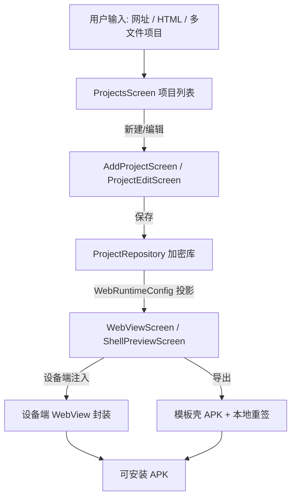
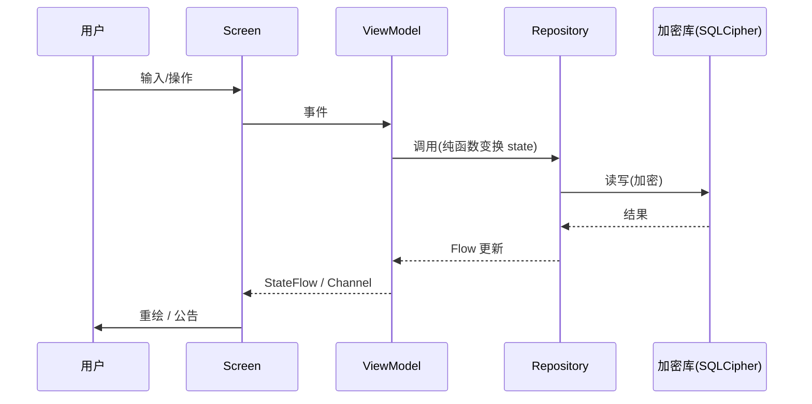
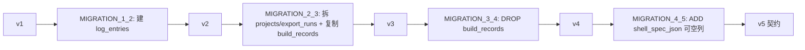

# Mini-MakeAPK（MMA）项目交付总览

> 本文档是对当前 Android 项目 Mini-MakeAPK（以下简称 MMA，包名 `com.make.apk`——一个把网页 / HTML 项目封装成独立安卓 App 的工具）**全部已有设计**的全量汇编，覆盖项目定位、设计语言、系统架构、数据层、日志与可观测性、代码与协作规范、构建 / 签名 / 发版体系、质量闸门与测试、版本历程、团队协作机制、已知问题与后续展望。
>
> 文档优先级与单一事实来源规则遵循 `docs/DOC_CHARTER.md`：`PROJECT_BRIEF.md` > `DESIGN_LANGUAGE.md` > `DOC_CHARTER.md` > 其他文档 > 源码。凡源码与文档冲突，以文档表述为主并注明显式例外。
>
> 汇编时间基准：版本 `0.0.0.1-rc12`，`versionCode = 15`（`app/build.gradle.kts`）。
>
> 全文为中文、GitHub 风格 Markdown、无 emoji，标题层级清晰，含 Mermaid 图与对比表，关键数字（版本号、指纹、令牌值、尺寸）与源码路径均尽量保留以佐证。

---

## 目录

1. 项目概览与定位
2. 设计语言宪法
3. 系统架构
4. 数据层
5. 日志与可观测性
6. 代码与协作规范
7. 构建 / 签名 / 发版体系
8. 质量闸门与测试
9. 版本历程（rc1 → rc11）
10. 团队协作机制
11. 已知问题与后续展望
12. 关键设计决策速查表（附录）

---

## 1. 项目概览与定位

### 1.1 应用身份

| 项 | 值 |
|---|---|
| 应用名 | Mini-MakeAPK（简称 MMA） |
| 包名 | `com.make.apk` |
| 定位 | 把网页 / 前端代码一键打包成可安装的安卓 APK |
| 形态 | 纯原生安卓 App（非跨平台壳），设备端封装为主 |
| 当前版本 | `0.0.0.1-rc12`（`versionName`），`versionCode = 15` |
| 安装包体积 | 约 25 MB（rc1 起已瘦身至此量级） |

### 1.2 技术栈基线

| 维度 | 选型 | 备注 |
|---|---|---|
| 语言 | Kotlin 1.9.24 | 全 Kotlin，无 Java |
| 构建 | Gradle 8.9（wrapper 提供） | `settings.gradle.kts` / `app/build.gradle.kts` / `gradle/libs.versions.toml` |
| 编译目标 | compileSdk / targetSdk = 34，minSdk = 24 | Android 14 为目标，Android 7.0 起可装 |
| UI | Jetpack Compose + Material 3（改造风） | 非原生 M3 默认视觉，令牌化改造 |
| 架构 | MVVM + 单向数据流、单一输入流、无 Hilt（手工 DI） | 进程级单例集中在 `MmaApplication` |
| 数据 | Room 2.6.1 + SQLCipher for Android 4.13.0 | 加密 SQLite，DB 当前 version = 4（含 v5 契约） |
| 可观测 | 自研 `MmaLogger`（零第三方） | 九大类别、结构化事件、全量化字段、强制脱敏 |
| 截图回归 | Paparazzi（纯 JVM，无模拟器） | 47 张基线（截至阶段 5，阶段 1 复核为 47） |
| 单测 | 344 用例全绿（截至阶段 5 复核基准） | 数据层逻辑 + UI 逻辑全覆盖 |

### 1.3 核心价值主张

- **设备端即时封装**：输入网址或 HTML 字符串，在设备端直接封装为可安装应用，构建历史本地加密保存，数据不出设备。
- **统一内核**：设备端 WebView 渲染与导出独立 APK 共用同一份 `WebRuntimeConfig` 数据契约，做到「预览即导出」。
- **可配置注入壳**：顶栏 / 顶栏 Tab / 底栏 / 侧边抽屉四区可独立开关、条目可增删改（`ShellSpec` 契约 + `ShellRenderer` 渲染）。
- **本地优先、零云端依赖**：当前成品构建路径全本地注入（资产注入模板壳 APK + 设备端 `apksigner` 重签），已废弃云端真构建路径。

### 1.4 当前落地状态（阶段 0-5）

依据 `PROJECT_BRIEF.md` §5-7，阶段 0-5 已落地并全绿：

- 阶段 0：WebViewScreen 设备端封装可用。
- 阶段 1：统一内核 `Project` / `WebRuntimeConfig` 数据模型与内核契约。
- 阶段 2：Room 加密库 v4 迁移、显式迁移链。
- 阶段 3：导航 `MmaRoute` / `MmaNavHost`、`ProjectListViewModel` 单一数据源。
- 阶段 4：添加页 `AddProjectScreen` 准星选择器、身份卡。
- 阶段 5：清理 legacy `build_records`、移除 `fallbackToDestructiveMigration()`、无障碍走查、DB v4 收口。
- 阶段 6 系列（rc5 起）：可配置注入壳 `ShellSpec` / `ShellRenderer`、全站控件自绘化、设计语言蓝化重构（rc6）、图标自定义、文件编辑器（rc11）。

---

## 2. 设计语言宪法

设计语言是项目的「宪法」，单一事实来源为 `DESIGN_LANGUAGE.md`，其 token 落地于 `docs/design/tokens/design-tokens.json`（28 类需求、43 组件条目全覆盖，版本 `2026.10.28-redesign`），最终编码进 `app/src/main/java/com/make/apk/ui/theme/*`。

### 2.1 三铁律

1. **中性 + 蓝点缀**：全界面以黑白灰中性为底，蓝（`#2563EB` 家族）为唯一点缀色，主色占比 < 15%。
2. **圆润利落**：圆角收敛为 6/12/16/20 + 胶囊（999），去掉「果冻感」。
3. **留白克制**：采用紧凑间距档（2025-09 全局收紧 -25%）。

### 2.2 色彩系统（OKLCH 感知均匀色板）

> 主色 `--primary` = `OKLCH(0.5461 0.2152 262.9)` = `#2563EB`（蓝 600）。

| 令牌 | 亮色 hex | 暗色 hex | 语义 |
|---|---|---|---|
| `--bg` | `#F6F7F9` | `#0E0F11` | 页面背景 |
| `--surface` | `#FFFFFF` | `#16181B` | 卡片 / 表面 |
| `--surface-2` | `#F0F1F3` | `#1E2125` | 次级表面 / 容器 |
| `--on-surface` | `#14171A` | `#F2F4F6` | 主文字 |
| `--on-surface-variant` | `#5B616E` | `#9BA1A8` | 次级文字 |
| `--outline` | `#E2E5E9` | `#2A2E33` | 边框 |
| `--outline-variant` | `#EDEFF2` | `#23272C` | 弱边框 |
| `--primary` | `#2563EB` | `#5B8DEF` | 蓝点缀主色 |
| `--on-primary` | `#FFFFFF` | `#0A1A33` | 主色上文字 |
| `--primary-container` | `#E6EFFF` | `#15315E` | 主色容器 |
| `--on-primary-container` | `#0B3FA8` | `#C7DBFF` | 容器上文字 |
| `--success` | `#16A34A` | `#22C55E` | 成功 |
| `--warning` | `#D97706` | `#F59E0B` | 警告 |
| `--error` | `#DC2626` | `#F87171` | 错误 |

蓝色刻度（双主题共用）：`blue-50 #EFF4FF` → `blue-900 #15346F`。`info` 语义色复用 `primary`（不另发明色相）。

完整蓝色刻度（`Color.kt:43-52`，OKLCH 见 `design-tokens.json`）：

| 刻度 | hex | OKLCH |
|---|---|---|
| blue-50 | `#EFF4FF` | oklch(0.9666 0.0157 266.3) |
| blue-100 | `#DBE6FF` | oklch(0.9243 0.0361 266.7) |
| blue-200 | `#BFD3FF` | oklch(0.8665 0.0651 265.8) |
| blue-300 | `#93B4FF` | oklch(0.7748 0.1139 265.6) |
| blue-400 | `#5B8DEF` | oklch(0.6545 0.1562 262.5) |
| blue-500 | `#3B6FE0` | oklch(0.5686 0.1814 263.2) |
| blue-600（主色） | `#2563EB` | oklch(0.5461 0.2152 262.9) |
| blue-700 | `#1D4FD0` | oklch(0.4827 0.2060 263.9) |
| blue-800 | `#1A41A8` | oklch(0.4186 0.1713 264.3) |
| blue-900 | `#15346F` | oklch(0.3392 0.1090 261.7) |

> **关键反模式防护**：`Color.kt` 显式锁死 `secondary` / `tertiary` / `errorContainer` 全部槽位，禁止回落 Material 3 默认色（M3 默认 `tertiaryContainer` 为粉 / 珊瑚系，与「黑白 + 蓝」冲突）。`secondary` 取中性灰，`tertiary` 取蓝家族（`Color.kt:58-90`）。

### 2.2.1 选择蓝 `#2563EB` 的理由（`ui-audit-20261028.md`）

- 现代、干净、专业：Blue-600 是主流工具 / 系统 UI（Material、iOS 系统蓝、Stripe、Linear 系）的高可信度色，传达「工具 / 效率」而非「可爱 / 消费」。
- 高对比、可读性强：白底 `#2563EB` 对比度 ≈ 4.6:1（AA 正文临界），白字按钮 ≥ 4.5:1 达 AA；暗色提亮为 `#5B8DEF` 对比更高。
- Android / Material 友好：直接映射 M3 `primary` 色槽，蓝色在系统导航 / 链接 / 选中态有强语义一致性（用户一眼懂「蓝 = 可点 / 选中」）。
- 克制：蓝仅作点缀（主色占比 < 15%），大面积仍是中性黑白灰，契合「黑白为主」。

### 2.2.2 风格方向对比（旧 → 新）

| 维度 | 旧（珊瑚粉可爱 iOS 风） | 新（蓝化工具风） |
|---|---|---|
| 主色 | 珊瑚粉 `#F19E97`（暖红粉） | 蓝 `#2563EB`（点缀 <15%） |
| 基调 | 暖中性 + 圆体 + 柔光 | 黑白中性 + 中性无衬线 + 干净阴影 |
| 圆角 | 大圆角 16/24 + 胶囊 | 收敛 6/12/16/20 + 胶囊 |
| 阴影 | 大模糊低透柔光 | 轻量 1-2 层低透（elevation-1/2） |
| 动效 | 弹簧回弹、慢节奏 | 收敛 150-300ms 微交互，去过度回弹 |

### 2.3 形状（圆角令牌）

| 令牌 | dp | M3 映射 |
|---|---|---|
| `radius-sm` | 6 | extraSmall |
| `radius-md` | 12 | small / medium（Card 默认） |
| `radius-lg` | 16 | large |
| `radius-xl` | 20 | 仅 bottomSheet 顶部（经门禁白名单） |
| `radius-pill` | 999 | extraLarge（胶囊按钮 / 底栏指示） |

`AppShapes`（`Theme.kt:23-29`）：`extraSmall=6`、`small=12`、`medium=12`、`large=16`、`extraLarge=999`。

### 2.4 间距（紧凑档，2025-09 收紧 -25%）

`SpacingScale` / `Spacing` 对象（`MmaDesign.kt`、`Spacing.kt`）：

| 令牌 | dp | 用途 |
|---|---|---|
| `space-1` | 3 | 图标与文字、行内元素 |
| `space-2` | 6 | 栅格基础单位 |
| `space-3` | 9 | 列表项内分组 |
| `space-4` | 12 | 卡片内边距、内容分组 |
| `space-5` | 18 | 页面级内边距 |
| `space-6` | 24 | 大分组间距 |
| `space-7` | 36 | 页面级大留白 |

门禁允许集 `SPACING_LADDER = {3,6,9,12,18,24,36}`（`check_token_usage.py:77`）。

### 2.5 字体（适中字阶，中性无衬线）

字族：Inter / Noto Sans SC（接入 `res/font`，回退系统无衬线，禁用默认 Roboto 主视觉）。字阶严格对齐 `design-tokens.json typography`：

| 令牌 | 字号 / 行高 / 字重 | 用途 |
|---|---|---|
| display | 28 / 34 / 600 | 大标题 |
| headline | 22 / 28 / 600 | 中标题 |
| title | 18 / 24 / 600 | 小标题 |
| body-lg | 16 / 24 / 400 | 正文大 |
| body-md | 14 / 21 / 400 | 正文 |
| label | 13 / 18 / 500 | 标签 / 底部 tab |
| caption | 12 / 16 / 500 | 说明 |

### 2.6 动效

`Motion` 对象（`Motion.kt`）：spring `stiffness≈300, dampingRatio≈0.3`（轻微回弹）；按钮按压 `PressScaleTarget=0.96`；时长 `DurationFast=200` / `Standard=300` / `Enter=400` / `Breath=1100`；列表项依次浮现 `StaggerMs=40`。尊重系统「减少动效」设置。

### 2.7 阴影与表面材质

`ElevationScale`：`elevation-1=2dp`（轻抬，卡片/输入框）、`elevation-2=6dp`（中抬，弹窗/浮层）。`MaterialTier` 三档：`Flat`（纯色）/ `Elevated`（阴影抬升）/ `Translucent`（半透明磨砂，API 31+ 真模糊 Haze，以下降级半透明纯色）。`TranslucentSpec`：`alpha=0.88`、`blurRadius=20dp`、`noise=0.05`、`borderAlpha=0.12`。

### 2.8 组件注册表（Component Registry）

对应 `ui/components/MmaComponentRegistry.kt`。每类组件仅一套规范样式、一个注册槽位（Slot）。已登记（节选）：

| 类型 | 槽位 | 规范样式（令牌引用） |
|---|---|---|
| Dropdown | Field | `fieldClosed(12)/fieldOpen(16)` + `menuItemHeight(48)` + `menuItemIcon(20)` |
| Dialog | Overlay | `dialog(28)` + `elevation2(6dp)` + `dialogMaxWidth(320)` |
| Switch | Toggle | `pill` + `switchTrackWidth(52)/Height(32)/Thumb(24)` |
| Choice | Toggle | `segmentPiece(12)` + `radioSize(20)/radioStroke(2)` |
| Chip | Action | `segmentPiece(12)` + `chipHeight(36)` |
| IconAction | Action | `segmentPiece(12)` + `iconButtonSize(40)` |
| Stepper | Field | `segmentPiece(12)` + `iconButtonSize(40)` |
| Tabs | Navigation | `tabIndicatorHeight(3)` |
| Screen | Surface | `MmaScreen` + `topBarHeight(52)/bottomBarHeight(56)` |
| TextButton | Button | `buttonHeight(40)` + `labelLarge` |

控制尺度令牌 `ControlScale`（`MmaDesign.kt`）与控件形状 `ControlShapes`（`ControlShapes.kt`）承载自绘控件几何（菜单项高 48、开关轨 52×32、滑块 24、胶囊高 36、弹窗最大宽 320、底栏 56、顶栏 52 等），**几何进令牌而非白名单**，门禁零白名单扩张。

### 2.9 启动图标

黑白 + 蓝点缀，主体 108dp 画布占 61%，由 `scripts/design/build_launcher_icon.py` 生成（`docs/design/assets/app-icon/`）。主程序启动图标恢复 MiniMe-MMA 名称字标（rc9）。

### 2.10 设计语言演进（重要一致性注记）

`DESIGN_LANGUAGE.md` 与 `design-tokens.json` 已改为「蓝 `#2563EB` 点缀」；`ui/theme/Color.kt` 已落地蓝家族。但以下旧文档仍引用历史珊瑚粉 `OKLCH(0.78 0.10 25)` ≈ `#E39E97` / `#F19E97`：

- `PROJECT_BRIEF.md` §3（设计语言章节）
- `README.md`（功能描述）
- `docs/qa/sprint-1-checklist.md` §1（设计一致性）
- `docs/design/project-editor-design.md` §2.6（`themeColor` 默认旧值字段校验文案）

CHANGELOG rc6 记录「界面改为黑白为主、蓝色点缀」，说明蓝化重构于 rc6 落地，上列为历史残留。项目铁律要求色彩重构审计须覆盖「令牌定义层 + UI 消费层 + 数据默认值层 + 测试固定值层」四层（`ui-audit-20261028.md` §5），旧文档残留不反映实际运行时配色。

---

## 3. 系统架构

### 3.1 总体架构图



### 3.2 模块划分

| 模块 | 职责 |
|---|---|
| `ui/screens` | 页面（Projects/Add/Edit/Preview/Profile/Log/FileEditor/ShellPreview） |
| `ui/editor` | 项目编辑表单与进阶配置（壳编辑器、校验器） |
| `ui/shell` | `ShellHost` / 四区渲染 / `ShellRenderer`（L3） |
| `ui/components` | 自绘组件 + 组件注册表 |
| `ui/theme` | 令牌定义处（Color/MmaDesign/Motion/Spacing/ControlShapes/Theme） |
| `ui/navigation` | `MmaRoute` / `MmaNavHost` / `MmaTabs` |
| `data/model` | 领域模型（零 Room 注解、零 `android.*`） |
| `data/local` | 实体（唯一带 Room 注解处）/ DAO / 迁移 / 工厂 |
| `data/mapper` | 实体 ↔ 领域映射 |
| `data/repository` | 数据出口 |
| `data/security` | SQLCipher 口令生成与存储 |
| `logging` | `MmaLogger` 自研日志门面 |
| `storage` | `MmaDir` / `MmaStorage` / 外部目录管理 |

### 3.3 关键架构决策（ADR 摘要）

依据 `docs/ARCHITECTURE.md` §3：

1. **设备端 WebView 封装**为默认路径（即时预览与轻量出包）。
2. **云端真构建已废弃**（原 `BuildEngine.CLOUD`），全本地注入（设备端 WebView + 资产注入模板壳 + 本地重签）。
3. **Material 3 改造风**：中性 + 蓝点缀，非原生 M3 默认。
4. **令牌单一来源**：DESIGN_LANGUAGE → `ui/theme` → `MaterialTheme`，门禁扫描 `ui/`（排除 theme/）。
5. **Room + SQLCipher 直连**：经 `androidx.sqlite` 通路，不使用 WCDB（旧包 `android.arch` 不兼容）。
6. **令牌门禁 CI 化**：`check_token_usage.py --strict` 出成品前必过。
7. **无 Hilt**：手工 DI，进程级单例集中 `MmaApplication`，避免 MVP 阶段引入 KAPT/KSP 开销。

### 3.4 页面骨架与导航

- `MmaRoute`（`ui/navigation/MmaRoute.kt`）：路由声明，参数键 `ARG_PROJECT_ID` 稳定。
- `MmaNavHost`：`composable` 注册，无状态 Screen 由 VM 供数。
- `MmaScreen` 三段式槽位（顶栏 / 内容 / 底栏），Screen 不 new ViewModel、不持业务态。
- **单一数据源 + 加密库**：`ProjectRepository` 为项目真源；导出终态守卫确保保存后才可导出。
- **导航 ViewModel**：`ProjectListViewModel` 管理列表与选中。

### 3.5 权限三层策略

依据 `ARCHITECTURE.md` §3.2：`ui/permission/*`（`MmaPermissionSpec` / `MmaPermissionState` / `PermissionStatus` / `MmaPermissionDialog`）实现权限请求两段式——先说明后请求，拒绝后引导设置。

### 3.6 存储初始化与 MMAFile

`MmaStorage` 五子目录（apk / log / project / setting / backup），API 分级与降级路径（`ARCHITECTURE.md` §3.3）：

- 已授权 → `MMAFile/Log` 等外部目录；
- 未授权 / 不可写 / 决策异常 → 私有兜底目录（`getExternalFilesDir` / 应用私有），卸载即清理，不阻断功能。

目录自愈：用户删除外部目录后，下次启动经 `MmaStorage.ensureAll()` 重建；项目 Items / 日志文件缺则回灌（`MmaApplication.restoreExternalMirrors`）。

### 3.7 令牌层（MmaDesign + LocalMmaDesign + Haze 磨砂）

`MmaDesign` 为令牌聚合体（`MmaDesign.kt:246`），`LocalMmaDesign` 为 `CompositionLocalProvider` 覆盖点。`MmaTheme`（`Theme.kt:113`）装配颜色/形状/字体 + `LocalMmaDesign`。Phase-2 自定义主题只需替换 `MmaDesign` 实例，业务代码写法不变（零迁移）。Haze 版本红线 0.7.3（`ARCHITECTURE.md` §3.4）。

`MmaDesign` 字段清单（`MmaDesign.kt:246-255`）：

| 字段 | 类型 | 默认值 | 用途 |
|---|---|---|---|
| spacing | SpacingScale | 紧凑档 3/6/9/12/18/24/36 | 间距阶梯 |
| alpha | AlphaScale | a1..a7（0.04..1.0） | 透明度阶梯（预留 Phase-2） |
| elevation | ElevationScale | 2dp / 6dp | 阴影抬升 |
| chrome | ChromeScale | 顶栏 52 / 底栏 56 | 顶底栏尺寸 |
| control | ControlScale | 菜单项 48 / 开关 52×32 / 胶囊 36 等 | 自绘控件几何 |
| defaultMaterial | MaterialTier | Flat | 默认材质档 |
| translucent | TranslucentSpec | alpha 0.88 / blur 20dp | 磨砂参数 |
| scaffold | ScaffoldStyle | 实色顶/底栏 | 骨架样式（预留） |

### 3.8 存储 API 分级与降级路径

`MmaStorage` 五子目录（apk / log / project / setting / backup），依据「已授权 / 未授权 / 决策异常」三态分级（`ARCHITECTURE.md` §3.3）：

| 状态 | 目录 | 行为 |
|---|---|---|
| 已授权 | `MMAFile/{apk,log,project,setting,backup}` 外部目录 | 完整能力，文件管理器可见 |
| 未授权 | 应用私有目录（`getExternalFilesDir` / 私有 fallback） | 功能不降级，卸载即清理 |
| 决策异常 | 同上私有兜底 | 启动链防御：目录决策不得杀进程 |

目录自愈：`MmaApplication.initStorageIfAuthorized()` 仅已授权时 `ensureAll()`（幂等）；`restoreExternalMirrors()` 在数据库就绪后执行——项目 Items 缺失则从库重建（`ProjectRepository.reconcileWorkspaces()`），日志目录缺失则从加密库回灌近 3 天（`restored-*.log`）。

### 3.8 数据流时序图



单向数据流：状态提升，Screen 无状态（数据进、事件出）；事件 `Channel(BUFFERED)` + `receiveAsFlow`，状态 `StateFlow`，UI 用 `collectAsStateWithLifecycle`。

---

## 4. 数据层

依据 `docs/data-layer.md` 与 `data/local/*`、`data/model/*` 源码。

### 4.1 选型

| 维度 | 选择 | 理由 |
|---|---|---|
| ORM | Room 2.6.1 | 编译期 schema 校验、迁移强约束 |
| 加密 | SQLCipher for Android 4.13.0 | 经 `androidx.sqlite` 直连；WCDB 因 `android.arch` 旧包否决 |
| 序列化 | kotlinx-serialization-json（全局唯一 `RuntimeJson`，`ignoreUnknownKeys=true`） | 预览与导出共用同一序列化器 |

### 4.2 版本上限两道约束（关键数字）

- **4.14+**：传递 `androidx.sqlite 2.6.x` 由 Kotlin 2.1 编译，与本项目 Kotlin 1.9.24 不兼容。
- **4.18+**：`minCompileSdk ≥ 37 > 34`，不可用。

故锁定 **4.13.0**（`app/build.gradle.kts`）。

### 4.3 依赖版本矩阵（节选）

| 库 | 版本 |
|---|---|
| Room | 2.6.1 |
| SQLCipher for Android | 4.13.0（排除 `kotlin-stdlib` 冲突） |
| security-crypto | 1.0.0（`MasterKeys` 复数，Android Keystore） |
| Compose BOM | 2024.09.00 |
| kotlinx-serialization-json | 随 Kotlin 1.9.24 |

`configurations.all` 强制 `kotlin-stdlib` 1.9.24。

### 4.4 分层结构

`model`（领域，零 Room）/ `local`（实体 + DAO + 工厂 + 迁移）/ `mapper` / `repository` / `security`（口令）/ `classifier`（ArchiveClassifier 嗅探）/ `json`（RuntimeJson）/ `strategy`（ProjectTypeStrategy）。legacy `build_records` 已退役（v4 删表）。

### 4.5 表结构

| 表 | 关键列 | 索引策略 |
|---|---|---|
| `projects` | id, createdAt, updatedAt, projectType, apkName, packageName(UNIQUE 应用层拦截), versionScheme, versionName, versionCode, iconRef, themeColor, entry_json, webSettings_json, isolationId, shell_spec_json | `index_projects_createdAt`、`index_projects_packageName` |
| `export_runs` | id, projectId(FK), createdAt, updatedAt, status, outputApkPath, apkSizeBytes, durationMs, errorMessage | `index_export_runs_projectId_createdAt`、`index_export_runs_status_createdAt` |
| `log_entries` | id, timestampMs, level, category, event, message, fieldsJson, stackTrace, traceId, sessionId, sequence, threadName, durationMs, success | `index_log_entries_timestampMs`、`index_log_entries_category_timestampMs`、`index_log_entries_event` |

不建 UNIQUE 约束，同包名拦截在应用层（`DuplicatePackageNameException`）。

### 4.6 加密方案

- `SecureRandom` 生成 32 字节口令 → Base64。
- 经 `EncryptedSharedPreferences`（`security-crypto`）存储。
- Keystore AES-256-GCM 保护（Android Keystore，`MasterKeys` 复数）。
- `SqlCipherInitializer.initOnce()` 在 `attachBaseContext` 最早显式 `System.loadLibrary("sqlcipher")`（rc6 事故修复，见第 11 章）。

### 4.7 高性能实践

WAL 模式、`synchronous=NORMAL`、覆盖索引、Paging3、Flow、惰性打开（`MmaApplication.database` 用 `by lazy`，首次访问才解密建连，不拖冷启动）。

### 4.8 迁移策略

当前 DB `version = 4`，显式迁移链 `MIGRATION_1_2 → 2_3 → 3_4`（已移除 `fallbackToDestructiveMigration()`），v5 契约已就绪（`MIGRATION_4_5`：新增可空 `shell_spec_json` 列）。三重校验：手写 SQL 与 `N.json` 逐字比对 + Room 运行期 `onValidateSchema` + 迁移测试。



### 4.9 统一内核契约（L1 / L2 / L3）

- **L1 `WebRuntimeConfig`**（`data/model/WebRuntimeConfig.kt`）：内容怎么跑（入口 / webSettings / 主题色 / 图标 / 版本）。可 JSON 序列化，本地与导出共用。
- **L2 `ShellSpec`**（`data/model/ShellSpec.kt`）：壳长什么样（四区开关 + 条目 + 主题覆写 + 尺寸/行为）。纯 Kotlin 零 `android.*`，`specVersion=1`，`ShellAction` 密封接口 + `ShellActionSurrogate` 容错序列化器（未知动作降级 `Unknown` 不崩）。默认 `ShellSpec.DEFAULT`（四区全关 = 裸 WebView，零回归）。
- **L3 `ShellRenderer`**（`ui/shell/`）：把 `ShellSpec` 渲染为原生 UI。一致性公式：**预览 == 导出 ⟺ 同一份 ShellSpec 数据 + 同一份 ShellRenderer 代码**。

一致性铁律（`shell-spec-design.md` §5.1）：
1. 渲染代码只有一份（任何「预览专用 UI」都是 bug）；
2. 渲染层不得依赖宿主业务（只吃 `ShellSpec` + `WebRuntimeConfig` + `ShellRenderEnv`）；
3. 数据只有一份（`ShellSpec` 是唯一真值）。

> **不变量**：`ShellSpec` 任何字段不得被运行时状态污染（选中态 / 抽屉开合 / 滚动位置不入 spec，运行期由渲染器持有）。

### 4.10 Project 模型字段与 ShellSpec 四区结构

`Project`（`data/model/Project.kt`）稳定定义字段：

| 字段 | 类型 | 约束 |
|---|---|---|
| id | Long | 0 表示未落库 |
| projectType | ProjectType | 保存后锁死（URL/HTML/VUE/PHP） |
| apkName | String | 显示名（android:label） |
| packageName | String | 全局唯一，同包名强制拦截（`DuplicatePackageNameException`） |
| versionScheme / versionName / versionCode | 二/三段式 / String / Int | 独立于 MMA 自身四段式 |
| iconRef | String? | null 时用默认占位（themeColor 底 + 首字母） |
| themeColor | Int (ARGB) | 默认 `0xFF2563EB`（蓝，非旧珊瑚粉） |
| entry | ProjectEntry | 保存后锁死（Url/BundledHtml/Archive/…） |
| webSettings | WebSettings | 本地与导出共用 |
| shellSpec | ShellSpec | 默认 `DEFAULT`（四区全关 = 裸 WebView，零回归） |
| isolationId | String | 本地多实例隔离目录：新建 `MakeApk_<yyyyMMdd_HHmmss>_item<id>`（W3 ⑬），存量 `webapp_<id>` 不迁移 |

`ShellSpec` 四区结构（`ShellSpec.kt`）：

| 区 | 类 | 开关字段 | 条目 |
|---|---|---|---|
| 主题覆写 | `ShellTheme` | `useProjectThemeColor`（默认 true 跟随 L1） | — |
| 顶栏 | `ShellTopBar` | `enabled` | `actions: List<ShellMenuItem>`（独立建模，与 tab 区分） |
| 顶栏 Tab | `ShellTopTabs` | `enabled` | `items`，`swipeEnabled`（tab 兼 pager 指示器），选中态恒开 |
| 底栏 | `ShellBottomBar` | `enabled` | `items`，`maxItems=5`（M3 惯例） |
| 侧边栏 | `ShellDrawer` | `enabled` | `items`，`contentSource`（NATIVE/WEB 占位），`width` 档位 |

`ShellMenuItem`：`id`（稳定短码，不可用下标）/ `title` / `iconRef`（逻辑键）/ `action`（`ShellAction`）/ `visible` / `selected` / `isEntry`。不变量：运行时状态不回写 spec。

### 4.11 测试

344 用例全绿（阶段 5 复核基准），47 张 Paparazzi 快照零漂移（`assembleDebug` 通过）。`assembleDebug` 为各阶段验收硬指标。

---

## 5. 日志与可观测性

依据 `docs/logging.md` 与 `logging/*` 源码。自研 `MmaLogger`，零第三方依赖。

### 5.1 九大类别与保留期

| 类别 | 级别 | 保留期 | 说明 |
|---|---|---|---|
| CRASH | FATAL | 90 天 | 崩溃 / ANR |
| ERROR | ERROR | 90 天 | 已捕获失败 |
| OPERATION | INFO | 180 天 | 用户操作 / 审计（合规最长，不限流） |
| STARTUP | INFO | — | 冷/温/热启动 + 阶段耗时 |
| PERFORMANCE | INFO | 30 天 | 必须带 `duration_ms` |
| NETWORK | INFO/WARN | 30 天 | 只记端点路径 / 状态码 / 耗时 / 重试，不记 body 与完整 URL |
| LIFECYCLE | DEBUG | 不落盘 | 前后台切换 |
| TRACE | DEBUG | — | 调试 |
| SECURITY | WARN | 1095 天（3 年） | 口令生成、加解密异常、日志导出（合规，不限流） |

分级展示：`LogGroup` / `LogLevel` / `LogCategory`。

### 5.2 架构

- `MmaLogger`：门面，构造结构化事件 → 强制脱敏 → 分发给 Sink。
- `LogConfig`：按构建类型差异化（debug 开 Logcat 且降到 DEBUG；release 仅 INFO 以上、不开 Logcat）。关键参数：`minLevel`（默认 INFO）、`logcatMinLevel`、`fileDirectory` / `fileMinLevel`、`maxFileSizeBytes`（2MB）、`maxFiles`（5）、`enableCrashHandler`、`enableAnrWatchdog`、`anrTimeoutMs`、`rateLimitMaxPerWindow`（30）/ `rateLimitWindowMs`（60s）。
- `Sanitizer`：脱敏门面层强制实施（见 5.4）。
- `TraceContext` / `RateLimiter`：traceId、限流（崩溃 / 安全不受限流）。
- `AsyncLogDispatcher`：异步分发，三原则——调用线程不碰磁盘、队列有界、崩溃安全不受限流。
- `JsonLite`：轻量 JSON（零第三方）。
- `StartupTracer`：启动监控（冷/温/热 + 阶段耗时），终点由 `MainActivity.reportFullyDrawn()` 触发。
- Sink：`DatabaseSink`（加密库，启动缓冲回灌）、`FileSink`（轮转文件，2MB×5）、`LogcatSink`，三原则如上；`redirectFileSink` 支持授权后从私有目录迁移到 `MMAFile/Log`。

### 5.3 结构化事件全量化

`LogFields`（`LogFields.kt`）约定词表：`duration_ms`、`success`、`attempt`、`size_bytes`、`count`、`endpoint`、`status_code`、`error_code`、`reason`、`start_type`、`phase`、`sample_rate`，以及设备/应用上下文（`app_version`、`app_version_code`、`build_type`、`device_model` 等，无 PII）。`duration_ms` 与 `success` 提升为数据库独立列便于 SQL 聚合。

### 5.4 脱敏红线（门面层强制）

`Sanitizer`（`Sanitizer.kt`）规则：

- 敏感键（token/password/secret/authorization/cookie/otp/pin/…）值整体掩码 `***`。
- PII 键（phone/email/id_card/imei/mac/…）值整体掩码。
- 完整 URL 只保留「协议 + 域名」+ 掩码占位。
- 邮箱、9 位以上连续数字就地掩码。
- 超长值截断（≤512 字符，栈 ≤60 行）。
- **哈希不等于匿名化**：一律用不透明临时 `traceId`（`SecureRandom` 8 字节 → 16 位十六进制），不跨日志关联用户。

### 5.5 四大 Sink 与崩溃 / ANR 捕获

- 自研崩溃 / ANR 捕获，`attachBaseContext` 最早安装（`MmaApplication`：`SqlCipherInitializer.initOnce()` → `StartupTracer.begin()` → `installLogging()`）。
- ANR 主线程看门狗（`AnrWatchdog`，默认超时 `DEFAULT_TIMEOUT_MS`）。
- `crash()` / `anr()` 写完后 `flushBlocking()` 尽力同步刷盘（进程即将终止）。
- 文件出口可迁移（`redirectFileSink`）：摘除旧 sink → drain → 合并 → 装新 sink，顺序保证不丢日志。

### 5.6 合规

保留期合规参照 PIPL 与 GB/T 45574-2025（`logging.md` §9）。

---

## 6. 代码与协作规范

依据 `docs/CODE_STYLE.md`、`docs/AGENT_COLLABORATION.md`、`docs/DOC_CHARTER.md`。

### 6.1 包结构与命名

- 包结构按职责分层（见 3.2）。
- Kotlin 约定：`val` 优先；单文件职责审计（rc9 起替代 300 行硬红线——`ShellEditorTab.kt` 曾 771 行被拆为三文件）。

### 6.2 Compose 约定

- 状态提升；Screen 不 new ViewModel、不持业务态。
- 权限请求两段式（`ui/permission`）。
- 无状态 Screen 便于 Paparazzi 直喂 state 出图。

### 6.3 设计令牌使用

- 唯一来源：`MmaDesign` / `MaterialTheme.colorScheme` / `Spacing.*`。
- 门禁 `check_token_usage.py --strict`：扫描 `ui/`（排除 theme/）裸写色值 / 圆角 / 非允许集 dp / 字号字面量即失败。
- 行内豁免 `// token-gate: allow <理由>`（须写理由）。
- 废弃色黑名单 `RETIRED_COLORS`（珊瑚粉系 `E39E97/F19E97/F2B8A2/9FD8C7/9DB8E8/C9A9E9`），全仓库 Kotlin 扫描，命中即失败，一次一除永不摘除；`// legacy-color <理由>` 仅迁移测试模拟历史数据可用，主源码禁用。

### 6.4 提交与变更日志

- Conventional Commits（`feat:`/`fix:`/`docs:`/`refactor:`/`test:`/`chore:`）。
- Keep a Changelog：`CHANGELOG.md` 条目 = 独立版本文档 = GitHub Release 正文（三处一致）。

### 6.5 Agent 协同写作（Docs-as-Code）

- 文档宪法优先级：`PROJECT_BRIEF > DESIGN_LANGUAGE > DOC_CHARTER > 其他`。
- 单一事实来源、相对链接、Mermaid。
- 状态标记（草案 / 生效 / 待裁决 / 已退役）。
- 交接即契约：Handoff Contract JSON 模板；结构化输出（Plan/Decision/Checklist/Status/Postmortem）；RACI（见第 10 章）；9 个本地 skill；失败恢复。
- 评审清单（CODE_STYLE §7）。

---

## 7. 构建 / 签名 / 发版体系

依据 `docs/VERSIONING.md`、`docs/RELEASE_NOTES.md`、`docs/DEPLOYMENT.md`、`.github/workflows/*`。

### 7.1 版本号规则（纯四段式）

- 格式 `MAJOR.MINOR.PATCH.BUILD[-rcN]`，**去 `+N` 后缀**。
- 当前 `versionName = "0.0.0.1-rc12"`，`versionCode = 15`。
- 默认顺延 BUILD 段，禁语义化跳段。
- 授权闸门 + RC 机制：**未授权可发 RC**（rcN 顺延）；**授权后去 `-rcN` 转正式版**。
- `versionCode` 内部单调递增，不参与 tag（tag 仅 `v<versionName>`）。

### 7.2 发版流程（tag 驱动）

```mermaid
flowchart LR
    A[推送 v* tag] --> B[validate-version: tag 与版本一致]
    B --> C[CHANGELOG 有条目校验]
    C --> D[versionCode 单调递增校验]
    D --> E[设计令牌门禁 --strict]
    E --> F[testDebugUnitTest + verifyPaparazziDebug]
    F --> G[签名 APK: 四 Secret 自检]
    G --> H[APK 证书指纹校验]
    H --> I[规范命名 MMA-v{版本}-{变体}.apk]
    I --> J[生成 Release 正文(取自 CHANGELOG)]
    J --> K[创建/更新 Release(prerelease 若含 -rcN)]
```

- 成品只在 GitHub 打 `v*` tag 时产出（`.github/workflows/release.yml`）。
- 本地只验证（`testDebugUnitTest` / `verifyPaparazziDebug`），不出成品（VERSIONING §5）。
- CHANGELOG 条目 = 独立文档 = Release 正文（三处一致，RELEASE_NOTES §1）。
- Release 标题概括表 `docs/Version Log/release-titles.md`（≤20 字、用户语言）。

### 7.3 命名规范

| 项 | 格式 |
|---|---|
| tag | `v{版本号}`，如 `v0.0.0.1-rc12` / `v0.0.0.1` |
| Release 标题 | `MMA {版本号} — {概括}`（概括 ≤20 字） |
| 变体 | `rcN` / `release` |
| APK 名 | `MMA-v{版本}-{变体}.apk` |

### 7.4 签名

- 环境变量四变量驱动：`MMA_KEYSTORE_FILE` / `MMA_KEYSTORE_PASSWORD` / `MMA_KEY_ALIAS` / `MMA_KEY_PASSWORD`（GitHub Secret 同名）。
- v1 + v2 + v3 全开（`app/build.gradle.kts` `signingConfigs`）。
- PKCS12 库 / 密钥口令须相同（坑）。
- 证书 DN：`CN=MMA, OU=Release, O=Mini-MakeAPK, C=CN`，RSA 4096，有效期至 2054-03-12，别名 `mma`。
- **官方证书 SHA-256 指纹硬校验**：`a7986a850e0c64b991aaa34587fd82975b0d3756e2685a85aada75ed71beb4e2`（`release.yml` 常量 `EXPECTED_SHA256`），不一致拒绝发布（防覆盖安装失败）。

### 7.5 CI 双工作流

- `verify.yml`：PR / push main 执行——令牌门禁 `--strict` + 单测 + Paparazzi + 预览 vs 导出像素对比（`compare_preview_export.py`）+ 壳契约校验（`inject_shell_spec.py --print`）。
- `release.yml`：tag 驱动，见 7.2。

### 7.6 设备端即时封装 / 云端（已废弃）

- 设备端：WebView 封装 + 资产注入模板壳 + 本地 `apksigner` 重签。
- 云端真构建（`build-api-contract.md`）：Phase 2 规格，当前仅契约文档，实现留待后续，架构已废弃 `BuildEngine.CLOUD`。

### 7.7 回滚与环境

- 回滚：新 tag 升 `versionCode` 重发；未授权 RC 可重打。
- 环境：本地验证 / GitHub 托管 runner（已带 Android SDK 34）。

---

## 8. 质量闸门与测试

### 8.1 三道并联 CI 闸门（`verify.yml`）

1. `testDebugUnitTest`（344 用例全绿基准）。
2. `verifyPaparazziDebug`（47 张基线零漂移）。
3. `check_token_usage.py --strict`（0 违规）。
4. 预览 vs 导出像素对比（`compare_preview_export.py`，均差 ≤ 2.0/255）。
5. 壳契约校验（`inject_shell_spec.py --print`）。

### 8.2 截图回归（Paparazzi）

- 纯 JVM，无需模拟器；已就绪配置：paparazzi 1.3.4、agp 8.5.2、kotlin 1.9.24、composeCompiler 1.5.14、bom 2024.09.00。
- 基线 47 张（阶段 5 复核；阶段 1 后曾为 37，阶段 5 升至 47）。
- 既有快照零漂移是硬指标；新增只增不改（唯一例外：进阶配置 UI 重写导致 `ProjectEditScreenTest_light_tab_advanced.png` 漂移，需主理人裁决，见 `shell-spec-design.md` §12.8）。

### 8.3 令牌门禁

`check_token_usage.py` 检查项：颜色字面量、圆角字面量、间距字面量（非允许集）、字号字面量、废弃色黑名单（全仓库）。允许集 `ALLOWED_DP = {3,6,9,12,18,24,36,0,1,2,16,20,24,32,36,40,48,52,56,64,72}`（间距阶梯 + 组件规范尺寸）。theme/ 包天然豁免（令牌定义处）。

### 8.4 无障碍（WCAG 2.2 AA）

`phase5-cleanup-design.md` §6 走查清单：触控目标 ≥ 48×48dp、对比度（正文 4.5:1 / 大字 3:1 / UI 3:1）、`contentDescription`、TalkBack 遍历顺序、动态状态 `Snackbar` / `LiveRegion` 公告、对比度工具复核。

### 8.5 数据库质量

- 显式迁移链 + `onValidateSchema` 强校验 + 与 `N.json` 逐字比对（`normalizeSql` 去 `IF NOT EXISTS`/空白）。
- 全链路升级测试：`1→2→3→4`、`2→3→4`、`3→4`、全新安装均成功打开且数据不丢。
- 脏 JSON 兜底为 `ShellSpec.DEFAULT` / 默认值，不崩。

### 8.6 发版格式校验

`check-release-format.py`：校验 Release 正文无占位符（TODO/TBD/XXX/待填/PLACEHOLDER）、无 emoji、与 CHANGELOG 一致（`RELEASE_NOTES.md` §8）。

---

## 9. 版本历程（rc1 → rc12）

### 9.1 版本总表

| 版本 | 概括（≤20 字） | 关键变更 | 备注 |
|---|---|---|---|
| rc1 | 应用上线与界面图标重绘 | 一键封装、本地预览、亮暗双主题、历史加密、矢量图标重绘、25MB 瘦身 | 2026-10-25 首发 |
| rc2 | 界面三栏目焕新与本地目录落地 | MMAFile 本地目录、统一骨架、底栏三栏目、项目工作台、我的页、日志实时、按压回弹 | — |
| rc3 | 修复启动闪退与运行更稳 | 修复部分设备启动闪退 | 2026-10-26，启动链防御 |
| rc4 | 首页改项目列表并修复闪退 | 首页改项目列表、修复首页闪退 | — |
| rc5 | 可配置外壳与实时预览上线 | 自定义应用外壳（四区）、实时预览、分页滑动、侧边抽屉、导出独立应用；移除旧构建流程 | 引入 ShellSpec 概念 |
| rc6 | 修复保存崩溃与视觉焕新 | 修复保存 100% 崩（SQLCipher 事故闭环）、视觉改为黑白为主蓝点缀、新图标 | 蓝化重构落地 |
| rc7 | 配置体验完善与交互修复 | 配置体验完善、交互修复 | — |
| rc8 | 进阶配置更好用与界面焕新 | 条目删除确认、显隐开关、上移下移、弹窗/下拉重绘、预览即真实配置 | — |
| rc9 | 本地目录自愈与日志分级上线 | 项目文件落地 MMA 文件夹、目录自动补全、运行日志页（问题/行为/诊断/安全四组）、图标形状预览、启动图标补名、保存提示气泡 | 344 单测、47 快照基准 |
| rc10 | 修复网页白屏与图标自定义 | 加载进度条、图标上传、白屏修复（放行混合内容）、代码可预览、失败有提示、形状预览移除 | — |
| rc11 | 文件目录树与自研编辑器上线 | 项目代码页改文件目录树、自研编辑器（行号 + 语法高亮）、多文件项目（css/js 附加）、下拉刷新、缓存选择卡、加载基座优化、壳编辑强化 | 历史版本 |
| rc12 | 目录更真实，刷新更顺手 | 修复打开文件偶发崩溃、内置浏览器加固（网页可打开）、选中色异常修复、项目代码页改为真实文件目录树、下拉刷新重写（自研替换官方 PullToRefreshBox） | 当前最新 |

> 注：无 rc2 单独日期标注；CHANGELOG 无 `[Unreleased]` 段，最新版为 rc12（`v0.0.0.1-rc12`，`versionCode=15`）。

### 9.2 演进主线

- **封装内核**：rc1 设备端封装 → rc5 可配置壳 → rc11 文件编辑器 / 多文件项目。
- **视觉**：rc1-rc5 珊瑚粉可爱风（历史）→ rc6 蓝化重构（黑白 + 蓝点缀）。
- **稳定**：rc3/rc4 启动闪退修复 → rc6 SQLCipher 事故闭环 → rc9 目录自愈 / 日志分级。
- **质量**：rc9 起 344 单测 + 47 快照零漂移成为常态基线。

---

## 10. 团队协作机制

依据 `docs/AGENT_COLLABORATION.md`、`docs/team/bug-handling-sop.md`、brainstorm。

### 10.1 多智能体团队与 RACI

角色（`PROJECT_BRIEF.md` §4 / brainstorm）：制作人（Kira）、产品设计师（Milo）、视觉总监（Nova）、安卓工程师（Sage/Remy）、QA（Ivy）等；架构师高见远（Gao）、主理人裁决方向。RACI 表定义谁负责 /  accountable / 咨询 / 知会。

### 10.2 交接契约（Handoff Contract）

「交接即契约」：每个任务交付结构化输出——Plan / Decision / Checklist / Status / Postmortem，附 JSON 模板，确保跨 Agent 上下文无丢失。

### 10.3 共享状态映射与本地 skill

- 共享状态映射：路由键、令牌、迁移版本等全局约定集中登记。
- 9 个本地 skill：文档写作、架构评审、UI 审计、组件登记、令牌门禁、迁移校验、截图回归、发版校验、事故复盘。

### 10.4 失败恢复

- 文档与代码分离（INDEX 与经验分离）；一问题一文档（`bug-handling-sop.md`：标准流程 8 步、10 节 + 附录经验结构）。
- 团队分工（bug-handling-sop）：主理人齐活林 / 产品经理许清楚 / 架构师高见远 / 工程师寇豆码 / QA 严过关。

### 10.5 概念决策史（brainstorm）

- 目标架构 = **Concept C（混合路径）**：设备端 WebView（A）+ 云端真构建（B）按输入类型路由。
- sprint-1 MVP = **Concept A（设备端 WebView 封装）+ Concept B 的 API 契约文档**。
- PHP/Vue 真构建 = Phase 2。
- 后架构调整：**云端真构建已废弃**，全本地注入（见 3.3 / 7.6）。

---

## 11. 已知问题与后续展望

### 11.1 P1 事故：SQLCipher UnsatisfiedLinkError（rc5 → rc6 闭环）

`docs/incidents/INC-20261028-sqlcipher-unsatisfiedlink.md`：

- **现象**：rc5 发布包项目保存 100% 崩溃，根因 `UnsatisfiedLinkError`——SQLCipher 4.13.0 不再自动 `loadLibs`，且 AGP 8 默认 `extractNativeLibs=false`（即 `useLegacyPackaging=false`），原生库未打包/未加载。
- **CI 假绿**：Robolectric 用 framework SQLite，不加载原生库，未能暴露问题。
- **修复（rc6 闭环）**：
  - `SqlCipherInitializer` 双入口（`System.loadLibrary("sqlcipher")`）。
  - `extractNativeLibs=true` + `useLegacyPackaging=true`（`app/build.gradle.kts`）。
  - `check_native_libs.py` 卡点（CI 校验原生库已打包）。
- **11 项行动项**，含 CI 必须真机/真原生库验证。核心行动项：
  1. `SqlCipherInitializer` 双入口显式 `System.loadLibrary("sqlcipher")`（早于任何 DB 访问）。
  2. `app/build.gradle.kts` 设 `useLegacyPackaging=true`（对应 `extractNativeLibs=true`）。
  3. 新增 `check_native_libs.py` CI 卡点，校验 `libsqlcipher.so` 已打进 APK。
  4. Robolectric 测试改为带原生库的验证路径，或补真机/模拟器验证档。
  5. 仓库 Secrets 自检（`MMA_KEYSTORE_*` 四项齐全，引用名逐字一致，防 rc2 别名误写 `MMA_KEYSTORE_ALIAS`）。
  6. 启动链防御：`resolveLogDirectory` / `isAuthorized` 异常一律兜底私有目录，绝不杀进程。
  7. 数据库打开置于后台线程，`attachDao` 后回灌启动期缓冲日志。
  8. 外部目录缺失自愈（项目 Items / 日志文件）。
  9. 证书 SHA-256 指纹硬校验纳入 release 流程。
  10. RC 机制与授权闸门分离（未授权发 RC，授权去 `-rcN`）。
  11. 文档同步：移除对 `BuildRecord` / `fallbackToDestructiveMigration` 的过期描述。

### 11.2 文档历史残留（珊瑚粉）

见 2.10：`PROJECT_BRIEF.md` §3、`README.md`、`sprint-1-checklist.md`、`project-editor-design.md` §2.6 仍引用旧珊瑚粉主色，实际运行时已蓝化。属文档未覆盖，不反映运行时。

### 11.3 已知不一致风险（ShellSpec 一致性）

`shell-spec-design.md` §5.4 列出 8 项「预览 == 导出」不可一致风险（R1-R8）：图标资源、字体、Android 版本、WebView 版本、状态栏沉浸、多实例内存回收时机、抽屉 Web 覆盖层、令牌/主题。验收标准定为「同设备同系统版本下预览 == 导出」；跨版本差异属系统行为不追责。

### 11.4 后续展望

- **Phase 2 云端真构建**：Vue/PHP 真构建、签名密钥服务端 KMS（`build-api-contract.md`，当前仅契约）。
- **`:shell-core` 模块化**：`ui/shell/` 搬独立 Gradle module（T09），导出侧直接依赖。
- **ShellAction.Native / InternalPage 执行**：当前按 `Unknown` 不可用处理（模型与枚举已登记）。
- **侧边栏 Web 覆盖层**：`ShellDrawerSource.WEB` 仅占位卡，待实现。
- **多 WebView 池精细内存优化**：当前基础版（退出销毁 + 上限告警），LRU 列入后续。
- **自定义主题（Phase-2）**：`MmaDesign` 覆盖点已就绪，零迁移。
- **Native 崩溃 / 云端上报**：`logging.md` §11 待补（Native 崩溃未实现、云端上报待 Phase 2、Instrumented 测试缺）。

---

## 12. 关键设计决策速查表（附录）

| # | 决策 | 依据 | 数字 / 关键值 |
|---|---|---|---|
| 1 | 全本地注入，废弃云端构建 | ARCHITECTURE ADR / 事故复盘 | 移除 `BuildEngine.CLOUD` |
| 2 | 蓝 `#2563EB` 点缀替代珊瑚粉 | ui-audit-20261028 | `--primary OKLCH(0.5461 0.2152 262.9)` |
| 3 | SQLCipher 4.13.0 上限两道约束 | data-layer | 4.14+ Kotlin 2.1 冲突 / 4.18+ minCompileSdk 37 |
| 4 | 移除 fallbackToDestructiveMigration | phase5-cleanup / PROJECT_BRIEF §7 | 显式链 1→2→3→4 + v5 契约 |
| 5 | 令牌门禁 CI 化 | CODE_STYLE / ARCHITECTURE | `check_token_usage.py --strict` 0 违规 |
| 6 | 纯四段式版本 + RC 机制 | VERSIONING | `0.0.0.1-rc12` / `versionCode=15` |
| 7 | 官方证书指纹硬校验 | DEPLOYMENT / release.yml | SHA-256 `a7986a85…71beb4e2` |
| 8 | 自研日志零第三方 + 九大类 | logging | 保留期 90/180/30/1095 天 |
| 9 | 脱敏门面层强制 | Sanitizer | 掩码 `***`、URL 仅协议+域名 |
| 10 | ShellSpec 一致性铁律 | shell-spec-design §5.1 | 预览==导出 ⟺ 同 ShellSpec + 同 ShellRenderer |
| 11 | 无 Hilt 手工 DI | ARCHITECTURE / MmaApplication | 单例集中 `MmaApplication` |
| 12 | 紧凑间距档 -25% | DESIGN_LANGUAGE §4 | 3/6/9/12/18/24/36 |
| 13 | 顶/底栏令牌化瘦身 | ui-audit 需求 1 | 顶栏 52 / 底栏 56（覆盖 M3 默认 80） |
| 14 | 控件几何进令牌而非白名单 | ui-audit §7.2 | `ControlScale` / `ControlShapes` |
| 15 | 组件注册表单套样式 | component-registry | 每类型仅一条登记 |
| 16 | 数据层四层分离 | data-layer / shell-spec §11 | model / local / mapper / repository |
| 17 | 单测 344 + 快照 47 零漂移 | phase5 / sprint-1 | `assembleDebug` 通过 |

---

## 附：核心源码与文档索引

### 源码锚点（佐证）

- 入口：`MmaApplication.kt`（`attachBaseContext` 顺序：SqlCipher → StartupTracer → installLogging）、`MainActivity.kt`（`reportFullyDrawn` 启动终点）。
- 主题令牌：`ui/theme/Color.kt`（蓝家族 + secondary/tertiary 锁死）、`Theme.kt`（AppShapes/AppTypography/槽位全显式）、`MmaDesign.kt`（令牌聚合 + LocalMmaDesign）、`Spacing.kt`、`Motion.kt`、`ControlShapes.kt`。
- 数据：`data/model/Project.kt`（`ProjectDefaults.DEFAULT_THEME_COLOR = 0xFF2563EB`）、`ShellSpec.kt`、`WebRuntimeConfig.kt`、`data/local/Migrations.kt`（1_2/2_3/3_4/4_5）。
- 日志：`logging/MmaLogger.kt`、`Sanitizer.kt`、`LogFields.kt`。
- 壳渲染：`ui/shell/ShellHost.kt` 等（+ 一致性铁律）。
- 组件注册：`ui/components/MmaComponentRegistry.kt`。

### 文档锚点（汇编来源）

根目录：`README.md`、`PROJECT_BRIEF.md`、`DESIGN_LANGUAGE.md`、`CONTRIBUTING.md`。
docs/：`INDEX.md`、`DOC_CHARTER.md`、`ARCHITECTURE.md`、`AGENT_COLLABORATION.md`、`CODE_STYLE.md`、`SETUP.md`、`DEPLOYMENT.md`、`data-layer.md`、`VERSIONING.md`、`RELEASE_NOTES.md`、`logging.md`、`build-api-contract.md`。
docs/design/：`project-editor-design.md`、`shell-spec-design.md`、`phase5-cleanup-design.md`、`component-registry.md`、`ui-audit-20261028.md`、`tokens/design-tokens.json`、`tokens/notes.md`。
docs/brainstorm/：`01-free-ideation` ~ `05-summary`（Concept C 目标 / A 为 MVP）。
docs/qa/：`screenshot-testing.md`、`sprint-1-checklist.md`。
docs/team/：`bug-handling-sop.md`。
docs/incidents/：`INDEX.md`、`INC-20261028-sqlcipher-unsatisfiedlink.md`。
docs/sprint-1/：`plan.md`、`progress.md`。
docs/Version Log/：`CHANGELOG.md`、`README.md`、`release-titles.md`、`MMA v-Logs/` 各 rc 独立文档。
.github/workflows/：`verify.yml`、`release.yml`。
scripts/gitops/：`check_token_usage.py`、`check-release-format.py`、`inject_shell_spec.py`、`compare_preview_export.py`。
scripts/design/：`build_launcher_icon.py`。

---

> 本文档为当前 MMA 项目全部已有设计的全量汇编，忠实保留关键数字、令牌值、Mermaid 图与对比表，并标注文档间不一致（珊瑚粉残留、云端构建废弃等）以反映真实演进状态。
